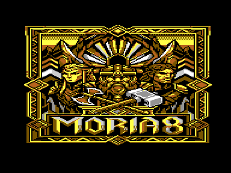

# Moria8

Moria8 is a port of the classic roguelike game, Moria, for 8-bit platforms
written in platform-specific assembly. It targets the Commodore 64, Plus/4, and
128 systems, the Apple II, the Commander X16, Atari 8-bit systems, and the
Acorn BBC Master 128.

Visit **[moria8.org](https://moria8.org)** for downloads, guides, the monster
compendium, and platform gameplay previews.



## Port Status

| Platform | Status | Download |
| -------- | ------ | -------- |
| Commodore 64 (C64) | Released ([notes](docs/release_notes/release_notes-v2.0.0.md)) | [moria8-c64-v2.0.0.crt](https://github.com/dcgibbons/moria8/releases/download/v2.0.0/moria8-c64-v2.0.0.crt) (Cartridge) · [moria8-c64-v2.0.0.d64](https://github.com/dcgibbons/moria8/releases/download/v2.0.0/moria8-c64-v2.0.0.d64) |
| Commodore 128 (C128) | Released ([notes](docs/release_notes/release_notes-v2.0.0.md)) | [moria8-c128-v2.0.0.crt](https://github.com/dcgibbons/moria8/releases/download/v2.0.0/moria8-c128-v2.0.0.crt) (Cartridge) · [moria8-c128-v2.0.0.d64](https://github.com/dcgibbons/moria8/releases/download/v2.0.0/moria8-c128-v2.0.0.d64) · [moria8-c128-v2.0.0.d71](https://github.com/dcgibbons/moria8/releases/download/v2.0.0/moria8-c128-v2.0.0.d71) · [moria8-c128-v2.0.0.d81](https://github.com/dcgibbons/moria8/releases/download/v2.0.0/moria8-c128-v2.0.0.d81) |
| Commodore Plus/4 | Released ([notes](docs/release_notes/release_notes-v2.0.0.md)) | [moria8-plus4-v2.0.0.crt](https://github.com/dcgibbons/moria8/releases/download/v2.0.0/moria8-plus4-v2.0.0.crt) (Cartridge) · [moria8-plus4-v2.0.0.d64](https://github.com/dcgibbons/moria8/releases/download/v2.0.0/moria8-plus4-v2.0.0.d64) |
| Apple II | Released ([notes](docs/release_notes/release_notes-v2.0.0.md)) | [moria8-apple2-v2.0.0.po](https://github.com/dcgibbons/moria8/releases/download/v2.0.0/moria8-apple2-v2.0.0.po) |
| Commander X16 | Released ([notes](docs/release_notes/release_notes-v2.0.0.md)) | [moria8-cx16-v2.0.0.zip](https://github.com/dcgibbons/moria8/releases/download/v2.0.0/moria8-cx16-v2.0.0.zip) (SD / WebEmu) · [moria8-cx16-v2.0.0.crt](https://github.com/dcgibbons/moria8/releases/download/v2.0.0/moria8-cx16-v2.0.0.crt) (Cartridge) |
| Atari 8-bit | Released ([notes](docs/release_notes/release_notes-v2.0.0.md)) | [moria8-atari8-v2.0.0.atr](https://github.com/dcgibbons/moria8/releases/download/v2.0.0/moria8-atari8-v2.0.0.atr) · [moria8-atari8-v2.0.0.car](https://github.com/dcgibbons/moria8/releases/download/v2.0.0/moria8-atari8-v2.0.0.car) |
| Acorn BBC Master 128 | Released ([notes](docs/release_notes/release_notes-v2.0.0.md)) | [moria8-bbcmaster-v2.0.0.ssd](https://github.com/dcgibbons/moria8/releases/download/v2.0.0/moria8-bbcmaster-v2.0.0.ssd) |
| Commodore PET | Unlikely | |
| Commodore VIC-20 | Unlikely | |
| CP/M (Z80) | Planned | |
| MSX | Planned | |
| Nintendo Entertainment System | Planned | |
| ZX Spectrum | Planned | |

Release notes describe the current feature set, known limits, and
platform-specific behavior for each target.

See the [Cross Platform Strategy](docs/CROSS_PLATFORM_STRATEGY.md) for more
details on upcoming ports.

### Real Floppy Users

Want a real floppy disk of Moria8? Please fill out the
[Google Form](https://forms.gle/aVDEXfVxjjsaLFNm6) to indicate interest.

## Building from Source

### Requirements

- macOS or Linux host, `make`, `curl`, `unzip`, `zip`, Java (for Kick
  Assembler, auto-downloaded (SHA256-pinned) into `tools/kickass/` unless
  `KICKASS=/path/to/KickAss.jar` is set), and Python 3
- **Apple IIe disk packaging:** AppleCommander (`ac`) and ProDOS 2.4.3 kernel /
  boot blocks auto-download (SHA256-pinned) into `tools/applecommander/` and
  `tools/prodos/` during `make diskapple2` and `make testapple2-runtime`
  (override with `AC_BIN`, `PRODOS`, and `BOOTBLOCKS`)
- **Commodore disk packaging & testing:** VICE 3.10+ (`c1541` for `make disk*`,
  `x64sc`, `x128`, `xplus4`, and `cartconv` for `run*` and `test*` targets)
- **Apple IIe / Atari 8-bit / BBC Master 128 emulation:** MAME (`apple2ee`,
  `a800xl` / `a130xe`, `bbcm`) with non-redistributable system ROM paths
  supplied in `A2ROMS`, `ATARI8ROMS`, and `BBCMROMS` (MAME runtime suites warn
  and skip when the matching env var is unset)
- **Commander X16 emulation:** `x16emu` (`X16EMU`, optional `X16ROM`)
- **Optional tools:** `Pillow`, `numpy`, and `ffmpeg` for gameplay GIF capture
  (`tools/gifcapture/`); `gpg` (`GPG`) and `sha256sum` or `shasum` (`SHA256`) for release
  packaging (`make artifacts`, `make artifact-checksums`)

### Common Commands

```sh
make build              # Build binaries and cartridges for all platforms under build/
make disk               # Build all 14 shipping disks, archives, and cartridges under build/
make run                # Launch the Commodore 64 disk in VICE
make test               # Run the regression suite (`make -j7 -O test` runs all 7 stages)
make artifact-checksums # Build all 14 versioned release artifacts and build/release/SHA256SUMS
make artifacts          # Build, checksum, and GPG-sign all 14 release artifacts
make clean              # Remove build/ artifacts
```

### Platform Targets

| Platform | Disk / Bundle | Cartridge | Run | Test | Output (`build/`) |
| -------- | ------------- | --------- | --- | ---- | ----------------- |
| Commodore 64 | `make disk64` | `make cartridge64` | `make run64` | `make test64` (`test64-cartridge`) | `moria8-c64.crt`, `moria8-c64.d64` |
| Commodore 128 | `make disk128` | `make cartridge128` | `make run128` (`run128-cart`) | `make test128` (`test128-fast`, `test128-fast-smoke`, `test128-cartridge`) | `moria8-c128.crt`, `moria8-c128.d64`, `moria8-c128.d71`, `moria8-c128.d81` |
| Commodore Plus/4 | `make diskplus4` | `make cartridgeplus4` | `make runplus4` (`runplus4-cart`) | `make testplus4` (`testplus4-cartridge`) | `moria8-plus4.crt`, `moria8-plus4.d64` |
| Apple IIe | `make diskapple2` | — | `make runapple2` | `make testapple2` (`testapple2-runtime`) | `moria8-apple2.po` |
| Commander X16 | `make diskcx16` | `make cartridgecx16` | `make runcx16` (`runcx16-cart`) | `make testcx16` (`testcx16-runtime`, `testcx16-cartridge`) | `moria8-cx16.zip`, `moria8-cx16.crt` |
| Atari 8-bit | `make diskatari8` | `make cartridgeatari8` | `make runatari8` (`runatari8-130xe`, `runatari8-cart`, `runatari8-cart-130xe`) | `make testatari8` (`testatari8-fast-smoke`, `testatari8-cartridge`) | `moria8-atari8.atr`, `moria8-atari8.car` |
| BBC Master 128 | `make diskbbcmaster` | — | `make runbbcmaster` | `make testbbcmaster` (`testbbcmaster-fast-smoke`, `testbbcmaster-runtime`) | `moria8-bbcmaster.ssd` |

## Documentation

- [Player Manual](docs/MANUAL.md)
- [Monster Reference](docs/MONSTERS.md)
- [Spell And Prayer Reference](docs/SPELLS.md)
- [Player Guide](docs/PLAYER_GUIDE.md)
- [Troubleshooting Guide](docs/TROUBLESHOOTING.md)
- [Development Process](docs/DEVELOPMENT_PROCESS.md) - the story of Moria8,
  including how it was built with modern tooling.
- [Architecture Reference](docs/ARCHITECTURE.md) - source layout, memory
  models, footprint tables.
- [Architecture Map](docs/architecture-map.json) - structural map of the
  codebase, with a viewable HTML companion at
  [docs/architecture-map.html](docs/architecture-map.html) (download and open
  in a browser).

## Community

Join our [Discord Server](https://discord.gg/b5rFSDZ8Yk) to get help, chat
with community, and discuss new features!

## Credits

The Dungeons of Moria is a single player dungeon simulation originally written
by Robert Alan Koeneke, with its first public release in 1983. The game was
originally developed using VMS Pascal as
[VMS Moria](https://github.com/dungeons-of-moria/vms-moria) before being
ported to the C language by James E. Wilson in 1988, and released as
[Umoria](https://github.com/dungeons-of-moria/umoria).

Moria8 is developed by [Chad Gibbons](https://github.com/dcgibbons).

## License Information

Moria8 is released under the [GNU General Public License v3.0](LICENSE).
