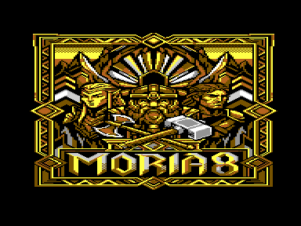

# Moria8

Moria8 is a port of the classic roguelike game, Moria, for 8-bit platforms
written in platform-specific assembly. It targets the Commodore 64, Plus/4, and
128 systems, the Apple II, the Commander X16, Atari 8-bit systems, and the
Acorn BBC Master 128.

Visit **[moria8.org](https://moria8.org)** for downloads, guides, the monster
compendium, and platform gameplay previews.



## Port Status

| Platform | Status | Download |
| -------- | ------ | -------- |
| Commodore 64 (C64) | Released ([notes](docs/release_notes/release_notes-v1.5.0.md)) | [moria8-c64.d64](https://github.com/dcgibbons/moria8/releases/download/v1.5.0/moria8-c64.d64) [moria8-c64.zip](https://github.com/dcgibbons/moria8/releases/download/v1.5.0/moria8-c64.zip) |
| Commodore Plus/4 | Released ([notes](docs/release_notes/release_notes-v1.5.0.md)) | [moria8-plus4.d64](https://github.com/dcgibbons/moria8/releases/download/v1.5.0/moria8-plus4.d64) |
| Commodore 128 (C128) | Released ([notes](docs/release_notes/release_notes-v1.5.0.md)) | [moria8-c128.d64](https://github.com/dcgibbons/moria8/releases/download/v1.5.0/moria8-c128.d64) [moria8-c128.d71](https://github.com/dcgibbons/moria8/releases/download/v1.5.0/moria8-c128.d71) [moria8-c128.d81](https://github.com/dcgibbons/moria8/releases/download/v1.5.0/moria8-c128.d81) |
| Commodore PET | Unlikely | |
| Commodore VIC-20 | Unlikely | |
| Commander X16 | In Progress | |
| Acorn BBC Master | In Progress | |
| Apple II | Released ([notes](docs/release_notes/release_notes-v1.5.0.md)) | [moria8-apple2.po](https://github.com/dcgibbons/moria8/releases/download/v1.5.0/moria8-apple2.po) |
| Atari 8-bit | In Progress | |
| CP/M (Z80) | Planned | |
| MSX | Planned | |
| Nintendo Entertainment System | Planned | |
| ZX Spectrum | Planned | |

Release notes describe the current feature set, known limits, and
platform-specific behavior for each target.

See the [Cross Platform Strategy](docs/CROSS_PLATFORM_STRATEGY.md) for more
details on upcoming ports.

### Real Floppy Users

Want a real floppy disk of Moria8? Please fill out the
[Google Form](https://forms.gle/aVDEXfVxjjsaLFNm6) to indicate interest.

## Building from Source

### Requirements

- macOS or Linux host, `make`, Java (for Kick Assembler, auto-downloaded into
  `tools/kickass/` unless `KICKASS=/path/to/KickAss.jar` is set), and Python 3
- Emulators (required only for `run*` and runtime `test*` targets):
  - **Commodore 64 / 128 / Plus/4:** VICE 3.10+ (`x64sc`, `x128`, `xplus4`, `c1541`)
  - **Apple IIe / Atari 8-bit / BBC Master 128:** MAME (`apple2ee`, `a800xl` /
    `a130xe`, `bbcm`) with system ROM paths in `A2ROMS`, `ATARI8ROMS`, and
    `BBCMROMS`
  - **Commander X16:** `x16emu` (`X16EMU` and optional `X16ROM`)

### Common Commands

```sh
make build        # Build binaries for all platforms (default target)
make disk         # Build all shipping disk and bundle images under build/
make run          # Launch the Commodore 64 disk in VICE
make test         # Run the regression suite (`make -j7 -O test` runs all 7 platforms in parallel)
make clean        # Remove build/ artifacts
```

### Platform Targets

| Platform | Disk / Bundle | Run | Test | Output (`build/`) |
| -------- | ------------- | --- | ---- | ----------------- |
| Commodore 64 | `make disk64` | `make run64` | `make test64` | `moria8-c64.d64` |
| Commodore 128 | `make disk128` | `make run128` | `make test128` (`test128-fast`) | `moria8-c128.d64` / `.d71` / `.d81` |
| Commodore Plus/4 | `make diskplus4` | `make runplus4` | `make testplus4` | `moria8-plus4.d64` |
| Apple IIe | `make diskapple2` | `make runapple2` | `make testapple2` (`testapple2-runtime`) | `moria8-apple2.po` |
| Commander X16 | `make diskcx16` | `make runcx16` | `make testcx16` | `moria8-cx16.zip` |
| Atari 8-bit | `make diskatari8` | `make runatari8` (`runatari8-130xe`) | `make testatari8` | `moria8-atari8.atr` |
| BBC Master 128 | `make diskbbcmaster` | `make runbbcmaster` | `make testbbcmaster` | `moria8-bbcmaster.ssd` |

## Documentation

- [Player Manual](docs/MANUAL.md)
- [Monster Reference](docs/MONSTERS.md)
- [Spell And Prayer Reference](docs/SPELLS.md)
- [Player Guide](docs/PLAYER_GUIDE.md)
- [Development Process](docs/DEVELOPMENT_PROCESS.md) - the story of Moria8,
  including how it was built with modern tooling.
- [Architecture Reference](docs/ARCHITECTURE.md) - source layout, memory
  models, footprint tables.
- [Architecture Map](docs/architecture-map.json) - structural map of the
  codebase, with a viewable HTML companion at
  [docs/architecture-map.html](docs/architecture-map.html) (download and open
  in a browser).

## Community

Join our [Discord Server](https://discord.gg/b5rFSDZ8Yk) to get help, chat
with community, and discuss new features!

## Credits

The Dungeons of Moria is a single player dungeon simulation originally written
by Robert Alan Koeneke, with its first public release in 1983. The game was
originally developed using VMS Pascal as
[VMS Moria](https://github.com/dungeons-of-moria/vms-moria) before being
ported to the C language by James E. Wilson in 1988, and released as
[Umoria](https://github.com/dungeons-of-moria/umoria).

Moria8 is developed by [Chad Gibbons](https://github.com/dcgibbons).

## License Information

Moria8 is released under the [GNU General Public License v3.0](LICENSE).
