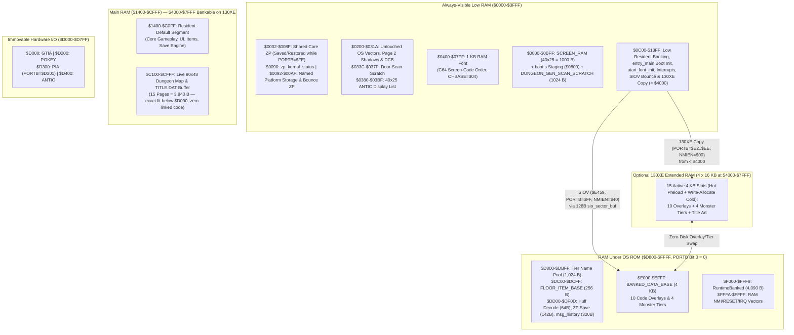

# Moria8 Atari 8-Bit (`platforms/atari8/`) Port — Architecture & Execution Plan

This document specifies the complete architecture and phased implementation
plan for the Atari 8-bit (`platforms/atari8/`) port of Moria8. Where memory
bounds or banking details are concerned, `docs/ATARI8_MEMORY_CONTRACT.md` is
the authoritative contract.

---

## 1. Design Decisions Summary (Locked In)

| Axis | Decision | Rationale |
| --- | --- | --- |
| **Target Hardware** | Stock **64 KB Atari 800XL / 65XE** baseline + auto-detected **128 KB Atari 130XE** extended RAM cache | Matches the C64 + optional REU tier: 100% playable on any 64 KB XL/XE, and 100% diskless gameplay when 130XE extended RAM (`4 × 16 KB` at `$4000-$7FFF`) is present. |
| **Display Geometry** | **40×25** via custom ANTIC Mode 2 Display List (`80×48` dungeon map = `3,840` B) | Identical geometry to C64 and Plus/4 (`hal_layout_screen_cols = 40`, `hal_layout_screen_rows = 25`, viewport `38×19`, status rows `21–23`, input row `24`). Zero layout divergence from 40-column `core/` UI views. |
| **Character Set & Encoding** | **1 KB RAM font at `$0400-$07FF` ordered by C64 screen codes** + hardware bit-7 inverse video | Because OS ROM (`$E000`) is banked out during gameplay (`PORTB = $FE`), ANTIC requires a 1 KB RAM font anyway. Permuting the Atari OS ROM font into C64 screen-code order at boot via `atari_font_init` (in `< $4000`) eliminates per-character translation tables in `screen_put_char` and `dungeon_render` while preserving native bit-7 inverse video (`$80-$FF`). |
| **Color, LOS, & Visual Style** | High-contrast monochrome ANTIC Mode 2 text + bit-7 inverse video + **self-healing DLI horizontal zone tinting** + classic monochrome LOS differentiation | ANTIC Display List Interrupts (DLIs) switch `COLPF1`/`COLPF2` across horizontal bands: Message Zone (rows `0–1`), Dungeon Viewport (rows `2–20`), Status Bar (rows `21–23`), and Input Prompt (row `24`), with VBI resetting `dli_vector = dli_row1` every frame. In the monochrome viewport, lit in-LOS floor renders as `.` (`$2E`) while remembered out-of-LOS floor (`FLAG_VISITED` without `FLAG_LIT`) renders as blank space (`$20`) with remembered walls (`#`), doors (`+`/`'`), and stairs (`<`/`>`) remaining visible. |
| **Disk Format & Boot** | **130 KB Enhanced Density (1050 standard, `1,040 × 128 B` sectors) Atari DOS 2.5 compatible `.atr`** built by `tools/make_atr.py`, booted via `boot.s` (`$0800`) -> `entry_main` (`< $4000`) using ROM `SIOV` (`$E459`) | Keeps `$0700-$1FFF` free for game RAM while remaining 100% inspectable in standard Atari DOS 2.5 / MyDOS / Altirra / Dir2Atr tools. |
| **Save & Release Packaging** | Single-disk self-contained `build/moria8-atari8.atr` containing boot loader, resident/banked/overlay/tier payloads, `LICENSE.TXT`, `SRCOFFER.TXT` (Rule 7, LF->`$9B` ATASCII EOL), `MORIA8.ID`, `HISCORE.DAT`, and 4 pre-allocated **56-sector (`7,000` B)** save slots (`SAVE0.SAV`..`SAVE3.SAV`) on `D1:` (with optional `D1:`..`D4:` selection) | Production `platforms/shared/save.s` writes the `3,840`-byte map raw (`6,616` B total = `53` DOS 2.5 sectors at `125` B/sector). Pre-allocating `56` sectors (`7,000` B) per slot fits full saves with headroom while leaving `41` usable sectors free below Sector `1024` on the 130 KB ATR. |
| **Audio & Input** | Full **4-channel POKEY sound effects** (`sound.s` exporting `hal_sound_init`, `hal_sound_play`, `hal_sound_stop`, `hal_sound_update`) + direct `POKEY` (`KBCODE` `$D209`, `SKSTAT` `$D20F`, active-low `IRQST` `$D20E`) & `GTIA` (`CONSOL` `$D01F`) keyboard driver | Provides authentic Atari audio feedback and full roguelike (`hjklyubn`), arrow-chord, `ESC`, `Ctrl+R`, and Atari `HELP` (`$11`) key support via a 128-byte (64 unshifted + 64 shifted) `KBCODE` translation table. |
| **Runtime Verification** | Headless **MAME (`a800xl` and `a130xe`)** driven by `platforms/atari8/harness_smoke.py` (Lua RPC harness, gated by `ATARI8ROMS`) | Runs the full 15-scenario behavioral suite on `a800xl` (64 KB disk path) plus 3 dedicated cache/SIO coexistence scenarios on `a130xe`, with `-seconds_to_run 120` (emulated time) and `subprocess.run(timeout=30)` (host wall-clock cap per `AGENTS.md` Rule 8). |

---

## 2. Memory & Banking Architecture



### Key Hardware Traps Prevented by Design

1. **No Write-Through Under Atari XL/XE OS ROM (`CO61618` MMU), Simultaneous `$C000-$CFFF`/`$D800-$FFFF` Banking, & Named Bounce ZP (`$0092-$00AF`):**
   Unlike the C64 (`6510` port `$01`), the Atari XL/XE MMU disables RAM `CAS`
   whenever OS ROM is selected (`PORTB` bit 0 = `1`), mapping OS ROM over
   **both** `$C000-$CFFF` and `$D800-$FFFF` simultaneously. CPU writes to those
   ranges are **discarded** while OS ROM is visible. Therefore:
   * All routines that touch `PORTB` or read OS ROM (`entry_main` boot init,
     `atari_font_init`, `EnterSio`, `ExitSio`, `xe_detect`, `xe_cache_*`) link
     and execute strictly below `$4000` (`$0C00-$13FF`), and no executable code
     is ever linked into `$C100-$CFFF` (`MAP_BASE`).
   * `SIOV` (`$E459`) always transfers 128-byte sectors through `sio_sector_buf`
     in low RAM (`< $4000`) with `PORTB = $FF`, then switches to `PORTB = $FE`
     before copying into `$E000-$EFFF`, `$F000-$FFF9`, or `$C000-$CFFF`.
   * `save_zp` and `restore_zp` (`zp_save_buf` at `$DD40-$DDCD`) always run
     while `PORTB = $FE` (RAM visible), never while `PORTB = $FF` (which maps
     the Floating-Point ROM at `$D800-$DFFF`).
   * `$0090` is reserved as `zp_kernal_status` (because
     `platforms/commodore/common/title_screen.s` executes `sta zp_kernal_status`
     at `$90`), and all sector-linking, directory parsing, and bounce-copy
     pointers (`atari_io_src`, `atari_io_dst`, `atari_io_sec`, `atari_file_idx`)
     reside in platform ZP at `$0092-$00AF` using named `.label` symbols in
     `platforms/atari8/memory.s` (never raw `$90-$FF` hex literals, as enforced
     by `tools/check_zp_usage.py`), so copying from `sio_sector_buf` after
     `restore_zp` never clobbers `zp_ptr0`/`zp_ptr1`.
2. **Strict `EnterSio` / `ExitSio` Discipline (`BRKKEY`, `POKMSK`, `CRITIC = $01`, `DTIMLO = $07`, `NMIRES`, `NMIEN = $40`, POKEY Audio Silence, & `DSTAT` Carry Return):**
   * All of Page 2 (`$0200-$02FF`) and `$0300-$031A` is left untouched for
     Atari OS vectors, shadow registers, and the `SIOV` DCB; all low resident
     trampolines, `exit_trampoline`, and interrupt handlers live at
     `$0C00-$13FF` (`< $4000`).
   * Before calling `SIOV` (`$E459`), `EnterSio` saves the caller's `I`
     interrupt flag, masks interrupts (`SEI`, `NMIEN = $00`), saves game ZP
     `$02-$8F` to `zp_save_buf` while `PORTB = $FE`, initializes OS ZP and DCB
     fields required by `SIOV` (`WARMST` `$08 = $00` so a physical `SYSTEM RESET`
     during `SIOV` falls through to `COLDSV` `$E477` instead of jumping through
     `DOSINI` `$000C` / `zp_temp4`, `POKMSK` `$10 = $00`, `BRKKEY` `$11 = $FF`
     so `zp_color_lo == 0` never triggers Error `$80` Break abort, `CRITIC`
     `$42 = $01` to inhibit OS Stage 2 VBI and prevent `VVBLKD` `$0224`
     execution, `ATRACT` `$4D = $00`, `DDEVIC` `$0300 = $31`, `DUNIT` `$0301 =
     device - 7`, and `DTIMLO` `$0306 = $07`), syncs OS Page 2 display shadows
     (`SDMCTL` `$022F = $22`, `SDLSTL/H` `$0230/$0231 = $0380`, `GPRIOR`
     `$026F = $00`, `COLOR1` `$02C5 = $0E`, `COLOR2` `$02C6 = $00`, `COLOR4`
     `$02C8 = $00`, `CHBAS` `$02F4 = $04`), sets `PORTB = $FF`, clears
     `STA NMIRES ($D40F)`, and sets `NMIEN = $40` (**VBI enabled** for `SIOV`'s
     `CDTMV1` timeout timer; **DLI disabled** so `STA WSYNC` never causes
     19,200-baud POKEY serial overrun Error `$8A`/`$8C` or vectors through OS
     `VDSLST` `$0200`).
   * On exit, `ExitSio` sets `SEI` and `NMIEN = $00`, restores `PORTB = $FE` and
     `restore_zp`, **silences all 4 POKEY audio channels** (`AUDC1..4`
     `$D201/$D203/$D205/$D207 = $00`, clearing the serial clock/tone state left
     in Channels 3 & 4 by `SIOV`), re-enables POKEY keyboard scan + IRQ (`AUDCTL = $00`,
     `SKCTL = $03`, `IRQEN = $00` then `$40`), clears `STA NMIRES ($D40F)`,
     restores `NMIEN = $C0`, restores the caller's `I` flag (without `PLP`), and
     explicitly sets `CLC` (`DSTAT` `$0303 == $01`) or `SEC` (`DSTAT != $01`) so
     callers (`bcs sio_error`) always receive `SIOV`'s completion Carry.
3. **Atomic NMI & IRQ Masking + `NMIRES` Reset During 130XE Bank Swaps (`NMIEN = $00` + `SEI`):**
   Because 6502 `SEI` masks only `IRQ` and **does not mask `NMI`**, and because
   under ANTIC Mode 2 DMA (`18,485` available CPU cycles/frame = `61.8%` CPU) a
   16-page (`4,096` B) 130XE copy takes `~57,500–65,700` CPU cycles (`~3.1–3.5`
   NTSC video frames = `52–59 ms`), `xe_cache_stash` and `xe_cache_fetch`
   disable ANTIC NMIs via `LDA #$00 : STA NMIEN ($D40E)` in addition to `SEI`
   before switching `PORTB` to `$E2`/`$E6`/`$EA`/`$EE` (preventing VBI from
   calling `hal_sound_update` in `$1400-$C0FF` while `$4000-$7FFF` is banked to
   extended RAM), then restore `PORTB = $FE`, clear `STA NMIRES ($D40F)`, and
   restore `NMIEN = $C0` upon return.
4. **15-Page `MAP_BASE` (`$C100-$CFFF`) Copy Guard, `NMIST` Bit 5 `SYSTEM RESET`, & Clean Coldstart `exit_trampoline`:**
   * `MAP_BASE` is `$C100-$CFFF` (`15` pages = `3,840` B), directly below GTIA
     (`$D000-$D0FF`). `platforms/atari8/title_data.s` links at `.pc = $C100 "Title Art"`
     (leaving `core/title_data.s` untouched) and copies only `3` pages (`768` B)
     into `MAP_BASE` (`$C100-$C3FF`). Because `disk_setup_atari.s` lives in
     `RuntimeBanked` (`$F000-$FFF9`) rather than `$E000`, `OVL.DTH` is never
     overwritten and no `tramp_game_over_stash` is used.
   * On Atari XL/XE, pressing the physical `SYSTEM RESET` button triggers an
     ANTIC NMI with `NMIST` (`$D40F`) bit 5 (`$20`) set, and OS warmstart
     (`WARMSV` `$E474`) checks `WARMST` (`$0008` = `zp_ptr1`) and jumps indirect
     through `DOSINI` (`$000C-$000D` = `zp_temp4`/`zp_machine_type`). Therefore,
     `atari_nmi_handler` checks `NMIST` bit 5 (`$20`) and vectors to
     `exit_trampoline` in `< $4000`, which sets `SEI`, `NMIEN = $00`, clears
     `WARMST` (`LDA #$00 : STA $0008`), sets `PORTB = $FF`, and jumps to Atari
     OS coldstart `COLDSV` (`$E477`).
5. **Resident `Default` & `RuntimeBanked` Budget Closure (`program_end <= $C100`):**
   * `RuntimeBanked` (`$F000-$FFF9`) hosts `generation_busy.s`,
     `run_initialize_impl`, `store_data.s`, `runtime_ui_strings.s`,
     `special_rooms.s`, `ego_items.s`, `ui_home.s`, `item_desc_banked.s`,
     `disk_setup_atari.s` (compact ~200-line native setup UI modeled on
     `disk_setup_cx16.s`, avoiding Commodore `disk_swap.s` and its
     keyboard-freezing `sei`), and `player_magic_learn_op.s` (with `ui_recall.s`
     in `DeathOverlay`).
   * `msg_history` (`320` B via `MsgHistorySegment`), `zp_save_buf` (`142` B),
     `PLATFORM_HD_DECODE_BUF_BASE` (`64` B), `FLOOR_ITEM_BASE` (`256` B), and
     `PLATFORM_TIER_NAME_POOL_BASE` (`1,024` B) all pack into `$D800-$DFFF`
     (`2,048` B RAM under OS ROM).

---

## 3. Display, Font, Self-Healing DLI Color, & Renderer Architecture (`screen.s` & `dungeon_render.s`)

### 3.1 Custom 40×25 ANTIC Mode 2 Display List (`$0380-$039D`), `NMIRES` Acknowledge, & Self-Healing DLI Chain

Standard Atari OS `GRAPHICS 0` is 24 rows (`192` scanlines). ANTIC natively
supports 25 rows (`200` scanlines, identical to C64/Plus/4):

```text
$0380: $70, $70             ; 16 blank scanlines (top overscan)
$0382: $42, $00, $08        ; Mode 2 + LMS $0800 (Row 0: Message Line 0)
$0385: $82                  ; Mode 2 + DLI (Row 1: Message Line 1 -> DLI sets Viewport colors)
$0386..$0397: 18 x $02      ; Mode 2 (Rows 2..19: Dungeon Viewport)
$0398: $82                  ; Mode 2 + DLI (Row 20: Dungeon Viewport bottom -> DLI sets Status colors)
$0399: $02, $02             ; Mode 2 (Rows 21..22: Status Lines 1..2)
$039B: $82                  ; Mode 2 + DLI (Row 23: Status Line 3 -> DLI sets Input Line colors)
$039C: $02                  ; Mode 2 (Row 24: Input / Command Row)
$039D: $41, $80, $03        ; JVB (Jump and Wait for Vertical Blank) to $0380
```

In `atari_nmi_handler` (`< $4000`):
* Saves `A`, `X`, and `Y` (`PHA/TXA/PHA/TYA/PHA`) and inspects `NMIST` (`$D40F`,
  which does not auto-clear on read): if bit 5 (`$20`, `SYSTEM RESET`) is set,
  jumps to `exit_trampoline`.
* Independently checks bit 7 (`$80`, DLI) and bit 6 (`$40`, VBI) before strobing
  `STA NMIRES ($D40F)` (because `NMIRES` clears all `NMIST` flip-flops
  simultaneously):
  * On DLI (bit 7): dispatches through `dli_vector` (`dli_row1 -> dli_row20 ->
    dli_row23 -> dli_row1`), where each DLI fires on scanline 7 (a non-Badline
    with `65` available CPU cycles), executes `STA WSYNC` (`$D40A`), and updates
    `COLPF2` (`$D018`) and `COLPF1` (`$D017`) during horizontal blank.
  * On VBI (bit 6): unconditionally resets `dli_vector = dli_row1`, sets top-band
    colors, and ticks `hal_sound_update`.
* Writes `STA NMIRES ($D40F)`, restores `Y`, `X`, and `A`, and returns via
  `RTI`. All 3 DLIs together consume only `~255` CPU cycles per frame (`1.38%`
  of CPU bandwidth).

### 3.2 C64-Screen-Code-Ordered 1 KB RAM Font (`$0400-$07FF`)

In `core/color.s` (`tile_screen_codes`), all dungeon tiles and UI elements use
standard C64 shifted-charset screen codes (`#` `$23` for walls, `.` `$2E` for
floor, `%` `$25` for mineral veins, `:` `$3A` for rubble, `^` `$1E` for traps,
`+` `$2B` / `'` `$27` / `;` `$3B` for doors, `<` `$3C` / `>` `$3E` for stairs).

At boot in `atari_font_init` (linked and executed strictly below `$4000` in
`$0C00-$13FF`, where setting `PORTB = $FF` exposes the OS ROM font at
`$E000-$E3FF` without unmapping the running code), the 1 KB character set at
`$0400-$07FF` (`CHBASE = $04`) is built by permuting the Atari OS ROM glyphs
into C64 screen-code order:

| Screen Code Range | Meaning in `core/` (C64 Shifted Charset) | Source in Atari OS ROM (`$E000-$E3FF`) |
| --- | --- | --- |
| `$00` | `@` (Player / `@` symbol) | OS glyph `$20` (`$E100..$E107`) |
| `$01-$1A` | `a..z` (Lowercase letters) | OS glyphs `$61-$7A` (`$E308..$E3D7`) |
| `$1B-$1F` | `[`, `\`, `]`, `^`, `_` | OS glyphs `$3B-$3F` (`$E1D8..$E1FF`) |
| `$20-$3F` | Space (`$20`), `!`..`?`, `0..9` (`$30-$39`) | OS glyphs `$00-$1F` (`$E000..$E0FF`) |
| `$40` | Horizontal bar (`-`) | OS glyph `$0D` (`-`) |
| `$41-$5A` | `A..Z` (Uppercase letters) | OS glyphs `$21-$3A` (`$E108..$E1D7`) |
| `$5B-$7F` | Box drawing (`hal_screen_box_vertical_char` = `\|` from OS `$7C`) & graphic slots | OS glyphs `$5B-$7F` (`$E2D8..$E3FF`) |
| `$80-$FF` | Reverse video of `$00-$7F` (`$A0` = reverse space) | Handled automatically in hardware by ANTIC Mode 2 bit 7! |

### 3.3 Monochrome Mode 2 LOS, HAL Screen Flags, & Cycle-Optimized `dungeon_render.s`

1. **Mandatory HAL Screen Flags (`platforms/atari8/config.s` & `hal/layout.s`):**
   * Define `#define HAL_SCREEN_HELP_LINE_USES_API` (and `hal_screen_help_line_uses_api = 1`) so `core/ui_help.s` calls `hal_screen_put_char` instead of writing through unmapped `zp_color_lo/hi` (`$11/$12`).
   * Omit `HAL_PLATFORM_GENERATION_BUSY_COLOR_BAR` so `core/generation_busy.s` never writes to `$D800` (`PLATFORM_TIER_NAME_POOL_BASE`).
2. **Monochrome Mode 2 LOS & Inverse-Video Semantics:**
   * **Lit in-LOS vs. Remembered Out-of-LOS Floor:** Because ANTIC Mode 2 has no per-cell color RAM to dim out-of-LOS floor tiles to dark grey, `dungeon_render.s` renders lit in-LOS floor (`FLAG_LIT` or within `zp_light_radius`) as `.` (`$2E`) and remembered out-of-LOS floor (`FLAG_VISITED` outside `zp_light_radius`) as blank space (`$20`), while keeping remembered walls (`#`), doors (`+`/`'`), and stairs (`<`/`>`) visible.
   * **Player & Target Highlight:** Player `@` (`$00 | $80 = $80`) and active look/target cursor (`screen_flash_at`) render in hardware bit-7 inverse video.
3. **1.79 MHz SALLY + ANTIC DMA Renderer Optimizations & Register Preservation:**
   * Strip all `COLOR_RAM` row pointers, `tile_colors` / `cr_color` / `item_get_floor_color` lookups, and color writes (`~12,500` cycles saved per full viewport).
   * Cache `rv_player_vx = zp_player_x - zp_view_x` once per viewport redraw, hoist per-row `rv_row_dy = |map_y - zp_player_y|` and `rv_player_row` outside the 38-column loop, and perform a **16-bit pointer addition** of `zp_view_x` into `zp_map_ptr_lo/hi` (`clc : adc zp_view_x` into `lo`, `adc #0` into `hi`, handling 80-byte map row page crossings such as `$C1F0 + 30 -> $C20E`) and `VIEWPORT_X` (`1`) into `zp_screen_lo/hi` so `Y = zp_render_x` indexes both `lda (zp_map_ptr_lo),y` and `sta (zp_screen_lo),y` directly (`~20,200` CPU cycles = `1.09` NTSC frames / `18.2 ms` for a full `722`-cell `render_viewport`).
   * **Entity Helper Register Preservation:** Because entity lookup subroutines (`floor_item_find_at`, `monster_find_at`, `glyph_find_at`, `monster_get_ptr`) require absolute map coordinates and clobber `A`, `X`, `Y`, and `zp_ptr0`, the column loop must translate relative column to absolute map X (`A = Y + zp_view_x`) before calling entity helpers and **must explicitly reload `ldy zp_render_x`** before executing `sta (zp_screen_lo),y`.
   * Use a scroll deadband in `viewport_update` (`VIEW_SCROLL_MARGIN_X = 8`, `VIEW_SCROLL_MARGIN_Y = 4`, matching `dungeon_render_a2.s`) so ~85% of player steps do not pan the viewport and execute a complete turn (input + move + LOS + monster AI + `render_local_area` + audio) in **`~9,500–11,050` cycles (`0.51–0.60` NTSC frames = locked 60 FPS)**.

---

## 4. Storage, Asset Loader, Boot, & 130 KB ATR Architecture (`storage.s` & `tools/make_atr.py`)

### 4.1 Unified Asset Loader (`hal_asset_load_prg_header` & `hal_asset_load_title`)

Both `core/tier_manager.s` (`tier_load_disk`) and `platforms/commodore/common/overlay.s`
(`overlay_load_disk`) route asset loads through `hal_asset_load_prg_header` (with
`platforms/atari8/config.s` defining `.macro AssetLoad() { jsr hal_asset_load }`
and `title_screen.s` routing title art through `hal_asset_load_title`). In
`platforms/atari8/storage.s` (linked in `< $4000`):

1. `hal_asset_load_prg_header` maps the requested filename (`OVL.STA`..`OVL.GEN`
   or `MONSTER.DB1`..`MONSTER.DB4`) to its 130XE slot index (`0..13`).
2. **9-Cycle 130XE Cache Hit Check:** `xe_slot_populated[slot]` stores `$00`
   when unpopulated (bit 7 = `0`) and the target `PORTB` byte (`$E2`, `$E6`,
   `$EA`, or `$EE`, bit 7 = `1`) when populated. If `xe_present != 0` and
   `lda xe_slot_populated,x` is negative (`bmi`), it calls `xe_cache_fetch`
   (`SEI`, `NMIEN = $00`, `PORTB = $E2..$EE`, copies 16 pages from
   `$4000+$x000` to `$E000-$EFFF`, restores `PORTB = $FE`, clears `STA NMIRES`,
   and sets `NMIEN = $C0`) and returns `CLC` with zero disk I/O.
3. **Disk Load + Write-Allocate Path:** On a 64 KB 800XL/65XE or a cold 130XE
   slot miss, it locates the file's directory entry, streams its DOS 2.5 sector
   chain via `EnterSio`/`SIOV`/`ExitSio` through `sio_sector_buf` (`< $4000`),
   strips the 2-byte PRG load header (`$00, $E0`), copies payload bytes into
   `$E000-$EFFF` under `PORTB = $FE` using named platform ZP pointers
   (`$0092-$00AF`), and (if `xe_present != 0`) calls `xe_cache_stash` and stores
   the slot's `PORTB` byte (`$E2..$EE`) in `xe_slot_populated[slot]` before
   returning `CLC`.
4. `platforms/atari8/memory.s` defines `.macro BankOutKernal() {}` and
   `.macro BankInKernal() {}` as no-ops (matching Apple IIe and CX16) because
   `$D800-$FFFF` RAM is already visible under `PORTB = $FE` whenever game code
   executes outside `EnterSio`/`ExitSio`.

### 4.2 Atari DOS 2.5 Compatible 130 KB Enhanced Density ATR (`1,040 × 128 B` Sectors)

The shipping disk image `build/moria8-atari8.atr` is a standard **130 KB
Enhanced Density** ATR image (`16`-byte ATR header + `1,040 × 128 B = 133,120 B`):

* **Boot Sequence (`boot.s` at `$0800` -> `entry_main` in `< $4000`):**
  * **Sectors `1..3` (`boot.s`, `384` B total / `378` usable bytes):** Boot
    header specifies load address **`$0800`** (inside `SCREEN_RAM` `$0800-$0BFF`,
    which is completely idle during OS boot while ANTIC displays the OS screen
    at `$9C00`/`$BC00`, and is strictly below `MORIA8.RES` at `$0C00-$C0FF` so
    `MORIA8.RES` never overwrites `boot.s`) and init address `boot_entry`
    (`$0806`). `boot_entry` executes `SEI : CLD : LDX #$FF : TXS` (discarding
    the OS `JSR (DOSINI)` return address so it never returns via `RTS` to
    uninitialized `DOSVEC`) and `LDA #$FF : STA $D301` (**disabling BASIC ROM**
    at `$A000-$BFFF` even when booted without holding `OPTION`, while keeping OS
    ROM `$E459` `SIOV` visible). `boot.s` stages each 128-byte sector of
    `MORIA8.RES` (`~45,500` B = `365` sectors) into `$0980-$09FF`, strips the
    2-byte PRG load header (`$00, $0C`) on the first sector, copies `buf[$7D]`
    payload bytes (`<= 125`) to `(dst_ptr)` (temporarily toggling `PORTB = $FE`
    when `dst_ptr+1 == $C0` so writes to `$C000-$C0FF` reach RAM), follows the
    10-bit link in `$7E..$7F`, sets `PORTB = $FE`, and jumps directly to
    `entry_main` in `< $4000` (`$0C00-$13FF`).
  * **`entry_main` Boot Init (in `< $4000` at `$0C00-$13FF`):** Immediately
    executes `SEI : LDA #$00 : STA NMIEN ($D40E) : STA DMACTL ($D400)` (blanks
    ANTIC DMA so no cycles are stolen and ANTIC never fetches `$E000` while
    `PORTB` toggles), calls `atari_font_init` (permuting the 1 KB RAM font from
    OS ROM `$E000-$E3FF` into `$0400-$07FF` from `< $4000`), installs the 40×25
    ANTIC Display List at `$0380` (reclaiming `$0800-$0BE7` as `SCREEN_RAM`),
    probes for 130XE extended RAM (`xe_detect`), streams `ATARI.BNK` into
    `$F000-$FFF9`, and (if 130XE is present) preloads the 8 hot cache slots
    (`OVL.STA`, `OVL.TWN`, `OVL.GEN`, `OVL.UI`, `OVL.ITM`, `OVL.SPL`,
    `MONSTER.DB1`, `TITLE.DAT`; cold slots populate lazily on first load via
    `xe_slot_populated`) before re-enabling ANTIC DMA (`SDMCTL`/`DMACTL = $22`),
    clearing `STA NMIRES`, setting `NMIEN = $C0`, and entering the title/startup
    flow.
* **Sector `360` & `1024`:** Standard DOS 2.5 VTOC & VTOC2 bitmaps.
* **Sectors `361..368`:** Standard DOS 2.5 64-entry directory (`16` bytes per
  entry: `flags`, `sector_count_lo/hi`, `start_sector_lo/hi`, `8+3 filename`).
* **Canonical Atari DOS 2.0S/2.5 3-Byte Sector Trailer Layout (`$7D..$7F`) & `< 1024` Cap:**
  * In Atari DOS 2.0S/2.5, each 128-byte sector (`$00..$7F`) holds up to `125`
    data bytes (`$00..$7C`) followed by the canonical 3-byte trailer:
    * **Offset `$7D` (Byte 125):** Data byte count in this sector (`0..125`).
    * **Offset `$7E` (Byte 126):** `(file_index << 2)` in bits `7..2` |
      `((next_sector >> 8) & $03)` in bits `1..0`.
    * **Offset `$7F` (Byte 127):** `next_sector & $FF` (`0..1023`; `0` on the
      final sector of a file).
  * `tools/make_atr.py` caps all file sector allocations at **Sector `1023`** so
    every file is 100% addressable by standard 10-bit DOS 2.5 sector links.
  * When reading files (`MORIA8.RES`, overlays, tiers, saves), `storage.s`
    copies `sio_sector_buf + $7D` (`<= 125`) bytes and follows the 10-bit
    next-sector link in `((sio_sector_buf[$7E] & $03) << 8) | sio_sector_buf[$7F]`
    (costing only `0.26 ms/sector` vs `77 ms` wire time), allowing `MORIA8.RES`
    (`365` sectors) to bridge cleanly across VTOC/Directory Sectors `360..368`
    with zero special cases.
  * Pre-allocated mutable files (`SAVE0.SAV`..`SAVE3.SAV` and `HISCORE.DAT`) are
    allocated as **contiguous sector runs** above Sector `368` and below Sector
    `1024`.
  * **Empty-Slot Convention & File-Index Stamping (Preventing Error 164):**
    An unpopulated `SAVE0..3.SAV` or `HISCORE.DAT` has **byte `$7D` (data byte
    count) of its first sector set to `$00`**. When `hal_storage_open` opens a
    file for READ, it reads the first sector; if `sio_sector_buf[$7D] == 0`, it
    returns `carry set` (`NOT_FOUND`) so `save_file_exists` and `load_missing_save`
    behave identically to Commodore/Apple IIe/CX16. When opening a file on
    `hal_storage_cmd_channel` (`15`) or with an `"S0:"` scratch prefix (used by
    `core/score_io.s` before writing high scores), `save_stream.s` immediately
    returns `CLC` as a no-op so the pre-allocated `HISCORE.DAT` slot is
    preserved. In WRITE mode, `save_stream.s` records the directory entry's
    `file_index` (`0..63`) in `atari_file_idx` and writes sequential sectors up
    to `sector_count` (`56` sectors max), stamping `byte_count` at `$7D`,
    `(atari_file_idx << 2) | (next_sec >> 8)` at `$7E` (preventing DOS 2.5 FMS
    Error 164 File Number Mismatch), and `next_sec & $FF` at `$7F` (`cur_sector + 1`
    on full sectors, `0` link + residual byte count on the final sector), and
    latching `HAL_STORAGE_STATUS_DISK_FULL` if a write ever exceeds
    `sector_count`.

### 4.3 Disk File Manifest (`build/moria8-atari8.atr`)

| DOS 8.3 Filename | Purpose | Approx. Size | Sectors (125 B/sec) |
| --- | --- | ---: | ---: |
| `LICENSE.TXT` | GPLv3 license notice (`AGENTS.md` Rule 7, LF->`$9B` EOL) | ~1,100 B | 9 |
| `SRCOFFER.TXT` | Source offer (`AGENTS.md` Rule 7, LF->`$9B` EOL) | ~600 B | 5 |
| `MORIA8.ID` | Save-disk marker (`"M8SAVE"`, 6 B) | 6 B | 1 |
| `MORIA8.RES` | Resident `Default` image (`$0C00-$C0FF`) | ~45,500 B | 365 |
| `ATARI.BNK` | `RuntimeBanked` image (`$F000-$FFF9`) | ~3,600 B | 29 |
| `OVL.STA` | `StartupOverlay` (`$E000`) | 4,066 B | 33 |
| `OVL.TWN` | `TownOverlay` (`$E000`) | 4,095 B | 33 |
| `OVL.DTH` | `DeathOverlay` (`$E000`) | 1,954 B | 16 |
| `OVL.MDL` | `ModalMiscOverlay` (`$E000`) | 3,679 B | 30 |
| `OVL.HLP` | `HelpOverlay` (`$E000`) | 3,890 B | 32 |
| `OVL.UI` | `UiOverlay` (`$E000`) | 4,076 B | 33 |
| `OVL.ITM` | `ItemActionsOverlay` (`$E000`) | 3,980 B | 32 |
| `OVL.SPL` | `SpellOverlay` (`$E000`) | 4,093 B | 33 |
| `OVL.CHS` | `ChestOverlay` (`$E000`) | 1,809 B | 15 |
| `OVL.GEN` | `DungeonGenOverlay` (`$E000`) | 3,406 B | 28 |
| `MONSTER.DB1` | Shallow creature tier (`$E000`) | 830 B | 7 |
| `MONSTER.DB2` | Early creature tier (`$E000`) | 1,109 B | 9 |
| `MONSTER.DB3` | Mid creature tier (`$E000`) | 1,367 B | 11 |
| `MONSTER.DB4` | Deep creature tier (`$E000`) | 2,062 B | 17 |
| `TITLE.DAT` | Title artwork (`platforms/atari8/title_data.s`, `.pc = $C100`) | 620 B | 5 |
| `HISCORE.DAT` | Pre-allocated high-score file (empty = `sector0[$7D] == 0`) | 250 B | 2 |
| `SAVE0.SAV`..`SAVE3.SAV` | 4 pre-allocated contiguous save slots (`56` sectors = `7,000` B each; fits `6,616` B raw-map save stream; empty = `sector0[$7D] == 0`) | 28,000 B | 224 |
| **Total Used** | Boot (`3`) + VTOC (`2`) + Dir (`8`) + Files (`969`) | **~121 KB** | **982 / 1,023 usable sectors (41 free)** |

---

## 5. Input & POKEY Audio Architecture (`input.s` & `sound.s`)

### 5.1 Keyboard Input (`input.s`)

With OS ROM banked out (`PORTB = $FE`), our RAM IRQ handler (`atari_irq_handler`
in `< $4000`) services POKEY's keyboard interrupt:

* **Active-Low `IRQST` (`$D20E`) Check & `IRQEN` Acknowledgement:**
  In POKEY hardware, status bits in `IRQST` (`$D20E` read) are **active LOW**
  (`bit 6 == 0` means a keyboard interrupt is pending; `bit 6 == 1` means no
  keyboard interrupt). `atari_irq_handler` tests `LDA $D20E : AND #$40 : BNE not_keyboard`
  and acknowledges the interrupt by strobing bit 6 in `IRQEN` (`$D20E` write:
  `LDA #$00 : STA $D20E` followed by `LDA #$40 : STA $D20E`), with `SKCTL`
  (`$D20F`) = `$03` (keyboard scan + debounce enabled).
* **128-Byte `KBCODE` Translation Table:** Reads `KBCODE` (`$D209`): bits `0..5`
  are the 6-bit key scan code, bit 6 (`$40`) is Shift, and bit 7 (`$80`) is
  Ctrl. Because Atari shifted punctuation (`<`, `>`, `?`, `:`, `!`, `_`) cannot
  be derived by bit-flipping ASCII, `input.s` uses a **128-byte lookup table**
  (64 unshifted + 64 shifted entries) plus Ctrl modifier mapping (`Ctrl+D` jam,
  `Ctrl+P` message history, `Ctrl+R` auto-rest, and Ctrl+arrow tunnel chords).
* **Run / Auto-Rest Interruption (`input_run_key_held` / `input_ctrl_r_held`):**
  Reads POKEY `SKSTAT` (`$D20F`) bit 2 (`0` = key currently depressed) and
  `KBCODE` (`$D209`) directly.
* **Special Atari Keys:**
  * `ESC` (`KBCODE = $1C`) -> Cancel (`$1B`)
  * `BACKSPACE` (`KBCODE = $34`) -> Delete (`$14`)
  * `HELP` (`KBCODE = $11`) -> Help modal (`?`) / `Shift+HELP` -> `CMD_VERSION`
  * `START` / `SELECT` / `OPTION` (`CONSOL` `$D01F` active-low bits `0..2`, where
    `0` = button pressed and `1` = released) -> Translated inside
    `hal_input_get_key` on the title screen to `'N'` (New Game), `'L'` (Load
    Game), and `'D'` (Disk Setup), matching the shared title menu checks and
    allowing `platforms/commodore/common/title_screen.s` to be used unmodified.

### 5.2 4-Channel POKEY Sound Engine (`sound.s`) & Entropy (`hal/entropy_consts.s`)

Implements the 4 required HAL sound services (`hal_sound_init`, `hal_sound_play`,
`hal_sound_stop`, and `hal_sound_update`, ticked at 60/50 Hz from the VBI
handler) using POKEY Channels 1 & 2 (`AUDF1`/`AUDC1` `$D200/$D201`,
`AUDF2`/`AUDC2` `$D202/$D203`, `AUDCTL` `$D208 = $00`, `SKCTL` `$D20F = $03`):

* Supports all shared `SFX_*` IDs (`SFX_BUMP`, `SFX_HIT`, `SFX_MISS`,
  `SFX_PICKUP`, `SFX_DEATH`, `SFX_LEVELUP`, `SFX_SPELL`, `SFX_SPELL_FAIL`,
  `SFX_HUNGER`, `SFX_FAINT`) with pitch/distortion envelopes.
* `platforms/atari8/hal/entropy_consts.s` exports the canonical HAL entropy
  constants required by `tools/check_hal_entropy_exports.py`:
  `hal_entropy_timer0_lo = $D20A` (POKEY `RANDOM`), `hal_entropy_timer0_hi = $D40B`
  (ANTIC `VCOUNT`), `hal_entropy_timer1_lo = $D20A`, `hal_entropy_timer1_hi = $D20A`
  (POKEY `RANDOM`).

---

## 6. HAL Integration, Shared-Code Reuse, & Zero-Breakage Guarantee

To prevent "6th snowflake" code duplication and guarantee **zero regressions**
across C64, C128, Plus/4, Apple IIe, and Commander X16:

1. **Unmodified `core/`, `save.s`, `save_slot_menu.s`, `overlay.s`, & `title_screen.s` + Native `disk_setup_atari.s`:**
   * `platforms/atari8/` imports `core/*`, `platforms/shared/save.s`,
     `platforms/commodore/common/save_slot_menu.s`,
     `platforms/commodore/common/overlay.s`, and
     `platforms/commodore/common/title_screen.s` **unmodified**.
   * `platforms/atari8/title_data.s` provides the `.pc = $C100 "Title Art"`
     wrapper around the title screen data (matching `platforms/cx16/title_data_cx16.s`)
     so `core/title_data.s` (`.pc = $C000`) is untouched.
   * `platforms/atari8/compat/hal_storage_tier_test_stub.s` satisfies
     `core/tier_manager.s`'s unconditional `#import "compat/hal_storage_tier_test_stub.s"`
     (matching `platforms/apple2/compat/` and `platforms/cx16/compat/`).
   * Rather than importing Commodore 1541 `disk_swap.s` and `disk_setup_banked.s`
     (whose `disk_kernal_exit` executes `sei` and would mask POKEY keyboard IRQs
     on Atari), `platforms/atari8/` provides a compact native `disk_setup_atari.s`
     (modeled directly on `platforms/cx16/disk_setup_cx16.s`, ~200 lines) in
     `RuntimeBanked` (`$F000-$FFF9`) and thin stream shims (`hal_storage_setnam`,
     `hal_storage_setlfs`, `hal_storage_open`, `hal_storage_close`,
     `hal_storage_chkin`, `hal_storage_chkout`, `hal_storage_chrin`,
     `hal_storage_chrout`, `hal_storage_clrchn`, `hal_storage_readst`) in
     `save_stream.s` (< `$4000`).
   * `platforms/atari8/hal/storage.s` exports the canonical HAL save/score
     strings (`"0:THE.GAME,S,R"`, `"@0:THE.GAME,S,W"`, `"0:HALL.OF.FAME,S,R"`)
     and overlay filename labels with `.label hal_storage_overlay_*_name_len = * - ...`
     followed by `.byte 0` so `save_slot_menu.s` and `check_hal_storage_exports.py`
     pass all assertions, while `storage.s` maps `"THE.GAME"` / `"THE.GAME2..4"`
     -> `SAVE0.SAV..SAVE3.SAV` and `"HALL.OF.FAME"` -> `HISCORE.DAT` internally
     at open time.
   * `OLDEST_SAVE_VERSION` is `$15` in `platforms/atari8/hal/storage_policy.s`
     and every feature-version constant is pinned to it, so no dead legacy save
     migration code is carried. The one exception is the 33-slot inventory
     (reserved cloak + secondary weapon): `SAVE_VERSION` is `$16`, and `$15`
     saves still load through the shared 31-slot inventory path
     (`docs/X_WEAPON_SWAP_DESIGN.md` §6.2; asserted in the policy file).
   * At boot, `disk_setup_done = 1`, `disk_mode = 2` (no-swap mode),
     `program_device = 8` (`D1:`), and `save_device = 8` (`D1:`) are initialized
     so single-drive `D1:` saving works immediately without swap prompts, while
     `disk_setup_atari.s` supports `"1) Same as program"` (`D1:`) and
     `"2) Pick save drive"` (`8..11` = `D1:..D4:`, mapped in `EnterSio` to DCB
     `DUNIT` `$0301 = device - 7` = `1..4` with `DDEVIC` `$0300 = $31`).
2. **HAL Checker Registration (All 10 Cross-Platform Checkers + Boundary/ZP/Lint):**
   * Register `atari8` in all 10 cross-platform HAL checkers (`check_hal_manifests.py`,
     `check_hal_storage_exports.py`, `check_hal_asset_exports.py`,
     `check_hal_layout_exports.py`, `check_hal_entropy_exports.py`,
     `check_hal_memory_bank_exports.py`, `check_hal_sound_exports.py`,
     `check_hal_lifecycle_exports.py`, `check_hal_screen_exports.py`,
     `check_hal_input_exports.py`), plus `TARGET_CONDITIONAL_RE` in
     `check_hal_boundaries.py` and `DEFAULT_SCAN_DIRS` in `check_zp_usage.py`
     and `check_6502_lint.py`.
   * In `tools/check_hal_asset_exports.py`, register 3-tuple entries
     `TRANSACTION_BODIES["atari8"] = (ROOT / "platforms/atari8/storage.s", "hal_asset_load_prg_header", ("xe_cache_fetch", "EnterSio", "ExitSio"))`
     and
     `TITLE_TRANSACTION_BODIES["atari8"] = (ROOT / "platforms/atari8/storage.s", "hal_asset_load_title", ("hal_storage_title_name", "hal_asset_load_prg_header"))`,
     and in `tools/check_hal_storage_exports.py`, register
     `OVERLAY_NAMES["atari8"] = ("start", "town", "death", "gen", "help", "ui", "items", "spell")`.
   * In `platforms/atari8/hal/manifest.json` and `tools/check_hal_manifests.py`:
     `"color_ram": null`, `"default_save_device": 8`, `"direct_display_consts": False`,
     and all 6 capability keys (`reu_overlay_cache`, `vdc_80_column`, `ted_display`,
     `sid_sound`, `ted_sound`, `two_drive_save`) explicitly set as booleans.
3. **Makefile & `.gitignore` Hygiene, Zero-ROM Build, & `ATARI8ROMS` Convention:**
   * `platforms/atari8/Makefile` places `-symbolfiledir "$(OVL_OUTATARI8)"` into
     common `KA_FLAGS` across all Kick Assembler invocations (`main.s`, `boot.s`,
     `title_data.s`, `tier1..4_prg.s`) so `.sym` and `.prg` files are emitted
     strictly into `build/atari8/` (enforcing `AGENTS.md` Rule 6), and `.gitignore`
     ignores `*.atr` and `/platforms/atari8/{cfg,nvram,inp,sta,snap,diff,comments,share}/`.
   * `make build` and `make disk` require **zero external ROMs** (the 1 KB RAM
     font permuter runs on the 6502 at boot from the machine's OS ROM, and
     `tools/make_atr.py` is pure Python).
   * When `ATARI8ROMS` is unset, `test-runtime` prints a clear warning and exits
     `0` (matching `A2ROMS` in `platforms/apple2/Makefile`) so `make test` stays
     green on ROM-less machines.

---

## 7. Phased Execution Milestones & Exit Gates (M0–M5)

To prevent breaking `make build`, `make disk`, or `make artifact` (`SHA256SUMS`)
on the 5 existing shipping ports while Atari is under construction, and to keep
the dungeon/overlay engine cleanly separated from the sector-write save engine,
execution is divided into 6 isolated milestones:

### Milestone 0: Contract, HAL Checker Registration, Skeleton Stubs, & ATR Builder (Static Gate)
* Create `platforms/atari8/memory.s` (with named ZP labels in `$0092-$00AF` and `$0090` reserved for `zp_kernal_status`), `platforms/atari8/config.s` (including `AssetLoad()` macro), `platforms/atari8/hal/*` (including `manifest.json` and `entropy_consts.s`), `platforms/atari8/compat/hal_storage_tier_test_stub.s`, contract-stub skeletons for `screen.s`, `input.s`, `sound.s`, `storage.s` (including the `TRANSACTION_BODIES` tokens `xe_cache_fetch`, `EnterSio`, `ExitSio`, `hal_storage_title_name`, `hal_asset_load_prg_header`), `save_stream.s`, `disk_setup_atari.s`, `platforms/atari8/Makefile` (with `-symbolfiledir` in `KA_FLAGS`), `.gitignore` additions (`*.atr` and MAME dirs), and `platforms/atari8/check_memory_contract.py` (with `--selftest`).
* Register `atari8` / `ATARI8` across all 10 cross-platform `tools/check_hal_*.py` scripts, `tools/check_hal_boundaries.py` (`TARGET_CONDITIONAL_RE`), `tools/check_zp_usage.py`, and `tools/check_6502_lint.py`. Wire only `clean` and `testatari8-memory-contract-selftest` in the root `Makefile` (deferring root `all`/`build` to M1 and `RELEASE_ARTIFACTS`/`disk`/`test` to M5).
* Create pure-Python DOS 2.5 Enhanced Density ATR image builder `tools/make_atr.py` with `--selftest` asserting: image size `133,136` B, all file sectors `< 1024`, canonical 3-byte DOS 2.5 sector trailers (`$7D` byte count, `$7E` `(file_index << 2) | link_hi`, `$7F` `link_lo`), contiguous 56-sector `SAVE0..3.SAV` slots with empty marker (`sector0[$7D] == 0`), and `LICENSE.TXT` / `SRCOFFER.TXT` parity (`LF -> $9B` ATASCII EOL).
* **M0 Exit Gate:** `make testatari8-memory-contract-selftest`, `python3 tools/make_atr.py --selftest`, `make check-hal-boundaries`, `make check-zp`, and `make check-6502-lint` all exit `0`.

### Milestone 1: Full Product Link, Boot (`$0800` -> `entry_main`), 40×25 ANTIC Screen, RAM Font, DLI, & Title (`boot_title`)
* Implement `boot.s` (loading at `$0800` and streaming `MORIA8.RES` into `$0C00-$C0FF` before jumping to `entry_main` in `< $4000`), `screen.s` (40×25 Display List, C64-ordered 1 KB RAM font permuter `atari_font_init` in `< $4000`, self-healing VBI->DLI zone color chain with `STA NMIRES` and `NMIST` bit 5 `SYSTEM RESET` check), `input.s` (active-low POKEY `IRQST` handler + 128B `KBCODE` table + `SKSTAT` + `CONSOL` `START`=`'N'`/`SELECT`=`'L'`/`OPTION`=`'D'`), `sound.s` (`hal_sound_init/play/stop/update`), `platforms/atari8/title_data.s` (`.pc = $C100`), and `storage.s` (`EnterSio`/`ExitSio` with `DTIMLO = $07`, `STA NMIRES`, and `DSTAT` Carry return, `hal_asset_load_prg_header`, ROM `SIOV` `$E459` loader, and 130XE `xe_detect`/`xe_cache_*` helpers in `< $4000` with `NMIEN = $00` + `SEI`).
* Assemble `platforms/atari8/main.s` with all real `core/` modules, all 10 overlays (`$E000-$EFFF`), `RuntimeBanked` (`$F000-$FFF9`), and 4 monster tiers (`creature_data/tier1..4_prg.s`). Wire `buildatari8` into root `Makefile` `all:` and `build:`.
* **M1 Exit Gate:** `make buildatari8`, `make testatari8-memory-contract` (proving `low_helpers_end <= $4000`, `program_end <= $C100`, `banked_code_end <= $FFFA`), and `boot_title` in `platforms/atari8/harness_smoke.py` under both MAME `a800xl` and `a130xe` (using `-seconds_to_run 120` emulated time and `subprocess.run(timeout=30)` host wall-clock cap, asserting `RuntimeBanked` at `$F000` and `TITLE.DAT` at `$C100` match their linked bytes under `PORTB = $FE`).

### Milestone 2: Character Creation, Town Rendering, & Town Stores
* Implement `dungeon_render.s` (cycle-optimized 40×25 viewport renderer with cached `rv_player_vx`, hoisted `rv_row_dy`/`rv_player_row`, 16-bit `zp_map_ptr` row addition, `ldy zp_render_x` reload after entity helper calls, scroll deadband, monochrome LOS `.` vs ` `, and bit-7 inverse-video player/cursor highlighting).
* **M2 Exit Gate:** Pass `chargen_to_town` and `town_stores` MAME scenarios on `a800xl` and `town_to_dungeon_130xe` on `a130xe` (proving DLI/IRQ stability across repeated `SIOV` and 130XE bank swaps).

### Milestone 3: Dungeon Engine, All 10 Overlays, 4 Monster Tiers, Spells, & 130XE Write-Allocate Cache
* Verify full dungeon gameplay across all 10 overlays (`OVL.STA`..`OVL.GEN`) and 4 monster tiers (`MONSTER.DB1`..`MONSTER.DB4`) on both 64 KB `a800xl` (disk streaming) and 128 KB `a130xe` (hot preload + cold write-allocate into `xe_slot_populated`).
* **M3 Exit Gate:** Pass dungeon generation, monster tier transitions, combat, inventory/equipment, doors/chests (`OVL.CHS`), spells/prayers (`OVL.SPL`/`OVL.MDL`), help (`OVL.HLP`), and game-over tombstone (`OVL.DTH`) under both `a800xl` and `a130xe`.

### Milestone 4: Storage Write Engine, 56-Sector Save/Load, & High-Score Persistence
* Implement `save_stream.s` over `SIOV` contiguous pre-allocated sector writes (`56` sectors/slot), stamping canonical DOS 2.5 3-byte sector trailers (`$7D` byte count, `$7E` `(atari_file_idx << 2) | link_hi`, `$7F` `link_lo`), empty-slot `sector0[$7D] == 0` detection, and channel 15 (`"S0:"`) scratch no-op for `HISCORE.DAT`.
* **M4 Exit Gate:** Pass `load_missing_save`, `save_slot_tracking` (writing full `6,616`-byte saves to `SAVE0.SAV` and `SAVE1.SAV` back-to-back and verifying zero cross-slot or directory corruption), and `HISCORE.DAT` persistence.

### Milestone 5: Full MAME Smoke Suite (`a800xl` + `a130xe`), Governance Registration, & Release Gate
* Pass all 15 behavioral MAME scenarios on `a800xl` (64 KB disk path) + all 3 130XE cache/SIO coexistence scenarios on `a130xe` via `make testatari8-runtime` (plus fast iteration target `make testatari8-fast-smoke`).
* Wire `$(BUILD)/moria8-atari8.atr` into root `Makefile` `RELEASE_ARTIFACTS`, `disk`, and `test`, and register `docs/ATARI8_MEMORY_CONTRACT.md`, `LICENSE.TXT`/`SRCOFFER.TXT` Rule 7 compliance, and `make testatari8*` in `AGENTS.md`, `docs/BEHAVIOR_CHANGE_PROTOCOL.md`, and `docs/INTERNAL_MANDATES.md`.
* **M5 Exit Gate:** `make check-hal-boundaries`, `make check-zp`, `make check-6502-lint`, `make testatari8`, `make test`, `make test128`, `make disk`, and `make artifact-checksums` all exit `0`.
