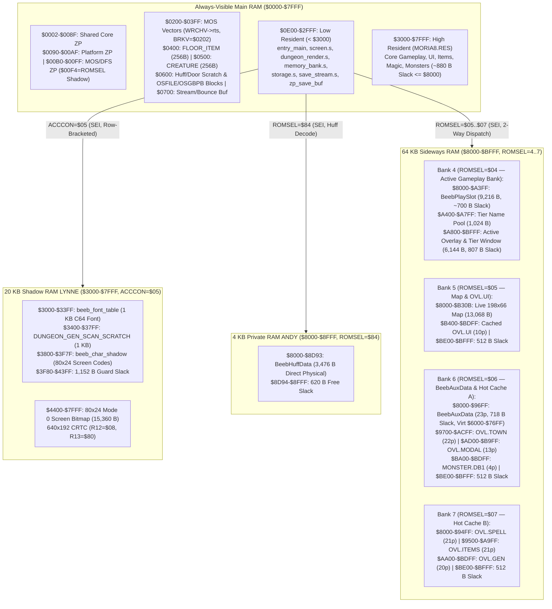

# Moria8 Acorn BBC Master 128 (`platforms/bbcmaster/`) Port — Architecture & Execution Plan

This document specifies the complete architecture and phased implementation
plan for the Acorn BBC Master 128 (`platforms/bbcmaster/`) port of Moria8,
incorporating all findings from the Staff Engineering, Engineering Management,
and 65C02 Performance reviews. Where memory bounds or banking details are
concerned, `docs/BBCMASTER_MEMORY_CONTRACT.md` is the authoritative contract.

---

## 1. Design Decisions Summary (Locked In)

| Axis | Decision | Rationale |
| --- | --- | --- |
| **Target Hardware** | Stock **128 KB Acorn BBC Master 128** (`65C12` @ 2 MHz, MOS 3.20, DFS 2.24, 32 KB Main RAM + 20 KB Shadow RAM `LYNNE` + 4 KB `ANDY` + 8 KB `HAZEL` + 64 KB Sideways RAM Slots 4–7) | Preloads `MORIA8.RES`, `BEEB.PLAY`, `BeebAuxData`, `BeebHuffData`, the 198×66 map, `MONSTER.DB1`, and the 6 core hot gameplay overlays (`TOWN`, `UI`, `SPELL`, `ITEMS`, `GEN`, `MODAL`) into RAM at boot with **512–880 B of free growth slack in every RAM bank**. |
| **Directory & Build Targets** | Flat `platforms/bbcmaster/` (`make buildbbcmaster`, `make diskbbcmaster`, `make runbbcmaster`, `make testbbcmaster`, shipping `build/moria8-bbcmaster.ssd`) | Matches the flat layout and target naming convention of `platforms/apple2/`, `platforms/cx16/`, and `platforms/atari8/`. |
| **Display Geometry & Mode** | **80×24** in **Mode 0** (`640×192` CRTC 1bpp bitmap at `$4400-$7FFF` in Shadow RAM `LYNNE`, `ACCCON` bit `D = 1`), `198×66` dungeon map (`13,068` B) | Matches C128, Apple IIe, and CX16 80×24 geometry while placing `beeb_font_table` (`$3000-$33FF`), `DUNGEON_GEN_SCAN_SCRATCH_BASE` (`$3400-$37FF`), and `beeb_char_shadow` (`$3800-$3F7F`) in off-screen `LYNNE` (saving **1 KB of Main RAM** and providing `1,152` B of guard space below `$4400`). |
| **Character Set & Rendering** | **1 KB C64-screen-code-ordered RAM font (`128 × 8` B)** at `$3000-$33FF` in `LYNNE` + **`beeb_char_shadow` (`80×24` B)** at `$3800-$3F7F` in `LYNNE` + **row-level `ACCCON = $05` bracketing** | Because font, character shadow, and Mode 0 screen bitmap all live in `LYNNE`, the low-RAM blitter (`< $3000`) sets `ACCCON = $05` once per row, skips unchanged cells via `beeb_char_shadow`, and blits 8 contiguous bytes per cell in ~77 ms per full viewport (~13 fps). |
| **Disk Format & Boot** | **Single-sided 80-track (`800 × 256 B = 200 KB`) Acorn DFS `.ssd`** (`build/moria8-bbcmaster.ssd`) built by `tools/make_ssd.py` with **`*OPT 4, 3` (`*EXEC $.!BOOT`)** -> `boot.s` streaming `MORIA8P` (`MORIA8.PAK`) | Packs boot/preload segments into `MORIA8P` so total DFS catalog entries stay at 20 (well below the 31-file DFS catalog ceiling), while cold modal overlays (`START`, `DEATH`, `HELP`, `CHEST`, `STORAGE`, `TITLE`) and `MONSTER.DB.2..4` load on demand via `OSFILE`. |
| **Save & Release Packaging** | Program disk `build/moria8-bbcmaster.ssd` carries **only** program/assets plus `LICENSE` and `SRCOFFR` (Rule 7, LF->`$0D` CR) — **never** `MORIAID`, `HISCORE`, or save slots. Saves require a separate Save Disk (1-drive swap on `:0` or 2-drive on `:1`..`:3`) initialized by Disk Setup (`disk_marker_init`) with `MORIAID`, `HISCORE`, and 4 contiguous **64-sector (`16,384` B)** save slots (`SAVE0`..`SAVE3`) updated in place via `OSFIND A=$C0` | Matches the Commodore, CX16, and Atari 8-bit disk workflow (`disk_setup_atari.s`): rejects saving onto the Program Disk (`"Program disk cannot hold saves."`), supports 1-drive swap (`disk_prompt_save` / `disk_prompt_game_required`) and 2-drive modes (`:0`..`:3`), and prevents DFS catalog fragmentation via in-place `OSFIND A=$C0` updates. |
| **Audio & Input** | **MOS `OSWORD A=7` (`SOUND`) + `OSWORD A=8` (`ENVELOPE`)** for 4-channel SN76489 audio; **MOS `OSRDCH` (`$FFE0`) / `OSBYTE $81` / `OSBYTE $79`** with `OSBYTE $04, X=1` and `OSBYTE $E5, X=1` | Uses the permanently mapped 2 MHz MOS ROM (`$E000-$FFFF`), while `WRCHV` (`$020E`) is redirected to `rts` and `VDU 23,1,0;0;0;0;` disables the MOS 100 Hz software cursor timer. |
| **Runtime Verification** | Headless **MAME (`bbcm`)** driven by `platforms/bbcmaster/harness_smoke.py` (Lua RPC harness, gated by `BBCMROMS`) | Inspects `beeb_char_shadow` (`$3800-$3F7F` in `LYNNE`) and RAM contracts directly without reverse-decoding bitmap pixels, completing every scenario well under the 30-second wall-clock cap (`AGENTS.md` Rule 8). |

---

## 2. Memory & Banking Architecture

---

## 3. High-Performance 65C02 Rendering & Banking (`< $3000`)

### 3.1 Unified `LYNNE` Address Space & Row-Level `ACCCON = $05` Bracketing
1. At startup (`screen_init` in `< $3000`):
   * Issues `VDU 22, 128` (Shadow Mode 0) and `VDU 23, 1, 0; 0; 0; 0;` (disables
     MOS 100 Hz software cursor timer), then redirects `WRCHV` (`$020E-$020F`)
     to `beeb_wrch_noop` (`rts` in `< $3000`).
   * Permutes the MOS ROM font (`$C000-$C3FF`) into `beeb_font_table` at
     `$3000-$33FF` in `LYNNE` and clears `beeb_char_shadow` (`$3800-$3F7F`) and
     the Mode 0 screen bitmap (`$4400-$7FFF`).
   * Reprograms CRTC (`$FE00`/`$FE01`) for `80×24` (`R1=80`, `R6=24`, `R7=32`,
     `R10=$20`, `R12=$08`, `R13=$80`).
2. During gameplay rendering (`dungeon_render.s`, `screen_clear`, `screen_clear_row`):
   * `dungeon_render` streams a 78-tile map row from Bank 5 via
     `mmu_safe_map_read_block` into low-RAM row staging, then enters `LYNNE`
     **once per row** (`PHP : SEI : LDA #$05 : STA $FE34`), updates
     `beeb_char_shadow` (`$3800 + row*80 + col`), skips unchanged cells, and
     blits changed 8-byte glyphs from `beeb_font_table` (`$3000-$33FF`) to
     `$4400 + row*640 + col*8` before restoring `LDA #$01 : STA $FE34 : PLP`.

### 3.2 Fast Two-Way Bank Dispatch, Row Helpers, & Direct `ANDY` Huffman Decode
1. **Direct `ANDY` Huffman Decoding (`HAL_HUFFMAN_LOCK_IRQ_DURING_DECODE = 1`):**
   * `BeebHuffData` is linked at physical `$8000-$8D93` in `ANDY`.
   * `huff_decode_from_ptr` brackets the decode with `ROMSEL = $84` (`ANDY`
     visible at `$8000-$8FFF` while Bank 4 overlays at `$A800-$BFFF` remain
     mapped!), reading tree and bitstream bytes directly in 4–5 cycles (**13.5×
     faster** than per-byte thunking).
2. **Two-Way `mmu_safe_map_read`/`write` & Row Helpers:**
   * A 2-cycle `LDA zp_ptr0_hi : BPL` branches between the **Bank 5 Live Map**
     (`>= $80`, `ROMSEL = $05`, zero address math, 39 cycles) and **Bank 6
     `BeebAuxData`** (`$60 <= eff_hi < $77`, `ROMSEL = $06`, `phys_hi = eff_hi + $20`).
   * Enabling `HAL_MEMORY_MAP_ROW_HELPER_ENABLED = 1` (`mmu_safe_mark_visited_row_ptr0`)
     and `HAL_LAYOUT_DUNGEON_GEN_ROW_BATCHED_MAP = 1` (`mmu_common_store_map_row`)
     accelerates LOS and map clearing by **7.3× to 70×**.
3. **Unrolled 256-Byte Page Bounce (`swr_cache_fetch`):**
   * Uses `beeb_ss_buf` (`$0700-$07FF`) to copy cached overlays from Banks 5/6/7
     into Bank 4 (`$A800-$BFFF`) at 2 bank switches per page (`~72.8 ms` for
     21 pages).

---

## 4. Storage, Boot Pack (`MORIA8P`), & Separate Save Disk Workflow (`storage.s`, `save_stream.s`, `disk_setup_beeb.s`, `tools/make_ssd.py`)

### 4.1 Shipping 200 KB 80-Track Acorn DFS Program Disk (`build/moria8-bbcmaster.ssd`)

`tools/make_ssd.py` builds a deterministic 80-track single-sided Acorn DFS
Program Disk (`800 × 256 B = 204,800 B`, `*OPT 4, 3` = `*EXEC $.!BOOT` in
Sector 1 byte `$06`). **The Program Disk never contains `MORIAID`, `HISCORE`,
or `SAVE0`..`SAVE3`** (and `tools/make_ssd.py --blank-disk` creates blank 200 KB
`.ssd` media for `-flop2` in `make runbbcmaster` and MAME tests):

| DFS File (`$`) | Approx Size | Sectors | Purpose |
| --- | ---: | ---: | --- |
| `$.!BOOT` | 16 B | 1 | `*RUN MORIA8\r` auto-boot script (`*OPT 4, 3` = `*EXEC`) |
| `$.MORIA8` | ~1.0 KB | 4 | Boot loader (`boot.s` at `$0E00`, relocated to `$0400-$07FF` during unpack) |
| `$.MORIA8P` | ~76.0 KB | 304 | Single-open sequential boot container (`MORIA8.RES` + `BEEB.PLAY` + `BEEB.AUX` + `BEEB.HUF` + `MONSTER.DB1` + 6 hot overlays `TOWN`, `UI`, `SPELL`, `ITEMS`, `GEN`, `MODAL`) |
| `$.OVLSTA` | 4.3 KB | 17 | Cold overlay: `OVL.START` |
| `$.OVLDTH` | 4.1 KB | 17 | Cold overlay: `OVL.DEATH` |
| `$.OVLHLP` | 2.2 KB | 9 | Cold overlay: `OVL.HELP` |
| `$.OVLCHS` | 2.1 KB | 9 | Cold overlay: `OVL.CHEST` |
| `$.OVLSTO` | 5.3 KB | 21 | Cold overlay: `OVL.STORAGE` |
| `$.OVLTTL` | 0.6 KB | 3 | Cold overlay: `OVL.TITLE` |
| `$.MONDB2`..`$.MONDB4` | 4.6 KB | 19 | Monster tiers 2–4 (`MONSTER.DB.2..4`) |
| `$.TITLE` | 0.6 KB | 3 | Title artwork (`TITLE`) |
| `$.LICENSE` | 0.3 KB | 2 | GPL / license notice (Rule 7, LF->`$0D` CR) |
| `$.SRCOFFR` | 0.5 KB | 2 | Source offer notice (Rule 7, LF->`$0D` CR) |
| **Total** | **~102.2 KB** | **~413 / 800** | **15 catalog entries (limit 31); ~387 sectors (~96.8 KB) free** |

### 4.2 Consistent Disk Setup & Separate Save Disk Workflow (`disk_setup_beeb.s`)

Matching `platforms/atari8/disk_setup_atari.s` and the Commodore ports:
1. **Default Session State:**
   * `program_device = 8` (DFS Drive `:0`), `save_device = 9` (DFS Drive `:1`),
     `disk_mode = 2` (2-drive mode), `disk_setup_done = 0`.
2. **Interactive `Disk Setup` Menu (`disk_setup_menu`):**
   * Displays `Program: :0` and `Save:    :0`..`:3` (`save_device - 8`).
   * `1) Same as program` -> sets `save_device = program_device` (`:0`),
     `disk_mode = 1` (1-drive swap mode), and runs `disk_prepare_selected_save_media`.
   * `2) Pick save drive` -> prompts `Save drive (0-3): ` (`'0'..'3'` -> HAL
     `8..11` = DFS `:0`..`:3`).
   * `3) Done` -> runs `disk_prepare_selected_save_media`.
   * `Q) Back` -> restores original `save_device` and `disk_mode`, returns `SEC`.
3. **Save Media Validation & Initialization (`disk_prepare_selected_save_media` & `disk_marker_init`):**
   * In 1-drive mode (`disk_mode == 1`), prompts `"Insert a separate Save Disk"`
     + `"Press any key"` (`Q`/`ESC` cancels).
   * Probes `save_device`; if absent/not ready, shows `"Drive is not ready."`.
   * Calls `disk_program_media_present` (checks for `$.TITLE` on `save_device`):
     if found, rejects saving onto the Program Disk with
     **`"Program disk cannot hold saves."`** (`HAL_STORAGE_STATUS_WRONG_MEDIA`,
     `disk_status = 3`) and loops back to prompt.
   * Calls `disk_marker_present` (verifies `$.MORIAID` starts with `"M8SAVE"`):
     if missing, prompts **`"No Save Disk marker found."`** /
     **`"Initialize this disk? (Y/N)"`**. On `'Y'`, `disk_marker_init` verifies
     the disk is not the Program Disk and writes a clean DFS Save Disk layout
     (`$.MORIAID` = `"M8SAVE"`, 1-sector `$.HISCORE`, and 4 contiguous 64-sector
     [`16,384` B] `$.SAVE0`..`$.SAVE3` slots with byte 0 = `$00` for empty).
4. **1-Drive Swap Prompts (`disk_prompt_save`, `disk_prompt_game`, `disk_prompt_game_required`):**
   * Before Save / Load / Highscore in 1-drive mode (`disk_mode == 1`),
     `disk_prompt_save` prompts `"Insert Save Disk"` when needed; afterward (or
     on cancel/error), `disk_prompt_game` / `disk_prompt_game_required` prompt
     `"Insert Program Disk"` and verify `$.TITLE` is back in `program_device`
     (`:0`) before resuming gameplay or loading cold overlays.

---

## 5. Phased Implementation Plan

1. **Phase 1 — Build Scaffolding, Memory Contract, Static Checkers, & `tools/make_ssd.py`:**
   * Create `platforms/bbcmaster/Makefile`, `memory.s`, `cache_layout.s`,
     `hal/layout.s`, `hal/hal_contract.s`, `hal/lifecycle_policy.s`,
     `hal/storage_policy.s`, `hal/memory_bank_consts.s`, `hal/entropy_consts.s`,
     `check_memory_contract.py`, and `tools/make_ssd.py` (with `--selftest`).
   * Register `bbcmaster` / `BBCMASTER` in `tools/check_hal_boundaries.py`,
     `tools/check_zp_usage.py`, and `tools/check_hal_*_exports.py`.
2. **Phase 2 — Low-RAM Banking, Mode 0 `LYNNE` Renderer, Audio, & Input (`< $3000`):**
   * Implement `memory_bank.s` (2-way `mmu_safe_map_read`/`write`,
     `mmu_safe_map_read_block`, `mmu_safe_mark_visited_row_ptr0`,
     `mmu_common_store_map_row`, `swr_cache_fetch`), `screen.s` (Mode 0 CRTC
     80×24 setup, `WRCHV` silencer, `beeb_font_init` in `LYNNE` `$3000-$33FF`,
     `beeb_char_shadow` at `$3800-$3F7F`, row-bracketed 8-byte glyph blitter),
     `dungeon_render.s`, `sound.s` (`OSWORD A=7/8` SN76489 SFX), and `input.s`
     (`OSRDCH`/`OSBYTE` keyboard driver).
3. **Phase 3 — DFS Storage, `MORIA8P` Boot Loader, & Main Linker (`main.s` & `boot.s`):**
   * Implement `boot.s` (streams `MORIA8P` into `LYNNE`, `ANDY`, Sideways
     Banks 4–7, and Main RAM `$0E00-$7FFF` with an on-screen progress display),
     `storage.s` (`OSFILE` cold overlay/tier loader + `BRKV` `$0202` trap with
     `Y=0` fault byte and `HAZEL` cleanup), `save_stream.s` (buffered
     `OSFIND A=$40/$C0` + `OSARGS PTR#=0` + `OSGBPB` stream),
     `disk_setup_beeb.s`, and `main.s`.
   * Verify `make buildbbcmaster`, `make diskbbcmaster`, and
     `make testbbcmaster-memory-contract`.
4. **Phase 4 — Headless MAME (`bbcm`) Runtime Harness & Root Integration:**
   * Implement `platforms/bbcmaster/harness_smoke.py` (Lua RPC harness reading
     `beeb_char_shadow` at `$3800-$3F7F` in `LYNNE` + RAM contract assertions
     across the full scenario suite).
   * Wire `bbcmaster` into root `Makefile` (`build`, `disk`, `test`, `clean`,
     `RELEASE_ARTIFACTS`) and verify all static and runtime gates.
