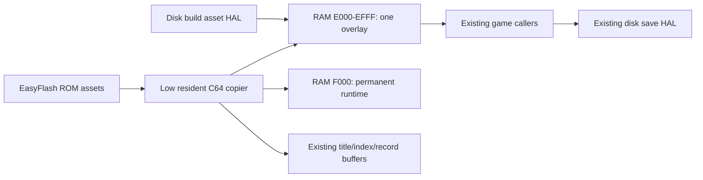

# C64 EasyFlash experiment

## Cartridge turbo restoration record (2026-11-10)

- Problem/success: native CRT boot is confirmed by the maintainer on C64
  Ultimate; restore the disk edition's automatic turbo bursts in the same
  standard subtype-0 CRT, with ordinary C64/EasyFlash remaining a no-op.
- State/search/readers/writers: `c64_hw_flags`, `c64u_turbo_depth`,
  `c64u_turbo_prev`, `$D031`; startup, title machine label, generation, map,
  door-reveal, destruction and earthquake burst hooks. UCI/REU and flash
  writes remain excluded. The disk detector and shared gameplay source stay
  unchanged.
- Initialization/reset/persistence: cartridge startup clears hardware flags,
  then passively probes `$D031`; `$FF` leaves flags clear, otherwise mark
  Ultimate-family turbo available. Session-local depth/previous-speed bytes
  retain their existing initialization and nested enter/leave semantics;
  neither is saved to disk. Restart does not rerun the boot-only detector.
- Sequence: detect before title/map ownership begins; enter the existing burst
  after generation overlay load, run generation/spawns/render, restore the
  exact previous speed before returning to play. Spell hooks use the same
  existing nested wrappers. No new storage or cartridge-copy burst is added.
- Authority/decision: maintainer's "proceed with that then" authorizes this
  restoration. Ultimate's [turbo register documentation](https://1541u-documentation.readthedocs.io/en/latest/config/turbo_mode.html)
  defines `$D031` and its unavailable `$FF` response. No UCI signature is
  read through EasyFlash RAM. This supersedes the experiment's exclusion of
  automatic turbo, while retaining standard subtype 0 and disk persistence.
- Width/range/ownership: existing 8-bit flags, depth and previous register;
  existing bounded synchronous hook nesting, no new nesting path. No new ZP
  or cartridge RAM owner. Wrappers/state are C64 resident; detection is in
  the init-only tail. All resident/overlay/runtime bounds remain asserted.
- RNG/gameplay: N/A; no algorithm, draw order, monster record, visibility,
  turn or render-event changes. CPU speed is separate from game speed.
- Required verification: actual stock-VIC unavailable path with misleading
  EasyFlash RAM; simulated available/disabled register, nested bursts and
  exact speed restoration; normal stairs dispatch through generation and
  return with balanced depth. PAL/NTSC cartridge/save tests and full
  `make -j7 -O test`; review linked boundaries and disk binary parity.
- Contract rows: TURN_RENDER re-entry via stairs and existing modal/save
  regressions; DUNGEON shared algorithm/stage order unchanged; MONSTER shared
  spell state unchanged. Their event/visibility/repeat, topology/RNG and
  monster arithmetic/state rows are N/A because only C64 hook selection and
  hardware capability detection change. Other ports retain their defines.
- Out of scope/risk: firmware-specific timing, physical EF turbo and actual
  clock switching need hardware acceptance. Register control must be enabled
  in Ultimate settings. No subtype change or UCI/REU service restoration.
  No unresolved representation, ownership or observable-policy questions.

## Harness startup repair (2026-11-10, before implementation)

Scope: infrastructure only. Keep product binaries, game assertions, both video
standards and the existing 30-second experiment deadline. No retries or queue
pausing. Give every invocation/scenario/attempt fresh evidence paths; capture
line-buffered VICE console output independently of monitor traffic. Record process identity, phase,
elapsed time, observed exit status and watchdog action before cleanup can
change the evidence. Log commands before waiting for responses.

Synchronize with a fresh register reply and terminating monitor prompt. Arm
entry breakpoints before asynchronous autostart/reset, and recognize an entry
already reached rather than resuming past it. Verify stale greetings, startup
ordering, natural process failure versus watchdog kill, and directory isolation
with local fake-transport tests, then run PAL/NTSC cartridge gates and the exact
failed full gate, make -j7 -O test. No unresolved product ownership or behavior
questions apply to this harness-only repair.


## Harness evidence and startup behavior

Each CLI invocation creates a fresh UTC-named run directory below its supplied
build/test output. Each scenario uses its own attempt-1 directory. Existing run
artifacts are never reused, and failures do not trigger emulator restarts.

- console.log: live console output captured through a pseudo-terminal and
  written directly to disk, including stdout/stderr diagnostics.
- monitor.log: commands written before their responses are awaited, followed
  by replies. ERROR -- responses fail explicitly.
- events.jsonl: process command/PID, monitor port, mode, video standard,
  startup phase, monotonic elapsed time, check count, observed return code,
  watchdog flag and cleanup action. Inspect the error event before cleanup
  when deciding whether a disconnect occurred while the process was alive.
- result.json: final process status and cleanup action. Process exit status
  is separate from the test verdict; the gate still checks every assertion.

A fresh register row plus terminating prompt establishes readiness. Entry
breakpoints are installed before autostart or reset; a breakpoint already
reached is recognized without resuming past it. Socket reads and emulation
share the original 30-second deadline. Ten local regressions cover stale
prompts, both startup paths, rejected monitor errors, evidence isolation,
live disconnects, native process failure and watchdog kill classification.
The watchdog kills before writing diagnostics, so evidence I/O cannot postpone
its deadline. A real subprocess SIGKILL regression also verifies that console
text written before termination survives in the captured file.

A controlled attempt to use VICE's LogFileName configuration reproduced native
SIGSEGV/SIGABRT heap failures in the installed 3.10 build. This is consistent
with [VICE startup bug #2240](https://sourceforge.net/p/vice-emu/bugs/2240/).
The harness therefore uses a tty-backed console capture rather than changing
VICE's log destination through the CLI or monitor. No emulator upgrade or host
configuration change is required. Very early failures can still produce little
console text, but their PID, phase, exit status and watchdog state are retained.
The original uninstrumented failure cannot retrospectively be classified from
its empty logs alone. Extracted diagnostic cores were removed after inspection;
run-specific crash metadata remains in build/.

## Pass-2 repair record (2026-11-10, before implementation)

- Success: ordinary cartridge save-media preparation performs no IEC drive
  initialization, keeps setup/device state and the caller's interrupt flag,
  and returns carry clear. Explicit Disk Setup/recovery still initializes the
  selected drive; save/load still validates its disk marker.
- State/search: disk_prompt_save, disk_init_drive, the storage init HAL,
  disk_require_save_media, setup coordinator, save/load and score callers;
  exit_trampoline, save_zp/restore_zp and zp_save_buf. Product searches found
  no callers of exit_trampoline and no other owners of its BASIC ZP snapshot.
- Sequence/reset/persistence: cold boot -> Disk Setup -> repeated save/load
  preparation -> marker validation -> real slot I/O -> resume/title. The
  cartridge does not return to BASIC; normal disk exit/snapshot code remains.
- Authority/deviation: maintainer's “proceed” following pass-2 assessment;
  existing HAL media ownership and save representation. No gameplay rule,
  catalog, save layout or cross-port storage policy changes.
- Ownership/ranges: remove the cartridge-only unused BASIC exit and 142-byte
  ZP snapshot owner; keep their existing boundary checks on builds where that
  owner exists. Resident, boot entry, reader, overlay and runtime boundaries
  remain asserted. Carry and I are checked for both caller interrupt states.
- RNG/arithmetic: N/A; no RNG draws, numeric representation or arithmetic
  changes. Visibility, turns and repeat commands are unchanged.
- Verification: reproduce unwanted initialization with a monitor breakpoint;
  PAL/NTSC preparation preserves I, never calls the drive-init HAL, and retains
  marker/setup rejection. Real disk/cartridge save interchange and modal
  cancellation/resume still pass. Check absence of removed cartridge symbols,
  rebuild/review linked spans, run make test64-cartridge and the full
  make -j7 -O test gate for shared-code parity.
- TURN_RENDER rows: re-entry via real setup/save/load cancellation and resume;
  shared behavior via normal disk regression on all ports. Visibility, event
  lifetime and repeat-command rows are N/A because their producers/consumers
  are unchanged.
- Out of scope: harness batching/CLI refactoring, release promotion, flash
  saves, alternate KERNAL initialization and other cartridge ports.
- Unresolved: none affecting the selected ownership or behavior. Physical
  drive timing and EF/EF3/Ultimate hardware acceptance remain external.


## Review repair record (2026-11-09, before implementation)

- Success: correct device-8 cold defaults, working single-drive setup and
  repeated persistence without program-disk swaps; disk/cartridge save round
  trip; safe diagnostic scratch; enforced boot/asset contracts and build gates.
- State: storage setup/device/media state, test-only map scratch, cartridge
  descriptors, ROM copy operands/counts and boot entry. Save representation,
  gameplay rules and catalog contents remain unchanged.
- Search/readers/writers: disk_reset_session_state, disk_prompt_save/game,
  disk_note_program_media_current, core save/load callers, FEAT-DISK UI and
  coordinator, asset HAL/retry, REU/turbo callers, boot/reset, packer/checker,
  catalog fetch and all cartridge diagnostics. Other ports retain their
  storage policies and receive shared-code regression coverage.
- Init/reset/persistence: cartridge storage starts with both device defaults
  at 8; setup remains mandatory and missing/wrong save media remains an error.
  Program media never leaves ROM, so return-to-program operations do not
  consume fresh save-media state or request a disk swap.
- Sequence: hardware boot -> storage reset -> title/Disk Setup -> new/load ->
  real Save command and slot selector -> saved file -> resume/load -> repeat.
  Cross-build verification uses matching disk and cartridge builds.
- Authority: maintainer's “proceed” after review; existing storage HAL and save
  format; EasyFlash memory bounds and existing domain contracts. This repairs
  the experiment; it does not establish new gameplay or cross-port policy.
- Width/carry/range: device IDs remain 8..30; asset IDs and descriptor offsets
  must agree with the shared contract; copy counts/addresses remain 16-bit,
  ROML advances at $A000, and zero length performs no write. Optimized catalog
  multiplication must equal unsigned id*49 for every valid catalog ID.
- Ownership: session reader stays below $8000; boot copier stays within its
  asserted cassette scratch; title-only test drivers/results borrow map RAM
  outside title input and index staging, never product page-2 buffers. Tests
  using that loan do not resume gameplay afterward.
- RNG: N/A, no generator draw or reduction changes. Generation/casting still
  consumes the same encoded catalog records.
- Required tests: failing cold-default regression; setup/cancel; consecutive
  no-swap save prompts; real slot save/load and cross-build round trip; boot
  entry/asset ordering guards; exact ROM bank crossings and all catalog IDs;
  page-2 preservation, NMI and PAL/NTSC; `make test64-cartridge`, then
  `make -j7 -O test` (the full seven-platform gate including C128).
- Out of scope: flash saves, new save formats, a replacement KERNAL initializer,
  general support for arbitrary alternative KERNALs, and other cartridge ports.
- Unresolved: none affecting the selected representation or ownership. Physical
  EF/EF3/Ultimate validation remains external. Initial vector installation is
  a boot operation; no claim that SEI masks NMI or makes a word write atomic.

This is an additional build, not a replacement for the disk ports. The
maintainer requested a prototype of native cartridge boot followed by all
read-only content on cartridge. Flash saves are out of scope; existing disk
save formats and storage routines remain in use. Physical EasyFlash and C64
Ultimate testing is performed by the maintainer after VICE verification.

## Architectural change record (before implementation)

- Problem/success: cold-reset a native type-32 CRT in VICE, reach the normal
  title and play without a program disk, and supply all overlays, the permanent
  runtime, title art and catalog from ROM. Deliver a hardware-testable image.
- State: EasyFlash bank/control registers, transient copy source/destination/
  count, NMI route/active flag, existing overlay identity and catalog buffers.
  No gameplay state or save representation changes.
- Search: C64 entry/init tail, asset HAL, overlay load, tier initialization,
  catalog fetch/boot, program-media probes, disk-swap and save setup paths.
- Readers/writers: the asset HAL supplies the same PRG destinations; catalog
  reads supply the existing 49-byte record. Disk save/read and marker routines
  remain authoritative for persistence. Other platforms are excluded.
- Initialization/reset/persistence: hardware reset starts bank-0 ROMH in
  Ultimax; a RAM bridge selects normal cartridge mode, then KERNAL reset and
  standard cartridge initialization establish the machine environment. A
  boot-only RAM copier restores the resident PRG. Session-time copies execute
  below $8000 and disable ROM before returning. No flash programming occurs.
- Sequence: reset -> ROM initialization -> resident copy -> existing entry ->
  runtime/index/title copies -> existing overlay dispatch -> catalog fetch.
- Authority: EasyFlash Programmer's Guide, hardware register/mapping rules;
  existing C64 memory assertions and MONSTER_STATE, DUNGEON_GENERATION and
  TURN_RENDER contracts govern unchanged game behavior. This experiment does
  not settle a cartridge architecture for other platforms.
- Deviations: program-media prompts/probes succeed without IEC access in this
  build. Disk setup and save-media checks still apply to disk persistence.
- Width/range/carry: source banks 0..63, source $8000..$9FFF; bank advances at
  $A000. Counts/destinations are unsigned 16-bit; zero count performs no write.
  The packer rejects oversize/out-of-range inputs. Copies preserve the caller's
  CPU port and interrupt flag, return carry clear, and clobber A/X/Y only.
- RNG: N/A; no RNG calls or reduction policy changes. Catalog bytes derive
  from the same committed source and existing record encoder as disk records.
- Ownership/lifetime: bank-0 boot ROM, $0200 reset bridge before RAMTAS, and
  $033C-$03FB cassette-buffer copier until application entry (generation uses
  cassette scratch later); cartridge reader in low resident RAM for the session; existing
  $E000 overlay, $F000 runtime, map/title and hidden catalog owners retained.
  Cartridge RAM at $DF00 is unused; REU probing/caching is bypassed.
- Production tests: cold boot with no disk, resident/runtime/overlay byte
  comparisons, repeated overlay transitions, all catalog records including
  bank-crossing records, copy state restoration, preserved KERNAL keyboard/editor workspace, and
  ordinary character
  creation/town/dungeon flow. Existing full regression gate: `make test`.
- Out of scope: flash writes, new save formats, other platform cartridge
  builds, accelerated copy/turbo optimization, arbitrary cartridge types.
- Uncertainty: hardware and Ultimate firmware validation remain external;
  the maintainer confirmed EasyFlash/EF3 hardware. The defined prototype's
  representation follows the EasyFlash hardware spec. Mapper assumptions
  must be enforced by packer and assembly checks, then checked in VICE.

## Hardware references

- [EasyFlash Programmer's Guide](https://skoe.de/easyflash/files/devdocs/EasyFlash-ProgRef.pdf)
- [Ultimate cartridge emulation](https://1541u-documentation.readthedocs.io/en/master/howto/cartridges.html)

Build commands, measured layout and verification results are recorded below as
the experiment is completed.


## Build and hardware handoff

Run from the repository root:

```sh
make cartridge64
make test64-cartridge

# Run the CRT directly in VICE (no program disk required):
x64sc +easyflashcrtwrite -cartcrt build/moria8-c64.crt
# The faster x64 frontend also accepts -cartcrt.
```

Use `-cartcrt` for this CRT container. VICE’s `-carteasy` option expects a
raw EasyFlash binary rather than a CRT file.
`+easyflashcrtwrite` prevents VICE from rewriting the CRT container on exit,
preserving the generated image and its recorded hash.

Outputs are `build/moria8-c64.crt` and the accompanying `.json`
manifest. The CRT is native EasyFlash type 32, standard subtype 0, with both
flash chips represented (1 MiB plus CRT headers). It uses 15 asset descriptors
and about 107 KiB of ROML, including embedded license/source-offer text. ROMH
bank 0 contains reset code; the other ROMH banks are erased. No EAPI, cartridge
RAM, REU, or flash writes are required. Use your normal EasyFlash/EF3 flashing
tool to install the CRT in a game slot. The host flashing tool programs the
cartridge; the game itself never programs it.

For the first physical test, use the stock KERNAL and normal CPU speed. Start
with no program disk and no REU. Cold boot, create a character, dismiss the
summary, enter town, descend, then try inventory/help, a shop and repeated
stairs transitions. Restart the cartridge and repeat. Please record C64 model,
PAL/NTSC, EF/EF3, cold/warm start and the first failing action if any. Both video
standards are exercised by the VICE cartridge gate. Physical validation remains
pending until the maintainer reports it.

Saves, loads and scores still use the existing disk storage paths. Disk Setup
is needed for those operations; the cartridge does not make an absent save
drive available. Game code/data never require the program disk. A cartridge
save/load round trip is an additional hardware acceptance check, not a claim
that flash persistence exists.

## HAL and ownership result

The cartridge is an additional C64 build define, `C64_CARTRIDGE`. It replaces
PRG asset loads/title loads and the platform catalog-record transport. Shared
overlay dispatch still selects the same platform-owned filenames and executes
from the same RAM window. A storage policy flag makes program-media checks
and return-to-program-disk prompts unnecessary; save-media validation remains
in place. The disk build has no cartridge define and retains its original
transport. C128 and Plus/4 require their own mapper/boot design, not shared
EasyFlash register accesses.



The prototype copies into RAM rather than executing game features directly
from cartridge. It removes program-disk latency and provides ROM capacity; it
does not remove the 4 KiB overlay limit or replace the feature ownership design.
The measured cartridge resident end is `$BB78` (1,160 bytes before `$C000`),
compared with disk `$BF2F` (209 bytes). The init-only tail ends at `$BE28`,
below the existing `$CE00` index buffer. The ROM reader ends at `$0DF7`, below
its asserted `$8000` ceiling. These measurements describe this experiment;
the per-build manifest and linker assertions remain the executable authority.

The reader preserves the CPU port, interrupt-enable state and game ZP; it
returns carry clear and clobbers A/X/Y. Startup installs a low RAM NMI router.
During a transfer a single-byte active flag routes NMI to its acknowledge/RTI
path; otherwise it delegates to the original KERNAL NMI vector. Copies do not
rewrite the two-byte vector, so an NMI cannot observe a partially replaced
vector during recurring loads. As with ordinary KERNAL initialization, initial
vector installation is a boot-time operation. This is not a general flash
filesystem or reentrant loader.
Unknown asset names and out-of-range catalog IDs stop with a red border; a
broken cartridge cannot be repaired by asking for the program disk. The
packer validates PRG destinations, window sizes and ROM capacity.

## C64 Ultimate differences

The [official C64 Ultimate guide](https://downloads.commodore-international.com/documentation/C64U/c64u-user-guide-1st-edition.pdf)
lists EasyFlash among the supported emulations. Load the same CRT from its
file browser; first test with normal speed and the stock KERNAL. Avoid an ACIA
mapping over `$DE00`, where EasyFlash owns its bank/control registers. Record
the firmware version separately from the original-C64 EF/EF3 result. Testing
a physical EF/EF3 in the Ultimate expansion port is a separate case from
loading the CRT internally; ensure another emulated cartridge is not also
enabled during the external-cartridge test.

[Ultimate's cartridge documentation](https://1541u-documentation.readthedocs.io/en/master/howto/cartridges.html)
describes subtype 0's conflicts with REU/UCI mappings and a REU-aware subtype
1. A [developer's hardware investigation](https://github.com/c64uploader/c64uploader/blob/main/docs/architecture-c64client.md#easyflash--tfcrt-build-target)
reports different banking/UCI behavior for subtype 1 on C64 Ultimate firmware
1.1.0, including problems with normal 8/16 KiB map modes. This is that
project's hardware evidence, not a result reproduced here. Accordingly this
experiment uses subtype 0 without UCI. Do not change
the subtype byte and assume equivalent behavior. There is no reason to make
Ultimate-specific services a prerequisite for an EasyFlash/EF3 build.

The maintainer confirmed that the original CRT runs through C64 Ultimate's
native cartridge emulation (2026-11-10); automatic turbo was absent in that
build. The updated cartridge probes only `$D031`, independently of UCI, and
uses the same nested turbo bursts as the disk edition. Enable the Ultimate's
register-controlled turbo mode (labelled C64U/U64 Turbo Registers) to allow
automatic switching; unavailable control reads `$FF` and skips automatic switching.
Each outer burst saves and restores the entire prior register value, including
the badline bit. It does not force the user's idle speed to 1 MHz. No cartridge
mapper, UCI, REU or save-format change is needed.

The maintainer also confirmed automatic turbo acceleration with the updated
native CRT (2026-11-10, "yup! zoom."). Firmware version and detailed settings
were not recorded. For the remaining hardware acceptance checks, start with idle speed 1 MHz and
register control enabled, descend into a dungeon, check that generation
accelerates and returns to the idle speed, then save/load. Also check turbo
control disabled. VICE checks production hooks with a simulated register;
it cannot prove Ultimate clock behavior. Physical EF/EF3 remains pending.

The [official download center](https://commodore.net/downloads/) listed 1.1.0
when checked on 2026-11-09. Ultimate emulation/firmware and physical EF/EF3 are
separate acceptance targets. VICE cannot validate Ultimate firmware behavior.

## Contract verification scope

- MONSTER_STATE: the shared-implementation row applies. Existing creature
  fields/IDs/names and 49-byte representation are retained. All 279 records
  are checked through the linked production fetcher against source-derived
  sums, with exact-byte checks for first/last, 8-bit-ID and ROM-bank cases.
  Spawn/sleep arithmetic, waking, spells and visibility semantics are unchanged;
  their conditional rows are N/A. Actual town/dungeon generation exercises the
  catalog consumer without a disk.
- DUNGEON_GENERATION: no generation stage, topology, picker pool, RNG order or
  algorithm is changed; room/tunnel/door/stair/streamer-policy/retry rows are
  N/A. The changed data transport is exercised through the normal stairs and
  generation trampoline, with depth and generated upstairs inspected in RAM.
- TURN_RENDER: startup and modal re-entry apply: clean title entry, repeated
  asset replacement, character summary return and town-to-dungeon return are
  checked. Disk Setup cancellation, overwrite cancellation and persistence
  resume now also run through real command/slot dispatch. Visibility
  production/consumer and repeat-command rows are N/A;
  no flags, renderer or turn-consumption rules change. Other ports compile
  without the new policy, and the full existing regression gate applies.

## Review repairs (2026-11-09)

Cold cartridge boot now defaults program/save devices to 8/8. The storage
implementation owns the no-swap behavior and exports its normal media helper;
shared game-loop code needs no cartridge branch. One-drive setup retains its
prepared state across repeated save/load operations, while save-disk markers
and errors still use the existing disk implementation.

`cartridge_contract.s` supplies named asset IDs and boot entry to assembly and
the packer. Linker assertions tie every overlay slot to the shared overlay
IDs/count. The checker verifies the reset bridge, entry jump, descriptor order,
source payloads and removal of unreachable REU/turbo/retry implementations.
Boot uses the KERNAL reset vector and public initialization jump-table entries;
standard RAMTAS remains. This improves boot portability without claiming
support for every replacement KERNAL.

Compared with the initial prototype, resident pressure falls by 377 bytes and
the resident-plus-init PRG shrinks by 1,224 bytes. The cartridge index omits
112 bytes of disk-sector tables, reducing ROM storage and startup copying;
the remaining hidden-RAM reservation is unchanged. Indexed copy chunks stop at
source page boundaries and switch banks at `$A000`. Catalog offset calculation
reuses the existing bounded multiply and saves/restores its four math scratch
bytes. All catalog IDs and exact bank-crossing records are checked.

A 4,024-byte startup overlay copy through production dispatch takes 70,543 PAL
or 70,929 NTSC emulated cycles, versus roughly 200,000 in the original byte
loop. These measurements include dispatch, mapping and the diagnostic call,
and use VICE's emulated cycle counter rather than warp-mode host duration.
The resident boot-copy phase takes 803,912 PAL / 810,784 NTSC emulated cycles;
this measures from boot_copy_prepare to application entry and excludes the
preceding standard KERNAL initialization.

The harness loans map scratch only to title-time diagnostics, preserves live
page-2 buffers, keeps separate scenario logs and tests private CRT copies with
VICE writeback disabled. It shares the neutral `tools/vice_connector.py` with
C128 through a compatibility import. Default `make build` now builds the CRT;
the full root `make test` C64 stage also runs its regression gate.

Persistence tests execute real Disk Setup, command dispatch and slot selection:
normal disk save -> cartridge load -> overwrite cancellation -> confirmed
cartridge save -> normal disk load, checking player, inventory and map state.
The disk fixture injects the normal resident PRG and sets its normal boot-device
value, then uses actual program/save disks; the existing C64 suite separately
covers disk bootstrap. Cartridge cases use native cold boot. Each emulator
retains its 30-second limit and warp mode. Physical EF/EF3/Ultimate remains
external acceptance work. Cartridge flash saves remain out of scope.

## Pass-2 result (2026-11-10)

Ordinary cartridge save-media preparation is now a carry-clear return, with
no drive command or interrupt-state change. Explicit Disk Setup and recovery
still initialize the selected drive. The regression first stopped at the real
drive-init HAL on the old path; it now forbids that HAL during preparation and
real cartridge save/load. It also rejects incomplete setup/unmarked media and
checks access after explicit recovery from a disk swap.

The cartridge build omits the uncalled BASIC exit trampoline, its startup
save call, save_zp/restore_zp, and the 142-byte snapshot buffer. The disk
build retains these owners and their existing bounds; normal C64 resident,
runtime and overlay payload hashes match the pre-removal baseline. The CRT
checker rejects reintroduction of these unused symbols. Combined with the
one-byte no-swap simplification, this removes another 232 resident bytes and 232 used ROML bytes:
resident end $BB27, init end $BDC5, and 1,241 bytes of resident headroom.
The runtime copy loop remains within one code page after relocation.

Harness batching, PAL/NTSC coverage reduction, CLI refactoring and release
promotion were not included. Physical drive timing is unmeasured here.

The standalone cartridge gate passed all 46 checks after both repairs. The
subsequent full parallel gate passed all existing platform suites and both
asset matrices, but lost the monitor connection while starting the normal-disk
load fixture in the persistence harness. The failure occurs while the constructor waits for
autostart, before it has armed the product entry breakpoint; both scenario logs
are empty, so they do not prove where the emulated CPU reached. Normal disk payload hashes still match the baseline. The original startup cause is unconfirmed; the subsequent harness
repair records fresh evidence and synchronizes startup as described above.
The exact full gate subsequently passed with the repaired harness. No timeout
was increased and no automatic retry was added.

The final full-gate run completed all 20 cartridge-test emulator processes with
exit status 0, watchdog_fired=false and nonempty captured console output. Both
PAL/NTSC persistence matrices passed, including the formerly failing normal-disk
startups after cartridge shutdown. These results validate this repair without
classifying the original uninstrumented disconnect as a proven game crash or
watchdog event. No startup retry, queue pause, timeout increase or game-check
reduction was used.

## Verification results before turbo restoration (2026-11-10)

| Command | Result |
| --- | --- |
| `make cartridge64` | PASS; native CRT plus per-asset manifest, all linker bounds retained |
| `make build` | PASS; seven platform payloads and the additional CRT built separately |
| `make test64-cartridge` | PASS; independent CRT/15-asset validation and 46 runtime checks: 13 asset/gameplay + 10 persistence checks per PAL/NTSC; full rerun also includes 10 harness regressions |
| `make -j7 -O test` | PASS after harness repair; C64 209 suites, C128 139 suites, Plus/4 44 scenarios, all four non-Commodore runtime stages, 10 harness regressions and all 46 PAL/NTSC cartridge checks |
| `git diff --check` | PASS |

The cartridge checks cover hard reset, KERNAL keyboard/editor workspace,
resident/runtime/overlay bytes, all catalog records, exact bank-crossing
records, banking/IRQ state, hardware NMI, game ZP/math scratch, zero-length transfers,
character creation, summary return, town and dungeon entry. Persistence checks
cover cold device defaults, setup cancellation/initialization, repeated media
preparation, disk-to-cartridge-to-disk state preservation, and overwrite
cancellation/confirmation. Each launched emulator is bounded to 30 seconds.

The source diff and the applicable contract rows above were reviewed. Only
intended project files changed; no generated PRG/symbol/monitor artifacts were
left in source directories. No staging, commit, branch or push was performed.
At that checkpoint, physical EF/EF3 and C64 Ultimate results were pending.
The maintainer subsequently confirmed native Ultimate CRT operation as recorded
above; automatic turbo was subsequently confirmed in the restoration result
below. Physical EF/EF3 remains unverified.

Pre-turbo checkpoint CRT SHA-256:
`392929d99e6ee4543580ab0bb6a3f4ff79ec0327d8f5e58411ed5b7418c4edd7`.

## Turbo restoration verification (2026-11-10)

`make -j7 -O test` passed after the restoration: C64 209 suites, C128 139
suites, Plus/4 44 runtime scenarios, and all four other port runtime stages.
The cartridge gate passed its 10 harness regressions and 60 runtime checks:
20 asset/gameplay/turbo checks plus 10 persistence checks for each of PAL/NTSC.
No timeout was increased and no emulator retry was added.

The stock-VIC test seeds a misleading UCI signature in actual EasyFlash RAM
and verifies that turbo remains unavailable. VICE lacks Ultimate registers;
positive fixtures redirect only the four `$D031` operands in the assembled
production routines to a simulated register in dead boot cassette scratch.
They check unavailable control, speed/badline settings, nested enter/leave and
exact restoration. Separate stock and simulated-Ultimate gameplay scenarios
execute real character creation, stairs dispatch, generation and return to
play; the latter checks the fast setting at the generation trampoline and the
restored setting at `main_loop`. Save interchange remains on real disk I/O.

All 12 normal C64 disk product payloads remain byte-identical to the earlier
disk baseline. Resident growth is 81 bytes, to `$BB78`; the init tail ends at
`$BE28`. All overlay/runtime/loader boundary checks pass. The final diff and
applicable TURN_RENDER, DUNGEON_GENERATION and MONSTER_STATE verification rows
were reviewed against the change record above; unrelated semantic rows remain
N/A with the recorded exclusions.

The maintainer confirmed native Ultimate CRT operation and automatic turbo
acceleration on the updated CRT (2026-11-10, "yup! zoom."). This is functional
hardware confirmation, not a clock-rate measurement or a completed save/reset
acceptance matrix. Firmware version and detailed settings were not supplied;
physical EF/EF3 remains pending. Enable register-controlled turbo before
starting; use idle speed 1 MHz for the remaining generation/save/load checks.

Updated CRT SHA-256:
`75dc150e10ba6ec80f5ccabd6fe5e450250ce572b44b068fe8a017dfa1a340cc`.
