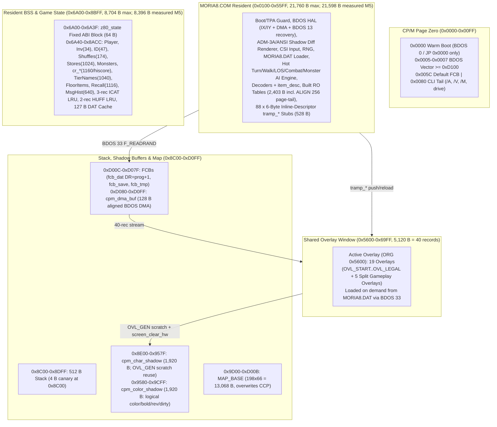

# Moria8 CP/M 2.2 Z80 (`platforms/z80/cpm/` & `core/z80/`) Port — Architecture & Execution Plan

> [!NOTE]
> **Status: Completed M0–M5 Implementation Plan (Historical).** Milestones M0–M5
> below are implemented and verified. For live authoritative memory bounds,
> measured M5 symbol sizes, and runtime invariants, see
> [`docs/CPM_MEMORY_CONTRACT.md`](CPM_MEMORY_CONTRACT.md).

This document records the architecture and phased execution plan
for the **CP/M 2.2 Z80** port of Moria8 (`platforms/z80/cpm/` and `core/z80/`).
Where memory bounds, TPA limits, BDOS calling discipline, or overlay ownership
are concerned, `docs/CPM_MEMORY_CONTRACT.md` is the authoritative contract.

---

## 1. Design Decisions Summary (Locked In)

| Axis | Decision | Rationale |
| --- | --- | --- |
| **Target Hardware & OS** | **CP/M 2.2 baseline on Zilog Z80** with **52 KB minimum TPA (`0x0100–0xD0FF`, BDOS vector ≥ `0xD100`)** | Fits classic 64 KB CP/M business machines (Kaypro II/4, Osborne, Morrow, Amstrad/Spectrum CP/M, C128 CP/M Plus, RunCPM) with zero bank-switching hardware assumptions. |
| **ISA & Assembler** | **Pure idiomatic Z80 assembly** in `core/z80/` and `platforms/z80/cpm/` assembled with **`sjasmplus` v1.24.0** (`0xNN` hex syntax, `DEVICE NOSLOT64K`) | Leverages `LDIR`, `EXX`, `IX`/`IY`, `DJNZ`, `LD A,R`, and relative `JR` cleanly; keeps `core/6502/` untouched and `0xNN` literals unambiguous (`$` remains assembly PC). |
| **Build & Headless Test** | `platforms/z80/cpm/Makefile` outputting into `build/cpm/`; **headless `tools/cpm_runner/` (`build/cpm/cpm_runner`) + `RunCPM` cross-check** | Zero TCP sockets, deterministic JSON-lines control, direct 64 KB Z80 RAM & screen inspection, strict BDOS `IX`/`IY`/stack-probe fuzzing, and `--tpa-top 0xC000` guard testing. |
| **Display Geometry & Mode** | **`80 × 24` ADM-3A (default `/A`) or VT100/ANSI (`/V` 16-color SGR, `/M` mono; runtime `M` / `=`)**, **`198 × 66` dungeon map (`13,068` B)** | Matches C128, Apple IIe, CX16, and BBC Master 128 (`VIEWPORT = 78×18`, messages `0–1`, input `20`, status `21–23`); dirty-cell diffing minimizes serial baud traffic and ADM-3A default runs out of the box on Kaypro hardware. |
| **Character Encoding** | **Pure 7-bit ASCII (`0x20–0x7E`)** internally across strings, Huffman corpus, monster/item catalogs, and `cpm_char_shadow` | Zero PETSCII or C64 screen-code translation at runtime; works natively across ADM-3A, ANSI/VT100, and CP/M CRTs. |
| **Input & Arrow Keys** | **`BDOS 6` (`C_RAWIO`, `E = 0xFF` poll only)** + bounded CSI (`ESC [`) / SS3 (`ESC O`) disambiguation (`ESC_CSI_POLL_ITERS = 255`) + 1-byte `abi_esc_pending` | Avoids CP/M 3-only `E = 0xFE`/`0xFD` so stock CP/M 2.2 never echoes garbage; safe down to 2400 baud and preserves rapid `ESC <key>` sequences. |
| **RNG & Audio** | **`LD A, R` refresh register + 32-bit `BDOS 6` idle-poll counter** for entropy; **ASCII `BEL` (`0x07`)** for alerts | Portable to every Z80 CP/M machine without hardware timers or sound chips. |
| **Overlays & Packed Assets** | **19 overlays (`5,120` B / `40 × 128` B records max at `0x5600–0x69FF`)** + single random-access **`MORIA8.DAT`** (`BDOS 33` `F_READRAND`, 2-record `'M8CP'` TOC, spare slots `25..40`) | Eliminates CP/M directory bloat (2 files instead of 25+) and allows O(1) random-record seeks; `+1,024` B over 4 KB 6502 overlays holds `~5.7–6.0 KB` of 6502 code cleanly without floppy double-reload thrashing (resolving Finding 1). |
| **Save System & Release Compliance** | **Save Format V2 (`SAVE_VERSION = 0x22`, `17,164` B)** across 4 slots (`SAVE0.SAV`..`SAVE3.SAV`) + `HISCORE.DAT` on drives `A:`–`P:` via atomic `.TMP` -> `bdos_rename`; CR+LF `LICENSE` / `SOURCE-OFFER` on distribution media and in `MORIA8.DAT` | Maintains full Save Format V2 gameplay/item/recall parity with all 7 6502 ports and satisfies `AGENTS.md` Rule 7 for Title `A` (`About`) and Help `L`. |
| **Distribution Media** | **`.zip` universal bundle** + **Kaypro II (`200 KB`) `.dsk`** + **Kaypro 4 (`390 KB`) `.dsk`** + **Commodore 128 CP/M `.d71`** | Total program + asset footprint (`~119 KB` raw) fits single Kaypro II, Kaypro 4, or C128 CP/M disks cleanly. |

---

## 2. Memory & Overlay Architecture

For full address ranges, the measured M5 `21,598`-byte resident &
`8,396`-byte BSS allocation tables (plus `2,403` B built RO tables and
CX16 `Default` cold-code eviction accounting), and link-time `ASSERT` contracts,
see `docs/CPM_MEMORY_CONTRACT.md`.

---

## 3. Z80 Terminal Rendering, Input, Assets, & Storage Design

### 3.1 Dirty-Cell Shadow Diffing & ADM-3A / ANSI Modes (`screen_ansi.asm`)

Because CP/M serial consoles often operate at `2400–19200` baud, emitting full
80×24 frames per turn (`~2,000+` bytes) causes visible flicker and lag:

1. **Dual 1,920-Byte Shadow Buffers (`cpm_char_shadow` at `0x8E00`, `cpm_color_shadow` at `0x9580`):**
   * `cpm_color_shadow` bits `0–3` store the **logical Moria8/C64 palette index
     (`0..15`)** directly with zero write-time conversion.
   * All screen writes (`screen_put_char`, `screen_clear`, `screen_clear_row`,
     `dungeon_render`) compare against `(cpm_char_shadow[idx], cpm_color_shadow[idx] & 0x7F)`.
     Unchanged cells do nothing; changed cells update the shadow and set
     `CPM_ATTR_DIRTY` (`bit 7 = 0x80`).
2. **Differential Flush (`screen_flush`):**
   * Scans `0..23` rows × `0..79` cols; skips clean cells (`bit 7 == 0`) with a
     fast `BIT 7, A : JR Z, skip` loop.
   * In `/V` ANSI Color mode (`abi_term_mode == 1, abi_monochrome == 0`), translates each dirty cell's 4-bit logical color index **once** through the 16-byte `sgr_lut` (packed at the tail `0xED..0xFC` of the `huff_tree` page) to emit ANSI SGR `30–37` / `90–97`.
   * Tracks emitted cursor `(emit_row, emit_col)` and emitted SGR attribute state:
     only emits cursor addressing (`ESC = r+32 c+32` in ADM-3A, `ESC[row;colH` in ANSI) across non-contiguous gaps, and **invalidates
     `(emit_row, emit_col)` after writing column `79`** so terminal wrap differences never misalign the cursor.
   * Clears `bit 7` on each flushed cell and positions the cursor before prompts.
3. **Terminal Mode Switching (`/A` ADM-3A Default, `/V` Color, `/M` Mono):**
   * Defaults to **ADM-3A** (`abi_term_mode = 0`, `abi_monochrome = 1`) for out-of-the-box compatibility with Kaypro / Osborne / vintage serial terminals (`0x1A` clear, `ESC = row+32 col+32` cursor, monochrome plain ASCII).
   * CLI `/V` enables VT100/ANSI 16-color SGR; CLI `/M` enables VT100/ANSI monochrome (retaining `ESC[7m` reverse video); Title `M` and in-game `=` cycle cleanly through `[ADM-3A]` -> `[Color]` -> `[Mono]`.
4. **`OVL_GEN` Scratch Reuse:**
   * During dungeon generation, `OVL_GEN` reuses `cpm_char_shadow` (`0x8E00–0x957F`,
     `1,920` B) as temporary scan scratch. On exit, `OVL_GEN` invokes `screen_clear_hw`
     (`0x1A` on ADM-3A, **`ESC[0m` followed by `ESC[2J`** on ANSI) to reset terminal state and clear the screen,
     clears `cpm_char_shadow` (`' '`) and `cpm_color_shadow` (`dirty = 0`,
     clean), and forces a full gameplay redraw so only active cells emit over
     serial.

### 3.2 `BDOS 6` Input, ESC/CSI Disambiguation, & Entropy (`input_csi.asm`)

* **Pure CP/M 2.2 Polling:** `input_poll_raw` invokes `BDOS 6` with `E = 0xFF`
  (preserving `IX`/`IY` in `bdos_call`). Blocking `input_get_key` loops until
  `A != 0`, incrementing the 32-bit `abi_entropy_poll` counter (`0x6A0C`) and
  mixing `LD A, R` into the PRNG entropy pool on keypress transitions.
* **ESC vs. CSI / SS3 State Machine:**
  * Checks 1-byte `abi_esc_pending` lookahead (`0x6A27`) before polling BDOS.
  * When `0x1B` is received, polls up to `ESC_CSI_POLL_ITERS = 255` times (safe
    down to 2400 baud on 4–8 MHz Z80; `cpm_runner` sets default `run_idle`
    threshold to `512 > 255`):
    - Timeout -> returns `KEY_ESC` (`0x1B`).
    - `'['` -> parses CSI parameters up to final byte `0x40..0x7E`, mapping
      arrows (`A/B/C/D`), Home/End (`H/F`, `1~/4~/7~/8~`), PgUp/PgDn (`5~/6~`),
      and Del (`3~`), discarding unrecognized CSI sequences cleanly.
    - `'O'` -> parses VT100 SS3 arrows (`O A..D`).
    - Any other byte `b` -> saves `b` into `abi_esc_pending` and returns `KEY_ESC`.

### 3.3 `MORIA8.DAT` Random-Access Asset & Overlay Streaming (`dat_loader.asm`)

All 19 overlays (`OVL_START..OVL_LEGAL` in DAT slots `0..13` and 5 split
gameplay overlays `OVL_ITEMS_EFF..OVL_ITEM_MGT` in DAT slots `20..24`, with
spare slots `25..40` available up to `DAT_MAX_ENTRIES = 41`) and 6 read-only
assets (`14..19`) reside in `MORIA8.DAT` (`tools/make_cpm_dat.py`):

* **2-Record TOC (`256` B) & Drive Pinning:** At startup, `dat_init` pins
  `fcb_dat[0]` to `abi_program_drive + 1` (`1..16`, never `0`), opens
  `MORIA8.DAT`, reads records `0` and `1` via `BDOS 33` (`F_READRAND`), verifies
  `"M8CP"` magic and `version == 1`, and caches the compact **`127` B** slot
  table (`41` slots × `3` B `(u16 start_rec, u8 rec_count)` + `4` B header,
  covering spare slots `25..40` natively; `rec_count <= 255` enforced). Cold RO
  streams (`DAT_ID_TITLE_ART = 17`, `DAT_ID_LICENSE = 18`, `DAT_ID_SRCOFFR = 19`,
  at bytes `108..125` inside TOC record `0`) read exact `u16 byte_len` directly
  from TOC record `0` via `BDOS 33` on open.
* **Overlay Loading (`overlay_load`):** Maps `ovl_id` (`1..19`) via
  `ovl_to_dat_slot` (`0..13`, `20..24`), verifies `rec_count <= 40` (`5,120` B
  max, resolving Finding 1 cleanly with `+1,024` B over 4 KB 6502 overlays),
  streams directly into `0x5600+` (`SETDMA` per 128 B record), and **always**
  resets `BDOS 26` (`SETDMA`) back to `cpm_dma_buf` (`0xD080`) before returning.
* **Nested 6-Byte Inline-Descriptor Trampolines (`trampolines.asm`):** Resident
  `tramp_*` wrappers use `CALL overlay_trampoline : DB ovl_id : DW target_addr`
  (`6` B/stub -> `528` B for `88` stubs), preserve `AF/BC/DE/HL/IX/IY`, check
  `abi_current_overlay == ovl_id` for a zero-I/O same-overlay fast path, or
  push the caller overlay onto `ovl_stack[8]`, load the callee overlay into
  `0x5600–0x69FF`, run the routine, and reload the caller overlay on return.
* **Resident-Pinned & LRU-Cached Assets:**
  * `DAT_ID_MONSTER_CAT` (`14`): `279 × 57 B` Phase 5 pure-ASCII records packed 2
    per 128 B CP/M record (`140` records = `17,920` B, zero cross-record
    straddles). Single `BDOS 33` read fetches any species record in O(1).
  * `DAT_ID_ITEM_CAT` (`15`): `367` B of RO metadata (`icat_blk_index`,
    `icat_canon_counts`, `icat_canon_syms`) are pinned in `MORIA8.COM`, while
    body blocks stream through a 3-record (`384` B) BSS LRU cache (`393` B total).
  * `DAT_ID_HUFF_STREAM` (`16`): Page-aligned Huffman trees (`ALIGN 256`, `+64`
    stride, `120` B) share a single 256-byte page tail with `monster_idx_z80`
    (`117` B) and `sgr_lut` (`16` B) in `MORIA8.COM`; compressed bitstream streams
    via a 2-record (`256` B) BSS LRU cache (`262` B total).
  * `DAT_ID_TITLE_ART` (`17`), `DAT_ID_LICENSE` (`18`), `DAT_ID_SRCOFFR` (`19`):
    streamed on demand for Title and `OVL_LEGAL`.

### 3.4 Save Format V2 (`0x22`) & Multi-Drive Storage (`A:`–`P:`)

* Produces and consumes exact **Save Format V2 (`SAVE_VERSION = 0x22`, `17,164` B
  for `198×66` map)** matching all 6502 ports (`"MORIA01" + 0x22`, 34 inventory
  slots, 47-byte `id_known_bits`, 174-byte shuffles, 1,024-byte stores, 462-byte
  floor items, 1,116-byte `recall[279]`, 13,068-byte map, 16-bit additive
  checksum).
* Saves (`SAVE0.SAV`..`SAVE3.SAV`) and high scores (`HISCORE.DAT`) target any
  user-selected CP/M drive `A:`–`P:` (`abi_save_drive`, `0..15`) via atomic
  `.TMP` write -> delete old target -> `bdos_rename` -> `bdos_close` (preserving
  the prior save if disk-full occurs), with `BDOS 13` (`Reset Disk System`)
  recovery (plus mandatory `SETDMA 0xD080`, `BDOS 14` drive re-select, and
  `fcb_dat` re-open) when probing/switching media.
* Exiting `MORIA8.COM` always invokes `BDOS 0` / `JP 0x0000` (warm boot) because
  `MAP_BASE` (`0x9D00–0xD00B`) overwrites the CP/M CCP.

---

## 4. Distribution Packaging (`.zip`, Kaypro II `.dsk`, Kaypro 4 `.dsk`, C128 CP/M `.d71`)

Every shipping package includes both the game payload and Rule 7 release-compliance
legal texts (`data/LICENSE` and `data/SOURCE-OFFER` with CR+LF line endings):

| Artifact | Target Media | Contents |
| --- | --- | --- |
| `build/moria8-cpm.zip` | Universal CP/M / RunCPM / emulator archive (`79,562` B) | `MORIA8.COM`, `MORIA8.DAT`, `LICENSE`, `SOURCE-OFFER`, `README.TXT` |
| `build/moria8-cpm-kaypro2.dsk` | **Kaypro II SSDD (`200 KB` formatted, 40 tracks × 1 side × 10 × 512 B sectors)** | CP/M 2.2 filesystem (`MORIA8.COM`, `MORIA8.DAT`, `LICENSE.TXT`, `SRCOFFR.TXT`) |
| `build/moria8-cpm-kaypro4.dsk` | **Kaypro 4 DSDD (`390 KB`, 40 tracks × 2 sides × 10 × 512 B sectors)** | CP/M 2.2 filesystem (`MORIA8.COM`, `MORIA8.DAT`, `LICENSE.TXT`, `SRCOFFR.TXT`), ~`240+ KB` free for save slots |
| `build/moria8-cpm-c128.d71` | **Commodore 128 CP/M Plus `.d71` (`340 KB+` formatted CP/M capacity)** | C128 CP/M 3.0 data disk (`MORIA8.COM`, `MORIA8.DAT`, `LICENSE.TXT`, `SRCOFFR.TXT`) |

---

## 5. Phased Execution Plan (Milestones M0–M5)

1. **M0 — Toolchain, Reorg, Assets, Contracts, & Scaffolding:**
   * Reorganize `core/` -> `core/6502/` and create empty `core/z80/`.
   * Provision `tools/ensure_sjasmplus.sh`, `tools/ensure_runcpm.sh`, and
     strict headless `tools/cpm_runner/` (`build/cpm/cpm_runner`).
   * Create pure-ASCII Z80 asset builders (`tools/build_z80_assets.py`,
     `tools/make_cpm_dat.py`) with page-aligned Huffman trees, pinned `ITEM.CAT`
     RO metadata, and 25-slot `'M8CP'` container packing.
   * Lock `docs/CPM_PORT_PLAN.md`, `docs/CPM_MEMORY_CONTRACT.md`,
     `platforms/z80/cpm/memory.inc`, `platforms/z80/cpm/check_memory_contract.py`,
     and `platforms/z80/cpm/Makefile`.
2. **M1 — Boot, BDOS HAL, ANSI Renderer, CSI Input, RNG, & Title/Legal Smoke:**
   * Implement `main.asm`, `bdos_io.asm`, `screen_ansi.asm`, `input_csi.asm`,
     `rng_z80.asm`, `dat_loader.asm`, `trampolines.asm`, `ovl_title.asm`, and
     `ovl_legal.asm`.
   * Verify 52 KB TPA `< 0xD100` guard (`--tpa-top 0xC000`), `/M` monochrome
     toggle, `z80_state` ABI at `0x6A00`, Title screen, and Title `A` Legal Viewer.
3. **M2 — Chargen, Town, Stores, Home, & Save Format V2:**
   * Port core math, player state, character creation (`OVL_START`), town layout,
     stores 0–6 (`OVL_TOWN`), Player Home (`OVL_HOME`), character/inventory UI
     (`OVL_UI`), help (`OVL_HELP`), and full Save Format V2 (`SAVE_VERSION = 0x22`,
     `OVL_STORAGE`, `SAVE0.SAV`..`SAVE3.SAV`, `HISCORE.DAT`, drives `A:`–`P:`).
4. **M3 — Dungeon Generation, LOS/FOV, Exploration, Features, & Modals:**
   * Port `OVL_GEN` (`cpm_char_shadow` scan scratch + `ESC[0m` + `ESC[2J` exit
     redraw), Bresenham LOS & lighting, movement/running, traps/doors/search/bash
     (`OVL_ACTIONS`), chests (`OVL_CHEST`), and modal/death/recall UI
     (`OVL_MODAL`, `OVL_DEATH`).
5. **M4 — 279 Monsters, Combat, 361 Items, 55 Egos, 62 Spells, & Endgame:**
   * Port full 279-species `MONSTER.CAT` + 361-item `ITEM.CAT` streaming,
     melee/ranged combat, monster AI + `OVL_MON_EXT` spells/breath, all 55 egos,
     item actions/effects (`OVL_ITEMS`, `OVL_ITEMS_EFF`, `OVL_ITEM_MGT`), all 62
     mage/priest spells (`OVL_SPELL`, `OVL_SPELL_EFF`), and Balrog / Royal victory.
6. **M5 — Disk Images, Root Integration, & Full Cross-Platform Regression:**
   * Build `.zip`, Kaypro II `.dsk`, Kaypro 4 `.dsk`, and C128 CP/M `.d71`
     packagers, wire `platforms/z80/cpm` targets into root `Makefile`, update
     `docs/FEATURE_MAP.md` & `docs/CROSS_PLATFORM_STRATEGY.md`, and run `RunCPM`
     + `cpm_runner` parity, playtest, and full `make test` regression gates.
