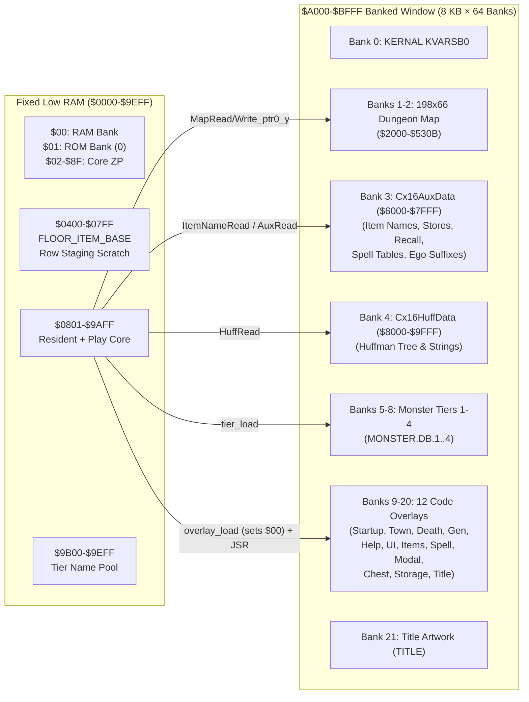

# Moria8 1.7.0 Commander X16 Port — Architecture & Autonomous Execution Plan

## 1. Post-Mortem: Why `origin/cx16` Went Off the Rails

The research subagent audited all 61 commits (`+15,361 / -3,578` lines across 136 files) on `origin/cx16` against `HEAD` (`feed714`). The root cause of the previous failure was a single early memory-layout mistake that snowballed:

1. **Fatal Memory Decision (`MAP_BASE = $6800` in Fixed Low RAM):**
   `origin/cx16` placed the 13,068-byte live dungeon map in fixed low RAM (`$6800-$9B0B`) and enforced `CX16_RESIDENT_PRODUCT_LIMIT = $6000` (only **22.5 KB** of resident code/data at `$0801-$5FFF`).
2. **Fake Vertical-Slice Reimplementation (`platforms/cx16/main.s` = 3,827 lines):**
   Because Moria8's shared resident + gameplay code needs ~37.5 KB when unbanked, `origin/cx16` could not fit the real game below `$6000`. Instead of moving the map into banked RAM, the previous agent wrote a parallel fake game loop inside `platforms/cx16/main.s` with hardcoded 3-monster spawns, no monster movement AI, a fake town recovery stub instead of stores, hardcoded survival loot drops, and a custom save format.
3. **`core/` Fragmentation (69 `core/` files touched):**
   To cherry-pick small helpers into its fake vertical slice, `origin/cx16` carved `core/` into 30+ micro-files and added feature-amputation macros (`HAL_PLATFORM_NO_MONSTER_TARGETS`, `HAL_PLATFORM_NO_FEAR_EFFECTS`, `HAL_PLATFORM_ITEM_CATALOG_BANKED`, etc.).

> [!IMPORTANT]
> **Our Core Rule:** We will **not** reimplement gameplay in `platforms/cx16/` or fragment `core/`. On `HEAD` (`feed714`), `platforms/apple2/main.s` (1,877 lines) already proved how a 128K+ 80-column port links the unmodified `core/` modules using clean segment and MMU macros.

---

## 2. Commander X16 Memory & Banking Architecture

Commander X16 is strictly easier than the Apple IIe:
* **38.6 KB Contiguous Unbanked Low RAM (`$0801-$9EFF`):** Even larger than Apple IIe's `$0A00-$9FFF` (`Resident` + `A2PlaySlot` = 37.7 KB combined).
* **512 KB Banked RAM (`64 × 8 KB` banks at `$A000-$BFFF` via ZP `$00`):** Every overlay (max ~5.4 KB) and monster tier (max ~2.0 KB) fits inside its own dedicated 8 KB RAM bank and **executes directly in-place at `$A000-$BFFF`**.
* **No RAMRD Instruction-Fetch Hazard:** Unlike the Apple IIe (where switching aux RAM banks out `$0200-$BFFF` code), changing ZP `$00` on CX16 *only* switches `$A000-$BFFF`. Resident helpers in `$0801-$9AFF` can switch `$00`, read/write `($zp_ptr0),y`, and restore `$00` directly without ZP execution thunks.

### Fixed Low Memory (`$0000-$9EFF`)

| Address Range | Size | Owner | Notes |
| --- | ---: | --- | --- |
| `$0000-$0001` | 2 B | CX16 Bank Registers | `$00` = active RAM bank (`$A000-$BFFF`), `$01` = active ROM bank (`0` = KERNAL) |
| `$0002-$008F` | 142 B | Moria8 Shared ZP (`core/zeropage.s`) | CX16 KERNAL uses `$80-$FF`; `$02-$7F` is 100% free application ZP. `$80-$8F` (16 B) saved/restored across KERNAL file I/O calls. |
| `$0100-$01FF` | 256 B | Hardware Stack | Always unbanked |
| `$0200-$03FF` | 512 B | KERNAL Vectors & System Scratch | Reserved for CX16 KERNAL |
| `$0400-$04FF` | 256 B | `FLOOR_ITEM_BASE` | Floor item table (VERA text RAM is in VRAM `$1B000`, so `$0400-$07FF` is free CPU RAM!) |
| `$0500-$05FF` | 256 B | `CREATURE_BASE` / Scratch | Fixed low scratch |
| `$0600-$07FF` | 512 B | `DUNGEON_GEN_DOOR_SCAN_BASE` & `CX16_ROW_STAGE_BASE` | Door scan / Huffman decode (`$0600-$06FF`) + VERA row / file I/O staging (`$0700-$07FF`) |
| `$0801-$9AFF` | 37,631 B | Resident + Play Image (`Default` segment) | Unified `core/` resident + play modules (no play-slot disk/bank swapping needed) |
| `$9B00-$9EFF` | 1,024 B | `PLATFORM_TIER_NAME_POOL_BASE` (`$9B00-$9EFF`) | Active monster tier name pool in fixed RAM (zero bank switches when rendering monster names) |
| `$9F00-$9FFF` | 256 B | VERA (`$9F20-$9F3F`) & VIA (`$9F00-$9F1F`) I/O | Hardware I/O hole — enforced by `.assert` and memory contract checker |

### Banked RAM Window (`$A000-$BFFF` — 8 KB per Bank via ZP `$00`)

* **How Virtual `$2000-$9FFF` in Banks 1–4 Works Transparently:**
  Every virtual address `V = zp_ptr + Y` in `$2000-$9FFF` maps deterministically via `bank = eff_hi >> 5` (`1..4`) and window address `((eff_hi & $1F) | $A0) << 8 | eff_lo` inside `$A000-$BFFF`, then restores previous `$00` on exit.

---

## 3. Salvage Map from `origin/cx16`

| Component | Source | Action |
| --- | --- | --- |
| VERA 80×24 Text HAL | `origin/cx16:platforms/cx16/screen_vera.s`, `palette_consts.s` | **Salvage & adapt** (add `screen_flash_at`, align status rows 21–23 with `core/ui_status.s`). |
| Keyboard Input HAL | `origin/cx16:platforms/cx16/input.s` | **Salvage & adapt** (preserve Bank 0 `$A80A` / `KERNAL_GETIN` wrapper; add full Moria8 command keymap). |
| Entropy & REU Stubs | `origin/cx16:platforms/cx16/hal/entropy_consts.s`, `reu_stub.s` | **Salvage as-is** (`VIA1_T1CL = $9F04`). |
| Monster Tier PRG Wrappers | `origin/cx16:platforms/cx16/creature_data/tier[1-4]_prg.s`, `storage_kernal.s` | **Salvage & adapt** to wire into `core/tier_manager.s`. |
| Bank Loader & Services | `origin/cx16:platforms/cx16/services.s`, `overlay_storage.s` | **Salvage & adapt** for preloading `CX16.AUXDATA`, `CX16.HUFFDATA`, `MONSTER.DB.1..4`, the 12 overlays, and `TITLE` at boot. |
| `main.s`, `mmu_macros.s`, `memory_bank.s` | `platforms/cx16/` | **First-class CX16 linker script and MMU macros** using CX16 ZP `$00` bank selection. |
| Viewport Renderer | `platforms/cx16/dungeon_render_vera.s` | **Write `dungeon_render_vera.s`** streaming 78 char+color pairs per row via `VERA_DATA0` auto-increment (`VERA_INC_1`). |
| Save/Load System | `platforms/shared/save.s` & `save_slot_menu.s` | **Use shared save engine** with thin KERNAL `OPEN`/`CHKIN`/`CHKOUT`/`CHRIN`/`CHROUT` stream shims (`save_stream.s`). |
| TestBench Harness | `platforms/cx16/harness_smoke.py` | **Implement `X16Bench` client** and the 20 runtime smoke scenarios. |

---

## 4. Phased Milestone Plan

### Milestone 0: Contract & Build Foundation
* Create `docs/CX16_MEMORY_CONTRACT.md` and `platforms/cx16/memory.s`.
* Create `platforms/cx16/Makefile` and `platforms/cx16/check_memory_contract.py` (with `--selftest`).
* Wire `buildcx16`, `diskcx16`, `runcx16`, `testcx16`, `testcx16-memory-contract` into root `Makefile`.

### Milestone 1: Boot, Preloader, VERA 80-Col Screen, & Title (`boot_title`)
* Implement `screen_vera.s`, `palette_consts.s`, `input.s`, `services.s`, `overlay_storage.s`, `storage_kernal.s`.
* Assemble `platforms/cx16/main.s` with the full `core/` import cascade, `Cx16AuxData` (Bank 3), `Cx16HuffData` (Bank 4), and all 12 overlays (Banks 9–20).
* Verify `make buildcx16`, `make testcx16-memory-contract`, and `boot_title` in `harness_smoke.py`.

### Milestone 2: Banked Map (Banks 1–2), AuxData (Bank 3), & Chargen → Town
* Implement `memory_bank.s` and `mmu_macros.s` (`MapRead/Write_ptr0/1_y`, `HuffRead`, `ItemNameRead`, `SpellTblRead`, `AuxRead/Write`).
* Implement `dungeon_render_vera.s` and `dungeon_scroll_vera.s` with fast VERA `DATA0` row streaming.
* Verify character creation, town rendering, and all 6 town stores.

### Milestone 3: Dungeon Generation, Monsters, Combat, Items, Spells, & Save/Load
* Verify monster tier bank switching (`storage_kernal.s` + `PLATFORM_TIER_NAME_POOL_BASE`), dungeon generation (`OVL.GEN`), movement/LOS, combat, inventory/equipment, chests/doors, spells/projectiles, and KERNAL stream save/load (`save_stream.s`).

### Milestone 4: Full Smoke Suite + Release Artifact + `make test`
* Pass all 20 `harness_smoke.py` scenarios.
* Build shipping CX16 package (`build/moria8-cx16.zip` containing `MORIA8.PRG`, banked payloads, and `LICENSE` / `SOURCE-OFFER` per `AGENTS.md` Rule 7).
* Run `make check-hal-boundaries`, `make check-zp`, `make check-6502-lint`, and full regression `make test`.
