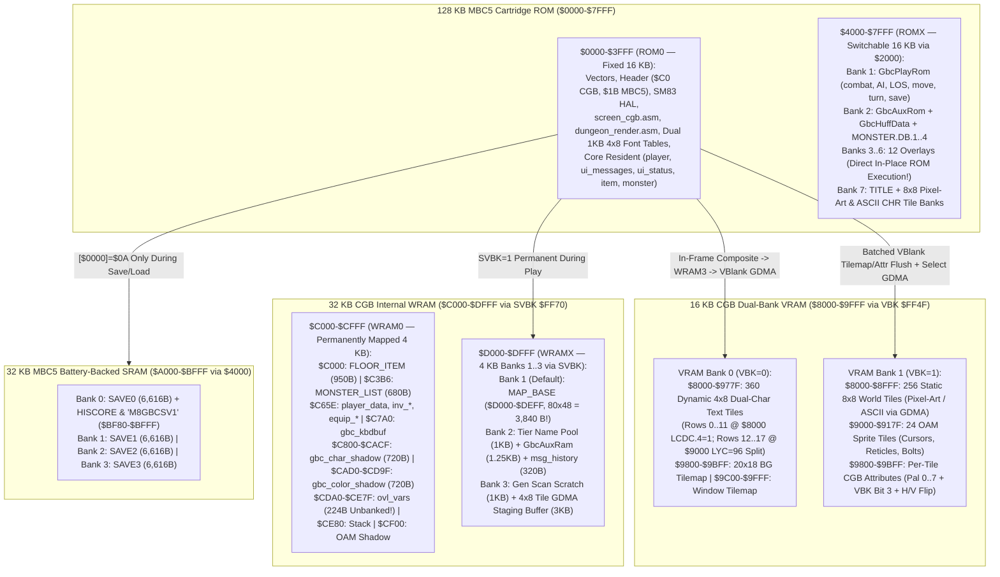

# Moria8 ModRetro Chromatic / Game Boy Color (`platforms/gbc/`) Port — Architecture & Execution Plan

This document specifies the complete architecture and phased implementation
plan for the ModRetro Chromatic / Game Boy Color (`platforms/gbc/`) port of
Moria8. Where memory bounds, `MBC5`/`SVBK`/`VBK` banking, or PPU/HDMA register
ownership are concerned, `docs/GBC_MEMORY_CONTRACT.md` is the authoritative
contract.

---

## 1. Design Decisions Summary (Locked In)

| Axis | Decision | Rationale |
| --- | --- | --- |
| **Target Hardware & Mapper** | Standard **Game Boy Color (`CGB-Only` `$C0`)** (`Sharp SM83` @ **8.388 MHz Double-Speed Mode**, `16 KB` VRAM, `32 KB` WRAM) with **`MBC5 + RAM + BATTERY` (`$1B`)**: `128 KB` ROM (`8 × 16 KB`), `32 KB` battery-backed SRAM (`4 × 8 KB`), calibrated for the **ModRetro Chromatic** `160×144` sapphire IPS display | Runs natively on ModRetro Chromatic hardware, original Game Boy Color, Analogue Pocket, and headless MAME (`mame gbcolor -cart`). Gives each of the 4 save slots (`SAVE0..SAVE3`) its own dedicated `8 KB` SRAM bank (`$A000-$BFFF`), fits the live `80×48` dungeon map (`3,840` B) in a single `4 KB` WRAM bank (`SVBK = 1`, `$D000-$DEFF`), and executes all 12 overlays directly in-place from `16 KB` `ROMX` banks (`$4000-$7FFF`) with zero RAM copy. |
| **Core Track & Sequencing (`core_z80/`)** | **Deferred until the 6502 `core/` track is playtest-complete**; shares an **SM83-clean `core_z80/`** core with `CP/M`, `MSX`, and `ZX Spectrum` (authored in **RGBDS**: `rgbasm`, `rgblink`, `rgbfix` for GBC first, with a documented `[` `]` ↔ `(` `)` preprocessor/macro shim or `sjasmplus` bridge for subsequent Z80 targets) | Coding `core_z80/` without Z80-only `IX`/`IY` indexed addressing, `DJNZ`, `SBC HL,rr`, or raw `LDIR`/`EX DE,HL` (using shared `HL`/`DE` struct macros and `BLK_COPY`) allows ~85–90% of `core_z80/` to compile directly for both Zilog Z80 and Sharp SM83 without maintaining divergent gameplay trees while 6502 playtesting continues. |
| **Dual-Density Display (`8×8` World Tiles + `4×8` 40-Column Condensed Font)** | **`VRAM Bank 1` (`VBK = 1`):** `256` static `8×8` World Tiles (shared 95+ bespoke pixel-art icons with NES, upgraded to **8 CGB RGB555 BG Palettes = 32 colors**, + `Select` toggle to `8×8` Classic ASCII via `1.95 ms` `GDMA`). **`VRAM Bank 0` (`VBK = 0`):** `360` dynamic `8×8` tiles packing **two `4×8` condensed characters per tile = `40 columns` across `160` pixels!** | Packing two `4×8` (`3×7` glyph + `1px` spacing) characters into each `8×8` tile in `VRAM Bank 0` yields **40 columns × 18 rows** of crisp text on the Chromatic's IPS panel. Every existing 40-column Moria8 string, item description, and store line fits on **1 horizontal row with zero wrapping or truncation (`AGENTS.md` Rule 2)** while keeping world tiles in `VRAM Bank 1` untouched across modal transitions. |
| **18-Row Exploration Layout (`40×2` Msg + `20×14` Viewport + `40×2` HUD)** | **Rows `0–1` (`2 × 40` chars, `4×8` font):** Fixed 2-row Top Message Bar. **Rows `2–15` (`20×14` `8×8` tiles):** Dungeon / Town Viewport. **Rows `16–17` (`2 × 40` chars, `4×8` font):** Fixed 2-row Bottom HUD (`Name/Race/LV/DL` on row 16; `HP/MP/AC/AU/Hunger/Search` on row 17); the 6 primary stats (`STR..CHR`) appear on the `Start` Command Menu mini-card & Character Sheet | Eliminates viewport resizing/jitter during movement while preserving a `20×14` (`280`-tile) tactical field of view and two full 40-character message lines plus essential vitals at all times. |
| **18-Row Paginated Modals (`40×18` Text Grid)** | **Inventory & Spells:** 2 pages (`11 items/page`, `a–k` / `l–v`). **Equipment:** 1 page (all `12` slots `a–l` on rows `2–13`). **Stores (`HAL_LAYOUT_STORE_COMPACT_ROWS = 1`):** 2 pages (`6 items/page` on rows `3–8` + Gold/Menu/Prompt/Price/Error on rows `10–16`). **Character Sheet (`HAL_LAYOUT_CHARACTER_TABS = 1`):** 2 tabs (`Tab 1: Identity, 6 Stats, Combat` / `Tab 2: 4-Line Background, Skills & Flags` via D-Pad `Left/Right`). **Victory (`HAL_LAYOUT_ROYAL_PAGINATED = 1`):** 2 pages | Because horizontal width is a full `40` columns (`SCREEN_COLS = 40`), all horizontal column coordinates match C64/Atari 8-bit directly; clean 2-page pagination and defensive `row < 18` clamping adapt the 25-row modals to `18` vertical rows (`SCREEN_ROWS = 18`). |
| **Controller UX & Test Injection (`gbc_kbdbuf`)** | **Mystery Dungeon / Dragon Warrior controller UX** (`A` context action, `Start` Pop-up Command Menu + 6-Stat Mini-Card on the Hardware Window layer, `B` diagonal/run/cancel, `Select` Pixel-Art/ASCII toggle, OAM cursor, Name Grid, Haggle spinner) + unbanked **`gbc_kbdbuf` (`$C7A0-$C7DF`)** | Matches the NES controller UX while allowing `platforms/gbc/harness_smoke.py` to inject PETSCII keys into `gbc_kbdbuf` (`WRAM0`) and inspect `gbc_char_shadow` (`$C800-$CACF`, `40×18` C64 screen codes in `WRAM0`) at native speed with zero banking race conditions. |
| **Audio & Verification (`GBCROMS`)** | **8 core SFX** on the **CGB 4-channel APU** (`Pulse 1/2`, `Wave`, `Noise`) + headless **MAME (`mame gbcolor -cart`)** runtime suite (`GBCROMS ?=` for `gbcolor.zip`, graceful skip when unset per Rules 8 & 9) + `build/moria8-gbc.zip` (`moria8-gbc.gbc` + `LICENSE` + `SOURCE-OFFER`, Rule 7) | Follows the exact `A2ROMS`/`ATARI8ROMS`/`BBCMROMS` Makefile contract (`GBCROMS ?=`, `RGBASM ?= rgbasm`, `RGBLINK ?= rgblink`, `RGBFIX ?= rgbfix`, all outputs in `build/gbc/`) and verifies all 18 runtime scenarios well under the 30-second cap (`AGENTS.md` Rule 8). |

---

## 2. Memory, `MBC5`, `SVBK`, & Dual-Bank `VRAM` Architecture



---

## 3. Dual-Density Renderer: `4×8` 40-Column Text + `8×8` 32-Color World Tiles (`screen_cgb.asm`, `dungeon_render.asm`)

### 3.1 How the `4×8` Dual-Character-Per-Tile Blitter Achieves 40 Columns on `160×144`

1. **Authoritative `40×18` Character & Color Shadows (`$C800-$CD9F` in `WRAM0`):**
   * `gbc_char_shadow` (`$C800-$CACF`, `720` B) and `gbc_color_shadow`
     (`$CAD0-$CD9F`, `720` B) store a standard **40-column × 18-row** grid of C64
     screen codes and logical `COL_*` colors in permanently mapped `WRAM0`.
   * Every horizontal text routine (`hal_screen_put_char`, `hal_screen_put_string`,
     `msg_print`, `status_draw`, `ui_store`, `ui_inventory`, `ui_equipment`,
     `ui_character`, `score`) writes to `cols 0..39` and `rows 0..17` identically
     to a 40-column target, guarded by a hard defensive row clamp (`cp 18; ret nc`).
2. **Fast `4×8` Pair Composition (`138` M-cycles/tile) & VBlank `GDMA` (`8` M-cycles/tile) in Double-Speed Mode (`8.388 MHz`):**
   * Each `8×8` hardware tile cell `(row, tile_col)` (`tile_col = 0..19`) covers
     two adjacent 40-column text cells: `left_char = gbc_char_shadow[row*40 + tile_col*2]`
     (high nibble `$F0` of each row byte) and `right_char = gbc_char_shadow[row*40 + tile_col*2 + 1]`
     (low nibble `$0F` of each row byte).
   * In `ROM0`, two page-aligned `1 KB` tables — `font_4x8_left` (`128 × 8 = 1,024` B,
     pre-shifted into the upper nibble `$F0`) and `font_4x8_right` (`128 × 8 = 1,024` B,
     pre-masked into the lower nibble `$0F`) — eliminate runtime nibble shifts.
   * Encoding **independent left and right character colors** within a single
     `8×8` 2bpp tile:
     * Each 8-row × 2-byte (`16`-byte) 2bpp CGB tile has two bitplanes (`bp0`,
       `bp1`), selecting palette color `0` (Black `$0000`), `1` (Sub-color 1),
       `2` (Sub-color 2), or `3` (Sub-color 3 / White Highlight).
     * By masking `font_4x8_left[left_char]` and `font_4x8_right[right_char]`
       into `bp0`/`bp1` according to each character's 2-bit sub-color (`1..3`),
       **two adjacent `4×8` characters inside the same `8×8` tile can have
       independent colors** within that tile's 4-color CGB palette!
   * Compositing one `8×8` tile pair (8 scanlines = 16 bytes) into `WRAM Bank 3`
     (`$D400-$DFFF`) takes **`15` M-cycles/scanline (`138` M-cycles / `65.8 µs`
     per tile at `8.388 MHz`)**.
   * **VBlank `GDMA` (`$FF55 bit 7 = 0`) Over `HDMA`:** Because real CGB silicon
     freezes HBlank DMA (`HDMA`) whenever the CPU executes `HALT`, `screen_cgb.asm`
     never uses `HDMA` with `HALT`. Instead, inside `gbc_vblank_isr`, **CGB
     General Purpose DMA (`GDMA`, `$FF55 bit 7 = 0`)** transfers each dirty
     16-byte tile into `VRAM Bank 0` in just **`8` Double-Speed M-cycles
     (`3.81 µs`)** (`160` M-cycles for a full 20-tile row, or `< 7%` of the
     `2,280` M-cycle VBlank budget; up to `160–180` tiles per VBlank, or all `360`
     tiles in a single `1.37 ms` `GDMA` during forced blank `LCDC.7 = 0`).
   * Dirty Tilemap (`VBK = 0`) and Attribute Map (`VBK = 1`) row flushes are
     batched by bank (`20` tile indices under `VBK = 0`, then `1` `VBK` switch
     followed by `20` attribute bytes under `VBK = 1`).

### 3.2 Chromatic-Calibrated 8 Background Palettes (`32` RGB555 Colors)

The Game Boy Color provides **8 Background Palettes (`Palettes 0..7`)** and **8
Sprite Palettes (`OBP 0..7`)** in dedicated Palette RAM (`$FF68-$FF6B`), giving
every `8×8` world tile in `VRAM Bank 1` (`Attribute Bit 3 = 1`) 3 rich 15-bit
RGB555 colors + universal dark/black background:

| CGB BG Palette | Color 0 (BG) | Color 1 (Shadow/Mid) | Color 2 (Primary) | Color 3 (Highlight) | World & Text Role |
| --- | :---: | :---: | :---: | :---: | --- |
| **Palette 0 (Stone / UI White)** | `#000000` | `#525252` (D.Grey) | `#A5A5A5` (L.Grey) | `#FFFFFF` (White) | Dungeon stone walls (`#`), lit floor (`.`), weapons/armor, skeletons, white/grey UI text |
| **Palette 1 (Torch / Fire / Gold)** | `#000000` | `#9C2918` (Crimson) | `#E67B18` (Amber) | `#FFE642` (Gold) | Torch-lit walls, doors (`+`), gold (`$`), chests, red/fire dragons, Balrog, yellow/red text |
| **Palette 2 (Verdant / Nature)** | `#000000` | `#633A18` (Wood) | `#188429` (Forest) | `#52DE52` (Bright Green) | Town trees, open wooden doors (`'`), food/potions, reptiles, orcs, trolls, green/brown text |
| **Palette 3 (Arcane / Frost / Mana)** | `#000000` | `#293A9C` (Deep Blue) | `#319CE6` (Sky Blue) | `#63FFFF` (Cyan) | Scrolls (`?`), wands/staves (`/`,`_`), rings (`=`), frost/lightning, cyan/blue UI text |
| **Palette 4 (Royal / Necrotic)** | `#000000` | `#4A1863` (Indigo) | `#9431C6` (Purple) | `#F784F7` (Magenta) | Amulets (`"`), magic portals, wraiths/liches/quylthulgs, warding glyphs, purple text |
| **Palette 5 (Copper / Earth)** | `#000000` | `#422108` (Umber) | `#8C4A18` (Copper) | `#DE9452` (Sand/Skin) | Rubble (`:`), traps (`^`), stairs (`<`,`>`), town cobblestones, humanoids/dwarves |
| **Palette 6 (Player & Town Roofs)** | `#000000` | `#184273` (Steel) | `#528CE6` (Azure) | `#FFF7C6` (Warm Ivory) | Player knight (`@`) armor & crest, town store signposts (`1`–`6`) |
| **Palette 7 (Dim / Remembered LOS)** | `#000000` | `#181821` (Slate) | `#313142` (Dim Stone) | `#4A4A63` (Muted Blue) | Out-of-LOS remembered walls (`#`), doors, and stairs (giving authentic dim fog-of-war tinting!) |

---

## 4. 18-Row Exploration & Paginated Modal Layouts (`40×18` Effective Text Grid)

### 4.1 Exploration Screen (`Rows 0–17`)

```text
+----------------------------------------+
|Row 0: Message Line 0 (40 chars @ 4x8)  | <-- Top 2-Row Message Bar (VBK=0 Text)
|Row 1: Message Line 1 / -more- (40 ch)  |
+----------------------------------------+
|                                        |
|       Rows 2..15 (20 x 14 Tiles)       | <-- Dungeon / Town Viewport (VBK=1 8x8)
|     (8x8 RGB555 Pixel Art / ASCII)     |     (Palettes 0..6 Lit, Palette 7 Fog)
|                                        |
+----------------------------------------+
|Row 16: Frodo      Hobbit  LV:12  DL:05 | <-- Bottom 2-Row Compact HUD (VBK=0 Text)
|Row 17: HP:142/142 MP:34/34 AC:28 AU:850|     (Plus Hungry/Search/Poison tags)
+----------------------------------------+
```

* **Pressing `Start` (Hardware Window Overlay at `WY = 16, WX = 7` with `LYC = 96` Split):**
  Slides up the CGB Hardware Window (`$9C00`; `WX = 7` places the Window's left
  edge at hardware column `0`) covering rows `2..15` (`280` text tiles) while
  enabling the **`LYC = 96` (Row 12) `STAT` IRQ split** (`LCDC.4 = 1` `$8000`
  for rows `0..11` indices `0..239`, `LCDC.4 = 0` `$9000` for rows `12..17`
  indices `0..119`):
  * **Left Card (`cols 0–15`):** Player's 6 primary stats (`STR`, `INT`, `WIS`,
    `DEX`, `CON`, `CHR`), `XP`, `Infra`, and active timed status effects.
  * **Right Menu (`cols 16–39`):** 2-column Pop-up Command Menu (`Inventory`,
    `Equipment`, `Magic`, `Quaff`, `Read`, `Use/Zap`, `Fire/Throw`, `Open`,
    `Close`, `Disarm`, `Bash`, `Tunnel`, `Look`, `Rest`, `Character`, `Help`,
    `Save`).
  * Closing the `Start` menu hides the Hardware Window (`LCDC.5 = 0`), disables
    the `LYC = 96` `STAT` IRQ, and restores `LCDC.4 = 1` — uncovering the
    `VRAM Bank 1` world viewport in **1 VBlank (`0` world-tile redraws!)**.

### 4.2 18-Row Modal Pagination Table (`SCREEN_COLS = 40`, `SCREEN_ROWS = 18`)

| Modal Screen | 25-Row Computer Layout | 18-Row Chromatic / GBC Adaptation (`40×18`) |
| --- | --- | --- |
| **Inventory (`a`–`v`, 22 slots)** | 22 lines on rows `1–22` | **2 Pages (`11 items/page`: Page 1 `a–k`, Page 2 `l–v` via D-Pad `Left/Right`)** across rows `2–12`; row `14` shows carry weight; rows `15–16` show contextual `[A] Use/Equip [Sel] Drop [B] Exit` |
| **Equipment (`a`–`l`, 12 slots)** | 12 lines on rows `2–13` | **1 Page (no pagination needed!)**: all 12 equipment slots fit on rows `2–13` at 40 columns, with title on row `0` and prompt on row `16` |
| **Spell Selection (`a`–`z`)** | Up to 22 lines | **2 Pages (`11 spells/page` via D-Pad `Left/Right`)** across rows `2–12`, with Mana and spell failure/cost summary on rows `14–16` |
| **Town Stores (`HAL_LAYOUT_STORE_COMPACT_ROWS = 1`)** | 12 items on rows `3–14` + prompts on `16–23` | **2 Pages (`6 items/page` on rows `3–8`, flipped via `Left/Right`)**: compacted footer rows place Gold (`row 10`), Action Menu (`row 11`), Buy/Sell Prompt (`row 12`), Price/Haggling Offer Spinner (`rows 13–15`), and Result/Error (`row 16`) strictly `< 18` |
| **Character Sheet (`HAL_LAYOUT_CHARACTER_TABS = 1`)** | Rows `0–22` (Identity + Stats + 4-line Background) | **2 Tabs (`Left/Right` or `Select`)**: **Tab 1** (`rows 1–15`): Name, Race, Class, LV, XP, Gold, 3×2 Stat Grid (`STR..CHR`), HP/MP/AC, To-Hit/Dam; **Tab 2** (`rows 1–15`): Sex, Social Class, 4-Line Character Background + Stealth/Search/Save Ratings; `[Left/Right] Tab  [B] Exit` on `row 17` |
| **Victory (`HAL_LAYOUT_ROYAL_PAGINATED = 1`), Help (`?`), & High Scores** | 20–23 lines per page | Paginated at **12–15 content lines per page** (`rows 1–15`) with `[Left/Right] Page  [B] Exit` on row `17` |

---

## 5. Six-Milestone Implementation Plan (Post-6502 Track Completion)

1. **Milestone 0 — `core_z80/` SM83 Subset Contract, RGBDS Build Pipeline, & CHR/Font Tooling:**
   * Establish the SM83-compatible macro layer (`core_z80/sm83_macros.inc`:
     `HL`/`DE` struct accessors, `BLK_COPY`, zero-page `HRAM` bindings) and
     `platforms/gbc/Makefile` (`RGBASM ?= rgbasm`, `RGBLINK ?= rgblink`,
     `RGBFIX ?= rgbfix`, `GBCROMS ?=`, all build outputs strictly under
     `build/gbc/`, isolated from 6502-only static linters).
   * Build `tools/make_gbc_assets.py --selftest` (generating the dual pre-shifted
     1 KB `font_4x8_left`/`font_4x8_right` tables, the `256`-tile `8×8`
     Pixel-Art & ASCII CHR banks, and the 8 Chromatic-calibrated RGB555
     palettes) and `platforms/gbc/check_memory_contract.py --selftest`.
2. **Milestone 1 — Cold Boot (`8.388 MHz` `KEY1`), Dual-Bank `4×8` Text Blitter, & MAME `boot_title`:**
   * Implement `platforms/gbc/main.asm` (`ld a, $30; ldh [rP1], a` joypad
     deselect before `KEY1` `STOP`), `screen_cgb.asm` (`WRAM0` `gbc_char_shadow`
     with `row < 18` clamp -> `WRAM3` `4×8` pair compositor -> VBlank `GDMA` +
     `LYC = 96` modal/`Start`-Window split), and `platforms/gbc/harness_smoke.py`
     (`mame gbcolor -cart`, gracefully skipping with exit `0` when `GBCROMS` is
     unset per `AGENTS.md` Rules 8 & 9).
   * **Gate:** `boot_title` passes in headless MAME `< 10s` when `GBCROMS` is set.
3. **Milestone 2 — `20×14` Viewport Renderer, `Start` Hardware Window Drawer, & Paginated Modals:**
   * Implement `dungeon_render.asm` (single-bank `SVBK = 1` map reads, batched
     `VBK = 0` / `VBK = 1` row flushes, Palette 7 fog-of-war tinting, and
     `Select` `GDMA` Pixel-Art/ASCII toggle) and the 18-row paginated
     Store/Inventory/Character/Victory modals.
   * **Gate:** `chargen_town`, `store_buy_sell`, and `inventory_equip` MAME
     scenarios pass.
4. **Milestone 3 — Dungeon Generation, LOS, In-Place ROM Overlays, & CGB 4-Channel Audio:**
   * Wire `ROMX` Banks `1..6` (zero-copy overlay execution with unbanked
     `ovl_vars` at `$CDA0-$CE7F` in `WRAM0`) and `sound_cgb.asm` (8 core SFX on
     CGB Pulse 1/2, Wave, and Noise).
   * **Gate:** Dungeon descent, combat, magic, chest, and modal scenarios pass.
5. **Milestone 4 — 32 KB MBC5 Battery SRAM Save Engine (`Banks 0..3`):**
   * Implement `storage_sram.asm` (`[$0000] = $0A` guard, 1 dedicated 8 KB SRAM
     bank per save slot `SAVE0..SAVE3`, and cold-boot preservation of `HISCORE`
     at `$BF80-$BFFF` in Bank 0 via `"M8GBCSV1"` signature) and verify MAME
     `.nv` persistence across clean restarts.
   * **Gate:** `save_load_roundtrip` and `death_hiscore` pass in MAME.
6. **Milestone 5 — Chromatic Palette Tuning, Controller UX Scenarios, & Release Bundle:**
   * Verify `test_controller_menu`, `test_name_entry`, and `test_haggle` via
     `$FF00` joypad emulation and package `build/moria8-gbc.zip` (`moria8-gbc.gbc`
     + `LICENSE` + `SOURCE-OFFER`, Rule 7).
