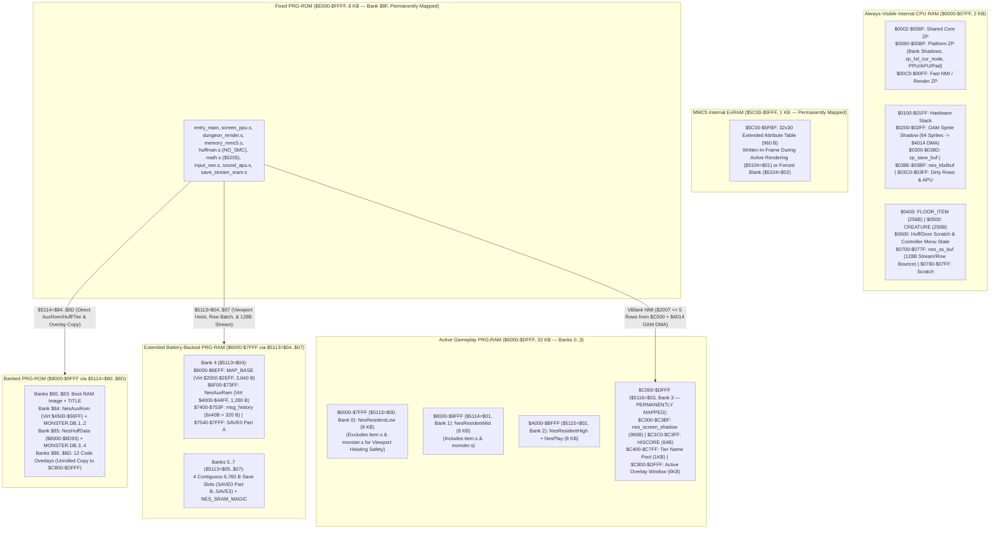

# Moria8 Nintendo Entertainment System (`platforms/nes/`) Port — Architecture & Execution Plan

This document specifies the complete architecture and phased implementation
plan for the Nintendo Entertainment System (`platforms/nes/`) port of Moria8,
incorporating all findings from the Staff Engineering, Engineering Management,
and 6502 / NES Performance reviews. Where memory bounds, MMC5 banking, or
PPU/APU register ownership are concerned, `docs/NES_MEMORY_CONTRACT.md` is the
authoritative contract.

---

## 1. Design Decisions Summary (Locked In)

| Axis | Decision | Rationale |
| --- | --- | --- |
| **Target Hardware & Mapper** | Stock **NTSC NES** (`Ricoh 2A03` @ 1.789773 MHz, `2C02` PPU) with **Nintendo MMC5 (`ExROM` / NES 2.0 Mapper 5)**: `128 KB` PRG-ROM, `64 KB` battery-backed PRG-RAM (`8 × 8 KB`, **NES 2.0 header byte 10 = `$A0`**), `32 KB` CHR-ROM (`8 × 4 KB`), and `1 KB` internal ExRAM (`$5C00-$5FFF`) | MMC5 Extended Attribute Mode (`$5104 = $01`) eliminates 16×16 attribute color clash by giving every individual `8×8` tile its own 2-bit palette and 6-bit 4 KB CHR bank (`0..63`), while 64 KB battery-backed PRG-RAM (`$A0` shift count `10` in MAME `nes_ines.hxx`) hosts `32 KB` of contiguous active gameplay RAM (`$6000-$DFFF`), the live `80×48` dungeon map, writable store/recall tables, and all 4 persistent `6,760`-byte save slots (`SAVE0..SAVE3`) + `HISCORE`. |
| **Directory & Build Targets** | Flat `platforms/nes/` (`make buildnes`, `make disknes`, `make runnes`, `make testnes`, shipping `build/moria8-nes.nes` and release bundle `build/moria8-nes.zip`) | Matches the flat layout and target naming convention of `platforms/apple2/`, `platforms/cx16/`, `platforms/atari8/`, and `platforms/bbcmaster/`. |
| **Visual Presentation (Dual-Mode 8×8 Pixel Art + Classic ASCII Toggle)** | **3-color-per-tile bespoke 8×8 Pixel-Art Mode** (default) with **instantaneous `Select`-button toggle to 12-color Classic ASCII Mode**; **hardware OAM sprites** for menu cursors, look/target reticles, and ranged/magic projectiles | `CHR Bank 3` holds `256` custom 2bpp (`3 colors + black`) pixel-art tiles covering **all 54 unique monster species** (`$80-$B5`), `~25` item icons, `~16` dungeon/town terrain tiles, and the player knight. `CHR Banks 0..2` hold the 128-glyph C64-ordered ASCII font (normal `$00-$7F` + inverse `$80-$FF`) across bitplanes `01`, `10`, and `11`, giving UI text and ASCII Mode **12 independent foreground colors on black** (`4 palettes × 3 sub-colors`) with zero scanline splits. |
| **Zero-Switch Screen Shadow (`$C000-$C3BF`) & In-Frame ExRAM (`$5C00-$5FBF`)** | **`nes_screen_shadow` (`960` B) permanently mapped at `$C000-$C3BF`** in PRG-RAM Bank 3 (`$5116 = $03`); **ExRAM (`$5C00-$5FBF`) written during active rendering (`$5104 = $01`)**; VBlank NMI flushes up to **5 unrolled 32-byte nametable rows/frame (`274` cycles/row)** | Eliminates all bank switching inside `hal_screen_put_char`/`put_string` (preventing caller/string unmapping in `$6000-$7FFF`), respects real MMC5 hardware's active-rendering ExRAM arbitration rule while saving 100% of VBlank budget for `$2007` nametable DMA, and lets the MAME Lua harness read `nes_screen_shadow` (`$C000-$C3BF`) at any CPU cycle. |
| **32×30 Screen Partitioning & Gated `core/` Layout** | **32×30 native PPU nametable** (`80×48` dungeon map = `3,840` B): **4-row Message Bar (`rows 0–3`)**, **30×21 (or 32×21) Dungeon Viewport (`rows 4–24`)**, **4-row Status HUD (`rows 25–28`)**, and **1-row Prompt/Hint Bar (`row 29`)** | Preserves every character of Moria8's user-visible strings (`AGENTS.md` Rule 2) and gates 32-column layout adaptations in `core/` behind compile-time HAL macros (`HAL_LAYOUT_STATUS_SPLIT_STATS`, `HAL_LAYOUT_STORE_WRAP`, `hal_layout_score_width`, `hal_layout_msg_hist_len = 40`) with zero byte/cycle change on the 7 existing ports. |
| **Controller UX & Test Injection (`nes_kbdbuf`)** | **Mystery Dungeon / Dragon Warrior controller UX** (`A` context action, `Start` Pop-up Command Menu, `B` diagonal/run/cancel, `Select` Pixel-Art/ASCII toggle, OAM list cursor, Name Entry grid, Haggle spinner) + unbanked **`nes_kbdbuf` (`$038E-$03BF`)** | Gives players ergonomic 8-button controller navigation while allowing `platforms/nes/harness_smoke.py` to inject PETSCII keys at native RAM speed for the 15 core behavioral scenarios and run 3 dedicated `$4016` joypad UX scenarios. |
| **Storage, Saves, & Release Packaging** | **Battery-backed PRG-RAM (`Banks 4–7`)** holds **4 × `6,760`-byte save slots (`SAVE0..SAVE3`)** (`144` B headroom above the `6,616`-byte `80×48` save stream) streamed via `nes_ss_buf` (`$0700-$077F`), plus `HISCORE` (`$C3C0-$C3FF`); `make disknes` builds `build/moria8-nes.zip` (`moria8-nes.nes` + `LICENSE` + `SOURCE-OFFER`, Rule 7) | Prevents any Tri-Bank lock between `$6000-$7FFF` source data, `MAP_BASE` (virtual `$2000-$2EFF`), and `SAVE0..SAVE3` by staging 128-byte chunks through unbanked `nes_ss_buf` (`$0700-$077F`). |
| **Audio & Hardware Math** | **8 core SFX** synthesized on the **2A03 APU** (`Pulse 1/2`, `Triangle`, `Noise`) + **MMC5 hardware 8×8->16 multiplier (`$5205`/`$5206`)** (`28` cycles vs `185` cycles software) | Accelerates combat, AI distance checks, and store math by **6.6×** while keeping audio deterministic and zero-bloat. |

---

## 2. Memory & MMC5 Banking Architecture

---

## 3. High-Performance PPU / ExRAM Rendering & MMC5 Banking (`< $E000-$FFFF`)

### 3.1 Two-Phase Rendering: In-Frame Shadow/ExRAM Writes + 5-Row VBlank NMI Sled

1. **In-Frame Phase (Active Scanlines `0..239`, `27,280` CPU cycles):**
   * `nes_screen_shadow` (`$C000-$C3BF` in permanently mapped PRG-RAM Bank 3) and
     MMC5 ExRAM (`$5C00-$5FBF`, permanently mapped in Mode `%01`) are **always
     visible in CPU address space**.
   * `hal_screen_put_char`, `hal_screen_put_string`, `hal_screen_clear_row`,
     `render_viewport`, and `status_draw` write character/tile codes directly to
     `nes_screen_shadow` (`$C000 + offset`), write the palette + 4 KB CHR bank
     byte directly to MMC5 ExRAM (`$5C00 + offset`), and set the corresponding
     bit in `nes_dirty_rows_0..3` (`30` bits).
   * Because neither `$5113` nor `$5114` is touched during text writes, string
     pointers in `zp_ptr0` pointing into any resident/overlay/ROM segment
     (`$6000-$FFFF`) never get unmapped.
2. **VBlank NMI Phase (Scanlines `241..260`, `2,273` CPU cycles strict ceiling):**
   * Fixed NMI overhead (`$4014` OAM DMA `514` cycles + prologue/epilogue/scroll
     `72` cycles) leaves **`1,687` CPU cycles** for `$2007` nametable transfers.
   * Each dirty row (`0..29`) is flushed from `$C000 + row*32` to PPU
     `$2000 + row*32` via an unrolled 32-byte load/store sled in **`274` CPU
     cycles** (`16` cycles `$2006` latch + `32 × 8 = 256` cycles transfer + `2`
     cycles clear dirty bit).
   * `nes_nmi_handler` flushes up to **5 dirty rows per VBlank** (`1,370` cycles,
     leaving a `317`-cycle safety margin):
     * 4-row Message Bar (`rows 0–3`) flushes in **1 frame (`16.6 ms`)**.
     * 4-row Status HUD (`rows 25–28`) flushes in **1 frame (`16.6 ms`)**.
     * Full-screen modal transitions disable rendering (`PPUMASK = $00`), switch
       ExRAM to `$5104 = $02`, bulk-fill all 960 nametable and ExRAM bytes in
       **`~4.3 ms`**, and restore `$5104 = $01` before re-enabling `PPUMASK`.

### 3.2 Viewport Bank-Hoisting, Row-Batched LOS/Gen, & Hardware Multiplier

1. **Single-Switch Viewport Hoisting (`14` cycles vs. `95,400` cycles):**
   * `core/item.s` (`floor_item_find_at`) and `core/monster.s`
     (`monster_find_at`) are linked in `NesResidentMid` (`$8000-$9FFF`, Bank 1),
     while `FLOOR_ITEM_BASE` (`$0400`) and `CREATURE_BASE` (`$0500`) live in
     unbanked internal RAM (`$0000-$07FF`).
   * `render_viewport` (in `NesFixedRom` `$E000-$FFFF`) switches `$5113 = $04`
     **once at entry**, reads all `32×21 = 672` map tiles directly from physical
     `$6000-$6EFF` while writing `nes_screen_shadow` (`$C000-$C3BF`) and ExRAM
     (`$5C00-$5FBF`) directly, and restores `$5113 = $00` **once at exit**.
2. **Row-Batched Map Helpers (`HAL_MEMORY_MAP_ROW_HELPER_ENABLED = 1` & `HAL_LAYOUT_DUNGEON_GEN_ROW_BATCHED_MAP = 1`):**
   * `mmu_safe_mark_visited_row_ptr0` marks an entire room row's visibility flags
     under a single `$5113 = $04` switch (`4.2×` faster LOS).
   * `mmu_common_store_map_row` stages an 80-byte map row in `nes_ss_buf`
     (`$0700-$074F`) and writes it to `MAP_BASE` under a single `$5113 = $04`
     switch (`9.6×` faster floor generation).
3. **Direct PRG-ROM Monster Tiers & Unrolled Overlay Copy:**
   * Monster tiers (`MONSTER.DB.1..4`) are read directly from PRG-ROM Banks
     `$84`/`$85` into `CREATURE_BASE` (`$0500`) and `PLATFORM_TIER_NAME_POOL_BASE`
     (`$C400`) without touching the overlay window.
   * Code overlays (`OVL.*`) copy from PRG-ROM Banks `$86..$8D` into
     `$C800-$DFFF` via a 16× unrolled transfer loop in `~27.5 ms` (`< 2` frames).
4. **MMC5 Hardware 8×8->16 Unsigned Multiplier (`$5205`/`$5206`):**
   * `platforms/nes/math_mmc5.s` implements `math_multiply` (`28` cycles vs.
     `185` cycles software, **`6.6×` faster**) and `math_mul_16x8` (`65` cycles
     vs. `400` cycles).

---

## 4. 32×30 Screen Partitioning & Compile-Time Gated `core/` Adaptations

To satisfy `AGENTS.md` Non-Negotiable Rule 2 (zero text truncation) while
guaranteeing **zero byte or behavioral changes on the 7 existing 40/80-column
platforms**, all 32-column adaptations in `core/` are strictly gated by
compile-time HAL macros (defaulting to `0` / 40-col on existing ports):

| `core/` Module | 32-Column Issue Identified in Audit | Compile-Time Gated Solution (`platforms/nes/hal/layout.s`) |
| --- | --- | --- |
| `core/ui_messages.s` | `MSG_HIST_LEN = SCREEN_COLS` would clip >31-char messages in Message Recall | Gate `MSG_HIST_LEN` on `hal_layout_msg_hist_len` (`40` on NES, stored at `$7400-$753F` in Bank 4 via `MSG_HISTORY_IN_AUX = 1`); `screen_ppu.s` maps logical message row `0` -> physical rows `0–1` (`64` chars) and logical row `1` -> physical rows `2–3` (`64` chars) |
| `core/ui_status.s` | `sd_row22_draw` prints all 6 stats (`36+` chars) on a single row without advancing `zp_cursor_row` | Gate on `HAL_LAYOUT_STATUS_SPLIT_STATS = 1`: prints `ST/IN/WI` on `STATUS_ROW + 1` (`row 26`), advances `zp_cursor_row` to `STATUS_ROW + 2` (`row 27`) for `DX/CO/CH`, and draws `HP/MP/AC/AU` on `STATUS_ROW + 3` (`row 28`) |
| `core/ui_store.s` | Single-line item + `USTORE_PRICE_COL` collides on 32 cols, and 12×2 wrapped rows would overlap `msg_tbl_row` (`rows 16–23`) | Gate on `HAL_LAYOUT_STORE_WRAP = 1` with **2-page store pagination (`6 items/page × 2 rows = rows 3–14`, Page 1 = `A–F`, Page 2 = `G–L` via D-Pad Left/Right)**: leaves `rows 15–24` open for Gold (`row 16`), Menu (`row 18`), and Haggle prompts (`rows 20–23`) |
| `core/score.s` | Hard `.assert SDS_LAYOUT_WIDTH <= SCREEN_COLS` (`40 <= 32`) aborts link, and `SDS_HISCORE_PAD_COL = 30` overflows `" LVxx"` | Parameterize `SDS_LAYOUT_WIDTH` via `hal_layout_score_width` (`32` on NES) and `SDS_HISCORE_PAD_COL` via `hal_layout_hiscore_pad_col = 22` |
| `core/royal.s` | `ROYAL_COL_BASE = (SCREEN_COLS - 40) / 2` underflows to `-4` | Parameterize `ROYAL_COL_BASE = 0` when `SCREEN_COLS < 40` and wrap 34-char lines cleanly across 2 rows |
| `core/ui_help.s` | `HELP_FOOTER_MORE_COL = (32 - 34) / 2` underflows; `HELP_LINE_COUNT = 28` overruns 23-line table | Clamp `HELP_LINE_COUNT` to `<= 23` and use `hal_layout_help_footer_col` on 32-column targets |
| `core/ui_character.s` & `core/player_create.s` | `UCHAR_STAT_COL2 = 27` overflows column 31, and `BG_LINE_WIDTH = 38` wraps onto subsequent background lines | Set `hal_layout_character_stat_col0=1, col1=11, col2=21` and gate `BG_LINE_WIDTH = 30` when `SCREEN_COLS < 40` (keeping `BG_LINE_STRIDE = 40` for savefile compatibility); gate `HAL_INPUT_NAME_ENTRY_GRID = 1` in `OVL.START` |
| `core/huffman.s` | Self-modifying `sta hd_cur_node_smc+1` fails in read-only `NesFixedRom` | Gate on `HAL_HUFFMAN_NO_SMC = 1` using `zp_hd_cur_node` in platform ZP |

---

## 5. NES Controller UX & Deterministic Test Injection (`input_nes.s`)

`hal_input_get_key` in `platforms/nes/input_nes.s` (`NesFixedRom`) first checks
the unbanked key queue `nes_kbdbuf_len` (`$038E-$03BF`): if non-zero, it
dequeues the next PETSCII byte immediately (enabling 1500%+ warp-speed MAME test
execution). Otherwise, it polls `$4016` and translates controller actions by
UI context:

| Context | Controller Input | Action / Emitted Keycode |
| --- | --- | --- |
| **Dungeon / Town Exploration** | **D-Pad Cardinal** | Move / attack N, S, E, W (`'k'`, `'j'`, `'l'`, `'h'`) |
| | **Hold `B` + D-Pad** | **Diagonal step** (`'y'`, `'u'`, `'b'`, `'n'`); double-tap `B` + D-Pad to **Run** (`.dir`) |
| | **`A` Button (Context-Sensitive)** | On `<` stairs -> `'<'`; on `>` stairs -> `'>'`; on floor item -> pickup/search `'s'`; adjacent to closed door `+` -> `'o'` + direction; otherwise `'s'` (Search) |
| | **`Start` Button** | Opens the **2-Column Pop-up Command Window** (`Inventory (i)`, `Equipment (e)`, `Magic (m)`, `Quaff (q)`, `Read (r)`, `Use/Zap (u/z)`, `Fire/Throw (f/t)`, `Open (o)`, `Close (c)`, `Disarm (D)`, `Bash (B)`, `Tunnel (T)`, `Look (l)`, `Rest (R)`, `Character (C)`, `Help (?)`, `Save (S)`) |
| | **`Select` Button** | Instantaneous toggle between **8×8 Pixel-Art Mode** and **Classic ASCII Mode** |
| **Modal Menus & Lists** | **D-Pad Up / Down** | Moves the OAM `>` sprite cursor across valid list items |
| | **D-Pad Left / Right** | Page flip (including 2-page Store inventory `A–F` / `G–L`) or Buy/Sell toggle |
| | **`A` / `B` Buttons** | **`A`** emits selected item key (`'a' + idx`, `'1'..'4'`, `'N'`/`'L'`, or `$0D`); **`B`** emits `ESC` (`$1B`) |
| **Character Name Entry** | **D-Pad + `A`/`B`/`Select`/`Start`** | 9×4 on-screen letter grid (`A-Z`, space, `DEL`, `END`, hosted in `OVL.START`); **`A`** types letter, **`B`** backspaces (`$14`), **`Select`** generates a random fantasy name, **`Start`** confirms (`$0D`) |
| **Store Haggling** | **D-Pad + `A`/`B`** | **`A`** submits/accepts current offer (`$0D`); **D-Pad Up/Down** adjusts offer spinner (hosted in `OVL.TOWN`) |

---

## 6. Six-Milestone Implementation & Verification Plan

Following the proven milestone structure from `docs/ATARI8_PORT_PLAN.md` and
`docs/BBCMASTER_PORT_PLAN.md`, MAME runtime verification comes online in
**Milestone 1** so no phase ever flies blind:

1. **Milestone 0 — Contracts, 13-Script HAL Checker Registration, & Pure-Python ROM/CHR Tooling:**
   * Register `nes` across all 13 static checkers (`check_hal_boundaries.py`,
     `check_hal_manifests.py`, `check_hal_layout_exports.py` with
     `VIEWPORT_X=1, VIEWPORT_Y=4, VIEWPORT_W=30, VIEWPORT_H=21`,
     `check_hal_screen_exports.py`, `check_hal_input_exports.py`,
     `check_hal_sound_exports.py`, `check_hal_storage_exports.py`,
     `check_hal_asset_exports.py`, `check_hal_entropy_exports.py`,
     `check_hal_memory_bank_exports.py`, `check_hal_lifecycle_exports.py`,
     `check_zp_usage.py`, and `check_6502_lint.py`).
   * Build `tools/make_nes_chr.py --selftest` (embedded C64 ASCII font bitplanes
     `CHR Banks 0..2` + initial tile/sprite banks, zero external file paths per
     Rule 9), `tools/make_nes_rom.py --selftest` (NES 2.0 Mapper 5 `.nes` +
     Rule 7 `.zip` bundler with byte 10 = `$A0`), and
     `platforms/nes/check_memory_contract.py --selftest`.
   * **Gate:** `make check-hal-boundaries`, `make check-zp`, tool `--selftest`s,
     and all 7 existing platform builds pass.
2. **Milestone 1 — Full Product Link, Cold Boot, 4-Page NMI Sled Renderer, & MAME `boot_title`:**
   * Implement `platforms/nes/main.s` (routing cold modules `player_create.s`,
     `royal.s`, `ui_wizard.s`, `chest_loot.s`/`cmd_jam`/`door_pick`, and
     `ui_recall.s`/`player_magic_earthquake.s` into overlays so `$6000-$BFFF`
     has `~2.5 KB` of resident slack), `memory.s` (`SCREEN_RAM = nes_ss_buf`),
     `memory_mmc5.s`, `screen_ppu.s` (4-page `flush_sled_c0..c3` dispatcher,
     `290` cycles/row), and gated 32-column `core/` macros.
   * Bring up `platforms/nes/harness_smoke.py` driving headless `mame nes -cart`
     and inspecting `nes_screen_shadow` at `$C000-$C3BF`.
   * **Gate:** `boot_title` passes in headless MAME `< 10s` + full `make test`
     regression gate green across all existing ports.
3. **Milestone 2 — Character Creation, Town Viewport, & 2-Page Store Modals (`chargen_town`):**
   * Implement `dungeon_render.s` (single-switch viewport hoisting, dirty-cell
     comparison against `nes_screen_shadow` for 1-frame 60 Hz step updates,
     4-row wrapped message bar, and 4-row Status HUD) and `input_nes.s`
     (`nes_kbdbuf` + modal list cursor + 2-page store flip).
   * **Gate:** `chargen_town`, `store_buy_sell`, and `inventory_equip` MAME
     scenarios pass.
4. **Milestone 3 — Dungeon Generation, LOS, Overlays, Monster Tiers, & 2A03 APU Audio:**
   * Enable row-batched LOS/generation helpers (`mmu_safe_mark_visited_row_ptr0`,
     `mmu_common_store_map_row`), MMC5 hardware multiplier (`math_mmc5.s`), and
     the 8 core SFX in `sound_apu.s`.
   * **Gate:** Dungeon descent, combat, magic, chest, and modal scenarios pass
     in MAME.
5. **Milestone 4 — Battery-Backed 64 KB SRAM Save Engine (`SAVE0..SAVE3` & `HISCORE`):**
   * Implement `storage_sram.s` and `save_stream_sram.s` (128-byte `nes_ss_buf`
     streaming into `4 × 6,760` B slots across PRG-RAM Banks 4–7 with
     `HAL_PLATFORM_AUX_PERSISTENT_DATA = 1` and `HAL_STORAGE_SAVE_BLOCK_MODE_HOOK = 1`,
     plus `"M8SV"`-guarded `HISCORE` preservation at `$C3C0-$C3FF`).
   * Verify MAME `.nv` NVRAM persistence across clean `manager.machine:exit()`
     restarts in isolated per-test `tempfile.TemporaryDirectory()` NVRAM paths.
   * **Gate:** `save_load_roundtrip` and `death_hiscore` MAME scenarios pass.
6. **Milestone 5 — Bespoke 95+ Tile 8×8 Pixel-Art Set (`CHR Bank 3`), Controller UX Polish, & Release Packaging:**
   * Populate `CHR Bank 3` in `tools/make_nes_chr.py` with the full 3-color 8×8
     pixel-art set (all 54 monster species `$80-$B5`, ~25 items, ~16 terrain
     tiles, player knight) and `CHR Bank 4` OAM sprites; verify `Select`
     Pixel-Art/ASCII toggle and the 3 dedicated `$4016` controller UX scenarios
     (`test_controller_menu`, `test_name_entry`, `test_haggle`).
   * Wire `make buildnes`, `make disknes`, `make runnes`, and `make testnes` into
     the root `Makefile`.
   * **Gate:** Full 18-scenario `make testnes` suite + full `make test` pass.
