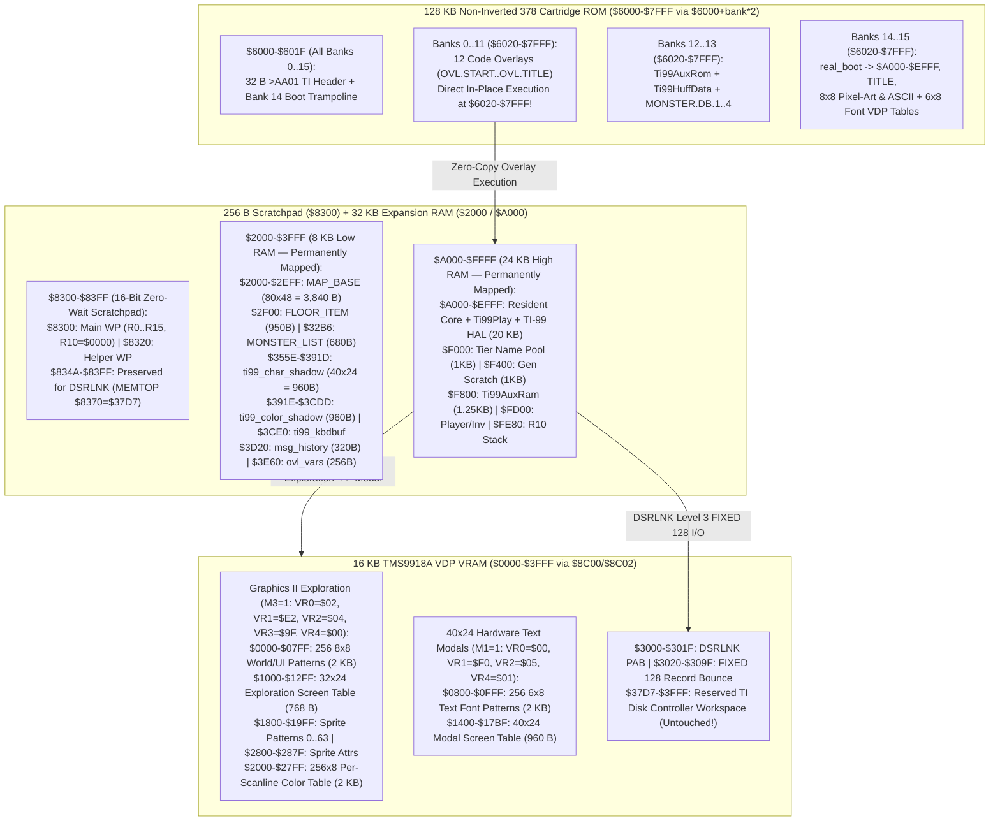

# Moria8 Texas Instruments TI-99/4A (`platforms/ti99/`) Port — Architecture & Execution Plan

This document specifies the complete architecture and phased implementation
plan for the Texas Instruments TI-99/4A (`platforms/ti99/`) port of Moria8.
Where `TMS9900` memory bounds, `$8300-$83FF` Scratchpad workspaces, `$6000`
`378` cartridge banking, `TMS9918A` VDP VRAM layout, or `DSRLNK` disk safety
are concerned, `docs/TI99_MEMORY_CONTRACT.md` is the authoritative contract.

---

## 1. Design Decisions Summary (Locked In)

| Axis | Decision | Rationale |
| --- | --- | --- |
| **Target Hardware, Cartridge, & Storage** | Standard **TI-99/4A (`3.0 MHz` 16-bit `TMS9900`)** + **`32 KB` Memory Expansion (`$2000-$3FFF` + `$A000-$FFFF`)** + **`128 KB` Non-Inverted (`378` / `FinalGROM99` / MAME `paged378`) Banked ROM Cartridge (`$6000-$7FFF`, `16 × 8 KB` banks)** + **Standard TI Floppy Drive (`DSK1` `.dsk` via `DSRLNK`)** for saves | Matches the standard enthusiast TI-99/4A setup and MAME (`mame ti99_4a -cart moria8-ti99.rpk -ioport peb -ioport:peb:slot2 32kmem -ioport:peb:slot8 tifdc -flop1 moria8-ti99-saves.dsk`). Every bank (`0..15`) carries a 32 B `$6000-$601F` `>AA01` boot trampoline (`CLR @$601C; B @real_boot`) for deterministic power-on boot; all 12 overlays execute **directly in-place from `$6020-$7FFF` Cartridge ROM** (`Banks 0..11`) with zero disk seeks during play, while `DSK1` stores `SAVE0..SAVE3`, `HISCORE`, `LICENSE`, and `SRCOFFR` via chunked Level 3 `FIXED 128` records (`$3020-$309F`). |
| **Core Track & Toolchain (`core_tms9900/` + `xdt99`)** | **Deferred until the 6502 `core/` track is playtest-complete**; authored in `TMS9900` assembly (`core_tms9900/`) using the **100% pure-Python `xdt99` (`xas99.py`, `xdm99.py`, `xhm99.py`)** toolchain | Exploits the `TMS9900`'s sixteen 16-bit registers (`R0..R15` in zero-wait-state `$8300-$83FF` Scratchpad RAM, with `R10 = $0000` pre-decrement call stack at `$FE80-$FFFF` and strict MSB byte-instruction discipline), hardware 16×16 multiply (`MPY`) and 32÷16 divide (`DIV`), and 16-bit indexed addressing (`@MAP_BASE(R1)`), with zero external C/Java toolchain dependencies. |
| **Dynamic Dual-Mode `TMS9918A` VDP (`32×24` Graphics II Exploration + Instant `40×24` Hardware Text Modals!)** | **Exploration Mode (`Graphics II`, `M3 = 1`, `VR0=$02, VR1=$E2, VR2=$04, VR3=$9F, VR4=$00`):** `32×24` tiles (`256×192`) with our `20×19` **`8×8` 16-color Pixel-Art / Classic ASCII Viewport** (`2` independent colors per `8×1` scanline row of every tile!), `12×19` Left Stat Sidebar, and `32×5` Bottom Message Box. **Modal Mode (`Text Mode`, `M1 = 1`, `VR0=$00, VR1=$F0, VR2=$05, VR4=$01`):** Native **`40×24` (`6×8` font) Hardware Text Mode**! | Keeping both screen tables (`$1000` and `$1400`) and both pattern tables (`$0000` `8×8` tiles and `$0800` `6×8` font) resident in `16 KB` VDP VRAM simultaneously means opening/closing **Inventory, Equipment, Character Sheet, Town Stores, Help, or High Scores** is an **instant 5-register VDP flip (`0` font reloads and `0` viewport redraws!)**, rendering full 40-column computer modals with **zero pagination and zero text truncation (`AGENTS.md` Rule 2)**! |
| **Dual Input UX (`48-Key TI Keyboard + Joystick 1 + ti99_kbdbuf`)** | Full standard Moria8 computer keyboard (`a–z`, `A–Z`, `0–9`, `hjklyubn`, `FCTN-E/S/D/X` arrows, `FCTN-9` Back/Esc, `FCTN-=` / `Tab` Pixel-Art/ASCII toggle) **plus** simultaneous **Joystick 1 (`CRU $0024`, with Row 5 Alpha Lock diode isolation) + Pop-up Command Menu** support and unbanked **`ti99_kbdbuf` (`$3CE0-$3D1F`)** | Gives keyboard players the full computer Moria experience, gives joystick players the streamlined console UX (`Fire` = context action, `Tab`/`FCTN-7` = Command Menu), and lets the MAME Lua harness inject keys into `$3CE0` and inspect `ti99_char_shadow` (`$355E-$391D`, `40×24` C64 screen codes) at warp speed. |
| **Audio & Verification (`SN76489` + `TI99ROMS`)** | **8 core SFX** on the **`TMS9919` / `SN76489` PSG (`$8400`)** (shared 1:1 with `platforms/bbcmaster/sound_sn76489.s`!) + headless **MAME (`mame ti99_4a`)** runtime suite (`TI99ROMS ?=` checking both `ti99_4a.zip` and `ti99_fdc.zip`, graceful skip with `exit 0` when unset per Rules 8 & 9) + `build/moria8-ti99.zip` (`moria8-ti99.rpk`, `moria8-ti99_8.bin`, `moria8-ti99-saves.dsk` carrying `LICENSE`/`SRCOFFR`, plus top-level `LICENSE` & `SOURCE-OFFER`, Rule 7) | Reuses our proven BBC Master `SN76489` sound tables directly and verifies all 18 runtime scenarios well under the 30-second cap (`AGENTS.md` Rule 8). |

---

## 2. Memory, `378` Cartridge, Scratchpad, & Dual-Mode `TMS9918A` Architecture



---

## 3. Dynamic Dual-Mode `TMS9918A` VDP Renderer (`screen_vdp.asm`, `dungeon_render.asm`)

### 3.1 How Instant Register-Flip Mode Switching Works

Because `16 KB` of VDP VRAM (`$0000-$3FFF`) is completely separate from CPU
RAM, `boot_init` preloads both the **`8×8` Graphics II tables** (`$0000-$07FF`
Pattern + `$2000-$27FF` Per-Scanline Color) and the **`6×8` Hardware Text Mode
font** (`$0800-$0FFF`) once at startup:

| Screen State | Active VDP Mode | VDP Register Configuration | Active Screen Table | Active Pattern / Color Tables |
| --- | --- | --- | --- | --- |
| **Dungeon & Town Exploration (`32×24`)** | **Graphics II (`M3 = 1, M2 = 0`, Masked 1-Bank)** | `VR0 = $02`, `VR1 = $E2`, `VR2 = $04`, `VR3 = $9F`, `VR4 = $00`, `VR5 = $50`, `VR6 = $03`, `VR7 = $01` | `$1000-$12FF` (`32×24 = 768` B) | Patterns: `$0000-$07FF` (`2 KB`); Colors: `$2000-$27FF` (`2 KB`, 2 colors per `8×1` scanline row); Sprites: `$1800-$19FF` (`Indices 0..63`) |
| **Full-Screen Modals & Title (`40×24`)** | **Hardware Text Mode (`M1 = 1`, `6×8` Cells)** | `VR0 = $00`, `VR1 = $F0`, `VR2 = $05`, `VR4 = $01`, `VR7 = $F1` (White on Black) | `$1400-$17BF` (`40×24 = 960` B) | Patterns: `$0800-$0FFF` (`2 KB` C64-screen-code-ordered `6×8` font); Sprites automatically hidden by `M1 = 1` |

* **Zero-Redraw Modal Transitions:**
  * Opening Inventory (`i`), Equipment (`e`), Character Sheet (`c`), Town Stores,
    Help (`?`), or High Scores writes the 40-column text into `ti99_char_shadow`
    (`$355E-$391D`), streams dirty rows into `$1400-$17BF` (`VR2 = $05`), and
    flips `{VR0, VR1, VR2, VR4, VR7}` into **`40×24` Hardware Text Mode**.
  * Closing the modal flips `{VR0, VR1, VR2, VR4, VR7}` back to **`32×24`
    Graphics II Mode**, instantly uncovering the intact `$1000-$12FF` dungeon
    screen and `$0000`/`$2000` world tiles in **1 VBlank (`0` tile redraws!)**.
* **Hardware-Safe Pixel-Art ↔ Classic ASCII Toggle (`Tab` or `FCTN-=`):**
  * Pressing `Tab` or `FCTN-=` during exploration streams the `96` world tile
    patterns (`Tiles 32..127` = `768` pattern bytes + `768` color bytes = `1,536` B)
    from Cartridge ROM Bank 15 (`$6020`) to `$0100-$03FF` and `$2100-$23FF`
    while the screen is briefly blanked across 1 VBlank (`VR1 bit 6 = 0`, where
    the VDP write window is `2.0 µs`, safely accommodating a `7.33 µs/byte`
    unrolled `MOVB *R1+, *R2` burst in **`~11 ms`**; active-display updates use
    the `16.67 µs/byte` looped transfer so the `8.0 µs` active VDP window is
    never overrun).

### 3.2 `TMS9918A` 16-Color Per-Scanline Shading (`8` Color Bytes per `8×8` Tile)

Unlike the NES (where an entire `16×16` pair of tiles shares 1 palette), the
`TMS9918A` in Graphics II mode gives **every individual `8×1` scanline row of
every `8×8` tile its own independent Foreground + Background color byte** from
the 16-color hardware palette:

* **Player Knight (`@`):** White/Cyan helmet (`rows 0–2`), Light Blue steel
  cuirass (`rows 3–5`), Gold belt/sword hilt (`row 6`), Silver boots (`row 7`)
  — **4 distinct colors inside a single `8×8` tile without using sprites!**
* **Dungeon Torch Wall (`#`):** Warm Yellow/Orange flame glow on upper brick
  rows (`rows 0–2`) transitioning to Dark Red/Grey mortar on lower rows
  (`rows 3–7`), while out-of-LOS remembered walls use Dark Blue (`$41`) tiles.
* **Potions (`!`), Scrolls (`?`), & Chests (`&`):** Cork/Gold top (`rows 0–1`)
  + Cyan/Magenta/Green liquid body (`rows 2–7`).

---

## 4. Exploration (`32×24`) & Unpaginated Modal (`40×24`) Screen Layouts

### 4.1 `32×24` Graphics II Exploration Layout (`$1000-$12FF`)

Matches the proven **NES `32×24` Split-Screen Layout** (`12×19` Left Stat
Sidebar + `20×19` `8×8` Pixel-Art/ASCII Viewport + `32×5` Bottom Message Box),
while mirroring all text/tile updates into the authoritative `40×24`
`ti99_char_shadow` (`$355E-$391D`) so the MAME Lua harness can inspect both
exploration and modal screens at fixed CPU addresses:

```text
+------------+--------------------+
|FRODO       |                    |  Rows 0..18:
|HOBBIT      |                    |  - Cols 0..11 (12x19): Compact Stat Sidebar
|MAGE        |                    |    (Name, Race, Class, LV, DL, 6 Stats,
|LV:12 DL:05 |   20 x 19 TILES    |     HP, MP, AC, Gold, Status Flags)
|STR:14      |  DUNGEON VIEWPORT  |  - Cols 12..31 (20x19): 8x8 Pixel-Art /
|INT:18/40   |  (16-Color Scanline|    Classic ASCII Dungeon Viewport +
|WIS:12      |   Shaded Tiles!)   |    Hardware Sprites (Look Cursor, Bolts)
|DEX:16      |                    |
|CON:15      |         @          |
|CHR:11      |                    |
|HP: 142/142 |                    |
|MP:  34/ 34 |                    |
|AC:  28     |                    |
|AU: 12450   |                    |
|HUNGRY SRCH |                    |
+------------+--------------------+
|You hit the Green Naga.          |  Rows 19..23 (32x5):
|The Green Naga spits acid!       |  - 4-Line Wrapping Message Log + Prompt
|[MORE] Press Space / Fire        |
+---------------------------------+
```

### 4.2 Native `40×24` Hardware Text Modals (`$1400-$17BF` — Zero Pagination!)

Because Hardware Text Mode (`M1 = 1`) provides **40 columns × 24 rows (`40×24`)**,
every 40-column Moria8 modal screen (**Inventory `a–v`**, **Equipment `a–l`**,
**Spell Selection**, **Character Sheet `ui_character`**, **Town Stores**,
**Victory Scroll**, **Help**, and **High Scores**) renders on a **single
unpaginated screen** (matching Commander X16 and BBC Master 128 vertical height
`SCREEN_ROWS = 24` and C64/Atari 8-bit horizontal width `SCREEN_COLS = 40`!).

---

## 5. Six-Milestone Implementation Plan (Post-6502 Track Completion)

1. **Milestone 0 — `core_tms9900/` Macro/Workspace Contract, Pure-Python `xdt99` Pipeline, & VDP Asset Builder:**
   * Vendor or detect `xdt99` (`XAS99 ?= xas99.py`, `XDM99 ?= xdm99.py`,
     `XHM99 ?= xhm99.py`, `TI99ROMS ?=` empty default per Rule 9, all build
     outputs isolated in `build/ti99/` per Rule 6, isolated from 6502 static
     linters) and define `SET_VDP_WRITE_ADDR` / register-MSB macros in
     `platforms/ti99/macros.inc`.
   * Build `tools/make_ti99_assets.py --selftest` (generating the `256`-tile
     `8×8` Pixel-Art & Classic ASCII pattern/color tables, the C64-ordered `6×8`
     Text Mode font, and Sprite Patterns `0..63`) and
     `platforms/ti99/check_memory_contract.py --selftest`.
2. **Milestone 1 — `378` (`paged378`) Cartridge Boot, Dual-Mode `TMS9918A` VDP Engine, & MAME `boot_title`:**
   * Implement `platforms/ti99/cart_header.asm` (placing the 32 B `>AA01`
     trampoline at `$6000-$601F` in all 16 banks `0..15`, copying `20 KB`
     Resident+Play to `$A000-$EFFF`, initializing `R10 = $0000`, and preloading
     VDP VRAM `$0000-$287F`), `screen_vdp.asm` (`ti99_char_shadow` at `$355E`
     with `row < 24` clamp + instant register-flip switching between `32×24`
     Graphics II `M3 = 1` and `40×24` Text Mode `M1 = 1`), `layout.xml`
     (`<pcb type="paged378">`), and `platforms/ti99/harness_smoke.py`
     (`mame ti99_4a -cart moria8-ti99.rpk -ioport peb -ioport:peb:slot2 32kmem -ioport:peb:slot8 tifdc -flop1 moria8-ti99-saves.dsk`,
     checking `TI99ROMS` for both `ti99_4a.zip` and `ti99_fdc.zip` and gracefully
     skipping with exit `0` when absent per Rules 8 & 9).
   * **Gate:** `boot_title` passes in headless MAME `< 10s` when `TI99ROMS` is set.
3. **Milestone 2 — `20×19` Graphics II Viewport, `40×24` Unpaginated Modals, & `CRU` Input:**
   * Implement `dungeon_render.asm` (`MAP_BASE` at `$2000`, `Tab`/`FCTN-=`
     blanked-VBlank Pixel-Art/ASCII toggle), `input_cru.asm` (`TMS9901` keyboard
     scan + Joystick 1 with Row 5 Alpha Lock diode isolation + `ti99_kbdbuf` at
     `$3CE0`), and the `40×24` Text Mode modals.
   * **Gate:** `chargen_town`, `store_buy_sell`, and `inventory_equip` MAME
     scenarios pass.
4. **Milestone 3 — `core_tms9900/` Dungeon Engine, In-Place `$6020` Overlays, & `SN76489` Audio:**
   * Wire `$6020-$7FFF` Cartridge Banks `0..13` (12 in-place overlays with
     unbanked `ovl_vars` at `$3E60-$3F5F` + `Ti99AuxRom`/`Ti99HuffData`) and
     `sound_sn76489.asm` (`$8400` PSG sharing the BBC Master 8-SFX tables).
   * **Gate:** Dungeon descent, combat, magic, chest, and modal scenarios pass.
5. **Milestone 4 — `DSRLNK` Level 3 `FIXED 128` Floppy Save Engine (`DSK1.SAVE0..3` & `DSK1.HISCORE`):**
   * Implement `storage_dsr.asm` (preserving `$834A-$83FF` Scratchpad and
     `$37D7-$3FFF` VDP workspace, streaming `52 × 128 B` `INTERNAL, FIXED 128`
     records via PAB at `$3000` and record buffer at `$3020-$309F`) and verify
     persistence on `moria8-ti99-saves.dsk` across MAME restarts.
   * **Gate:** `save_load_roundtrip` and `death_hiscore` pass in MAME.
6. **Milestone 5 — Joystick Pop-up Menu UX & Shipping Release Bundle:**
   * Verify keyboard and joystick scenarios and package `build/moria8-ti99.zip`
     (`moria8-ti99.rpk` + `moria8-ti99_8.bin` + `moria8-ti99-saves.dsk` carrying
     `LICENSE` and `SRCOFFR` as `DISPLAY VARIABLE 80` files + top-level
     `LICENSE` + `SOURCE-OFFER`, Rule 7).
