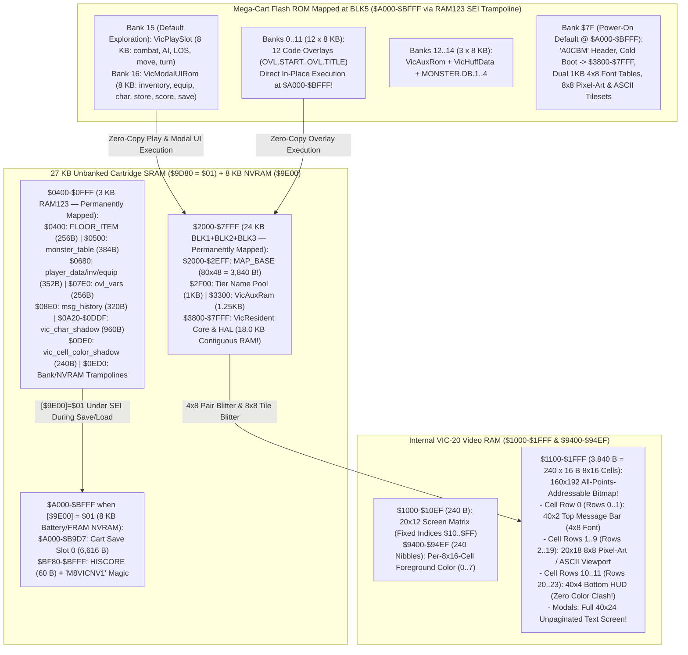

# Moria8 Commodore VIC-20 (`Mega-Cart`, `platforms/commodore/vic20/`) Port — Architecture & Execution Plan

This document specifies the complete architecture and phased implementation
plan for the Commodore VIC-20 (`Mega-Cart`, `platforms/commodore/vic20/`) port
of Moria8. Where `RAM123`/`BLK1..3`/`BLK5` memory bounds, `Mega-Cart` `$9C80-$9E00`
banking registers, VIC-I (`6560`/`6561`) `$1000-$1FFF` bitmap ownership, or
zero-page/KERNAL/VIA rules are concerned, `docs/VIC20_MEMORY_CONTRACT.md` is
the authoritative contract.

---

## 1. Design Decisions Summary (Locked In)

| Axis | Decision | Rationale |
| --- | --- | --- |
| **Target Hardware & Cartridge Architecture** | Stock **Commodore VIC-20 (`MOS 6502`, `6560` NTSC / `6561` PAL VIC-I)** with a **`Mega-Cart` (`cartconv -p -t mega`, `xvic -cartcrt`)**: provides **`27 KB` linear Cartridge SRAM (`$0400-$0FFF` + `$2000-$7FFF`)**, **`8 KB` switchable Flash ROM window at `BLK5` (`$A000-$BFFF`, `128` banks)**, and **`8 KB` Battery/FRAM NVRAM** | Manufacturable as a physical 4-chip 5V PCB (`~$4.50` BOM: Flash + `32 KB` SRAM/FRAM + `74HCT374` + `74HCT138`, zero CPLDs) that automatically upgrades any unexpanded `5 KB` VIC-20 to full `32 KB` linear RAM, while running natively on **Penultimate+2/3**, **BackBit**, **MiSTer FPGA**, and **VICE (`xvic` — zero external ROMs required!)**. |
| **Core Track Reuse & `34 KB` Banked Code Capacity (`core/` + `platforms/commodore/common/`)** | Links the **unmodified 6502 `core/`** and shared **`platforms/commodore/common/`** with **Kick Assembler** (sequencing implementation after the active 6502 playtest track freezes) | Combines **`18.0 KB` `VicResident` in contiguous SRAM (`$3800-$7FFF`)** with **`8.0 KB` `VicPlaySlot` in `BLK5` ROM Bank 15 (`$A000-$BFFF`, mapped during exploration)** and **`8.0 KB` `VicModalUIRom` in `BLK5` ROM Bank 16** (`34.0 KB` total Resident/Play/UI code capacity, plus `96 KB` across 12 in-place Overlay Banks `0..11`), while `MAP_BASE` (`$2000-$2EFF`, `3,840` B) stays permanently mapped in `BLK1`. |
| **`160×192` VIC-I Double-Height Bitmap (`40×24` `4×8` Text + `20×18` `8×8` Tiles!)** | Sets VIC-I (`$9005 = $CC`, `$9002 = $14` `[20 cols, bit 7 = 0]`, `$9003 = $19`, auto-centered for NTSC/PAL) to **`20 columns × 12 rows` of `8×16` double-height characters**: `$1000-$10EF` (`240` B Screen Matrix = indices `16..255`) + **`$1100-$1FFF` (`3,840` B = `160×192` bitmap)** + `$9400-$94EF` (`240` Color Nibbles) | Gives a stock VIC-20 an exact **`160×192` pixel bitmap** (`40 columns × 24 rows` of `4×8` condensed characters, or `20 columns × 24 rows` of `8×8` world tiles) inside `$1000-$1FFF` with zero overlap! Every 40-column Moria8 string and modal renders at **`40×24` with zero modal pagination and zero text truncation (`AGENTS.md` Rule 2)**! |
| **Even-Cell-Aligned `40×24` Exploration Layout (`2` Msg + `20×18` Viewport + `4` HUD)** | **Cell Row `0` (`Rows 0–1`, `2 × 40` chars):** Fixed 2-row Top Message Bar. **Cell Rows `1..9` (`Rows 2–19`, `20×18` `8×8` tiles):** Dungeon / Town Viewport (shared NES/GBC `8×8` Pixel-Art tileset + `F1` toggle to `8×8` Classic ASCII!). **Cell Rows `10..11` (`Rows 20–23`, `4 × 40` chars):** 4-Row Bottom HUD (`Name/Race/Class/LV/DL`, all 6 stats `STR..CHR`, `HP/MP/AC/AU`, and `Status/Depth`) | Aligning the Message Bar (`Cell Row 0`), `20×18` Viewport (`Cell Rows 1..9`), and 4-Row HUD (`Cell Rows 10..11`) to exact `8×16` cell boundaries **completely eliminates Color RAM cross-talk** between the dungeon viewport and HUD text! |
| **Dual Save Backend (`8 KB` Mega-Cart NVRAM + `1541` `.d64` IEC Floppy)** | **Diskless Mode:** Instant saves to the `8 KB` Mega-Cart NVRAM (`Cart Slot 0` `6,616` B at `$A000-$B9D7` + `HISCORE` at `$BF80-$BFFF` via `-mcnvramfile` / `-mcnvramwriteback`). **Floppy Mode:** 4 standard save slots (`SAVE0..SAVE3`) + `HISCORE` on `Drive 8–11` (`.d64`) via Commodore KERNAL IEC | Works out of the box on a bare diskless VIC-20 console with a Mega-Cart, while also supporting standard 1541 / SD2IEC floppy drives using our proven C64/Plus/4 IEC storage routines. |
| **Input (`VIA2 PB7` Isolated), 4-Voice VIC-I Audio, & `xvic` Verification** | Full VIC-20 keyboard (`KEYD` `$0277` / `NDX` `$00C6` + `F1` Pixel-Art/ASCII toggle) + Joystick (`$9111`/`$9120` with `SEI` + `VIA2 DDRB` bit 7 input isolation + Pop-up Command Menu) + **8 core SFX on the 4-voice VIC-I (`$900A-$900E`)** + headless **`xvic -remotemonitor`** suite | Reuses our VICE remote-monitor harness infrastructure directly (inspecting `vic_char_shadow` at `$0A20-$0DDF` and injecting into `KEYD` `$0277`) with zero external ROM dependencies, and ships `build/moria8-vic20.zip` (`moria8-vic20.crt`, `moria8-vic20.bin`, `moria8-vic20-saves.d64` with `license,s`/`source-offer,s`, and `LICENSE`/`SOURCE-OFFER`, Rule 7). |

---

## 2. Memory, `Mega-Cart` Banking, & VIC-I `160×192` Bitmap Architecture



---

## 3. Dual-Density VIC-I `160×192` Bitmap Renderer (`screen_vic.s`, `dungeon_render.s`)

### 3.1 How `$1000-$1FFF` Provides Both `40×24` Text and `20×18` `8×8` Tiles with Zero Overlap

1. **Zero-Overlap `$1000-$1FFF` Memory Partitioning (`$9005 = $CC`, `$9002 = $14`):**
   * On the `6560`/`6561` VIC-I, setting `$9005 = $CC`, `$9002 = $14` (`20`
     columns, bit `7 = 0` so Screen Matrix is `$1000` and Color RAM is `$9400`),
     and `$9003 = $19` (`12` double-height `8×16` rows) places both the Screen
     Matrix base and the `8×16` Character Generator base at `$1000`.
   * At boot, `screen_init` detects NTSC (`6560`: `$9000 = 6, $9001 = 18`) vs.
     PAL (`6561`: `$9000 = 14, $9001 = 32`) for centered CRT geometry and fills
     the `240`-byte Screen Matrix at **`$1000-$10EF`** with character indices
     **`16..255` (`$10..$FF`)**.
   * Because character indices `0..15` span `$1000-$10FF` (`256` B), the `240`
     active `8×16` bitmap cells (`indices 16..255`) occupy **`$1100-$1FFF`
     (`240 × 16 = 3,840` B)** — completely disjoint from the Screen Matrix at
     `$1000-$10EF`!
2. **Row-to-Bitmap Address Mapping (`24` Rows of `8` Scanlines):**
   * Each `8×16` cell `(cell_col = 0..19, cell_row = 0..11)` at
     `$1100 + (cell_row * 20 + cell_col) * 16` contains **two vertically stacked
     `8×8` tiles**:
     * **Even Row (`row = cell_row * 2`, `0..22`):** bytes `0..7` of the cell.
     * **Odd Row (`row = cell_row * 2 + 1`, `1..23`):** bytes `8..15` of the cell.
   * **40-Column `4×8` Text Blitter (`2` Chars per `8×8` Half-Cell):**
     * Uses the dual pre-shifted `1 KB` `font_4x8_left` (`$F0` upper nibble) and
       `font_4x8_right` (`$0F` lower nibble) tables:
       ```assembly
       // Blit two adjacent 4x8 characters (left_ch, right_ch) into 8 bitmap bytes:
       ldy #7
       !loop:
           lda (zp_font_left_ptr),y    // Upper nibble ($F0)
           ora (zp_font_right_ptr),y   // Lower nibble ($0F)
           sta (zp_vram_cell_ptr),y    // Write directly to $1100..$1FFF!
           dey
           bpl !loop
       ```
     * Including zero-page pointer setup (`~24` cycles) and the 8-byte loop
       (`167` cycles), blitting a `4×8` character pair takes **`~190` CPU cycles
       (`~185 µs`)**, and rendering a full `40×24` modal screen (`480` pairs)
       takes **`~85 ms` (`4–5` frames)**!
   * **`20×18` `8×8` Dungeon Tile Blitter & Vertical Pair Color Arbitration (`Rows 2–19`):**
     * Copies `8` bytes directly from the active `8×8` tileset (`Pixel-Art` or
       `Classic ASCII`, toggled via `F1`) into the target `8×8` half-cell in
       `$1100-$1FFF`.
     * Because each `8×16` cell (`Cell Rows 1..9`) holds two vertically adjacent
       `8×8` viewport tiles (`even_row` and `odd_row`) that share one Color RAM
       nibble at `$9400 + cell_row * 20 + cell_col`, `dungeon_render.s` selects
       the cell color using the deterministic priority rule:
       `Player (@) > Awake Monster > Asleep Monster > Floor Item / Chest > Door / Stairs / Trap > Lit Wall / Floor > Remembered Dim Wall`.

---

## 4. `40×24` Exploration & Unpaginated Modal Layouts (`SCREEN_COLS = 40`, `SCREEN_ROWS = 24`)

### 4.1 Even-Cell-Aligned Exploration Screen (`Rows 0–23` Across `160×192`)

```text
+----------------------------------------+
|Row 0: Message Line 0 (40 chars @ 4x8)  | <-- Cell Row 0 (Rows 0..1):
|Row 1: Message Line 1 / -more- (40 ch)  |     Top 2-Row Message Bar (White)
+----------------------------------------+
|                                        |
|       Rows 2..19 (20 x 18 Tiles)       | <-- Cell Rows 1..9 (Rows 2..19):
|      (8x8 Pixel Art / ASCII via F1)    |     20x18 Dungeon / Town Viewport
|                                        |     (Zero Cell Overlap with HUD!)
+----------------------------------------+
|Row 20: Frodo  Hobbit Mage  LV:12 DL:05 | <-- Cell Rows 10..11 (Rows 20..23):
|Row 21: ST:14 IN:18 WI:12 DX:16 CO:15 CH|     4-Row 40-Column Bottom HUD
|Row 22: HP:142/142 MP:34/34 AC:28 AU:850|     (Identity, 6 Stats, Vitals, and
|Row 23: State: Hungry  Search  Infra    |      Active Status Flags!)
+----------------------------------------+
```

### 4.2 Unpaginated `40×24` Modal Screens (`Zero Pagination!`)

Because the `4×8` dual-character blitter provides **40 columns × 24 rows
(`40×24`)** across the `160×192` bitmap, **every single 40-column Moria8 modal
screen** (**Inventory `a–v`**, **Equipment `a–l`**, **Spell Selection**,
**Character Sheet `ui_character`**, **Town Stores**, **Victory Scroll**,
**Help**, and **High Scores**) renders on **1 unpaginated screen** with zero
text wrapping or truncation (`AGENTS.md` Rule 2)!

---

## 5. Six-Milestone Implementation Plan (Post-6502 Track Completion)

1. **Milestone 0 — `Mega-Cart` Memory Contract, `.crt` Builder (`cartconv -p -t mega`), & Static Linter Wiring:**
   * Register `platforms/commodore/vic20` in `tools/check_zp_usage.py`,
     `tools/check_6502_lint.py`, and `tools/check_hal_boundaries.py` (`VIC20`
     target tag), and add `xvic` / `make testvic20` to the `AGENTS.md` VICE
     escalation list.
   * Implement `platforms/commodore/vic20/check_memory_contract.py --selftest`,
     `tools/make_vic20_assets.py --selftest` (generating `font_4x8_left`/`right`
     and the `8×8` Pixel-Art & ASCII tilesets), and `cartconv -p -t mega`
     packaging (padded through Bank `$7F`) in `platforms/commodore/vic20/Makefile`
     (all outputs isolated in `build/vic20/` per Rule 6).
2. **Milestone 1 — `'A0CBM'` `Mega-Cart` Cold Boot, `160×192` VIC-I Bitmap Blitter, & `xvic` `boot_title`:**
   * Implement `platforms/commodore/vic20/main.s` (`$9D80 = $01` SRAM enable,
     copying `18.0 KB` `VicResident` to `$3800-$7FFF` and `RAM123` trampolines
     to `$0ED0-$0FFF`, auto-detecting NTSC/PAL centering, and initializing
     `$1000-$10EF` Screen Matrix to `$10..$FF`), `screen_vic.s`
     (`vic_char_shadow` at `$0A20` with `row < 24` clamp + `4×8` bitmap
     blitter), and `platforms/commodore/vic20/harness_smoke.py` (`xvic -cartcrt`,
     pre-creating the `8,192` B `-mcnvramfile`).
   * **Gate:** `boot_title` passes in headless `xvic` `< 10s`.
3. **Milestone 2 — `20×18` Viewport Renderer, `F1` Pixel-Art/ASCII Toggle, & `40×24` Modals (`VicModalUIRom`):**
   * Implement `dungeon_render.s` (`MAP_BASE` at `$2000`, `8×8` half-cell tile
     blitter, priority-arbitrated `$9400` color nibbles, `F1` toggle),
     `input_vic.s` (with `SEI` + `VIA2 DDRB` bit 7 input isolation for Joystick
     RIGHT), and Bank 16 `VicModalUIRom` for unpaginated `40×24` Store,
     Inventory, Equipment, and Character modals.
   * **Gate:** `chargen_town`, `store_buy_sell`, and `inventory_equip` `xvic`
     scenarios pass.
4. **Milestone 3 — In-Place `BLK5` (`$A000-$BFFF`) `VicPlaySlot` (Bank 15), Overlays (Banks `0..11`), & 4-Voice VIC-I Audio:**
   * Wire `BLK5` ROM Bank 15 (`VicPlaySlot`), Banks `0..11` (12 in-place
     overlays with unbanked `ovl_vars` at `$07E0-$08DF`), Banks `12..14`
     (`VicAuxRom`/`VicHuffData`/`MONSTER.DB.1..4`), and `sound_vic.s` (8 core
     SFX on `$900A-$900E`).
   * **Gate:** Dungeon descent, combat, magic, chest, and modal scenarios pass.
5. **Milestone 4 — Dual Save Engine (`8 KB` Mega-Cart NVRAM + `1541` `.d64` IEC Floppy):**
   * Implement `storage_vic20.s` (executing in Resident RAM with `$9E00 = $01`
     under `SEI` for instant diskless `Cart Slot 0` & `HISCORE` NVRAM
     persistence via `-mcnvramfile` / `-mcnvramwriteback`, plus standard IEC
     `Drive 8–11` `.d64` saves).
   * **Gate:** Both NVRAM and `.d64` `save_load_roundtrip` and `death_hiscore`
     pass in `xvic`.
6. **Milestone 5 — Joystick Pop-up Menu UX & Shipping Release Bundle:**
   * Verify keyboard and joystick scenarios and package `build/moria8-vic20.zip`
     (`moria8-vic20.crt` + `moria8-vic20.bin` + `moria8-vic20-saves.d64` carrying
     `license,s` and `source-offer,s` + top-level `LICENSE` and `SOURCE-OFFER`,
     Rule 7).
